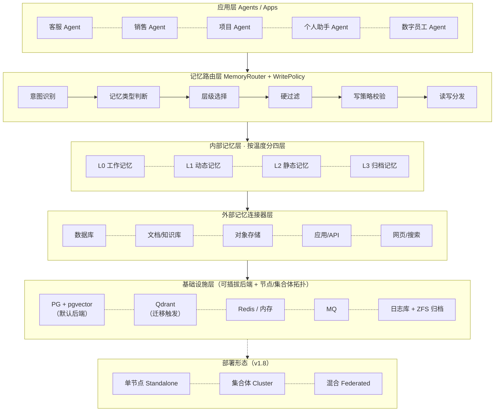
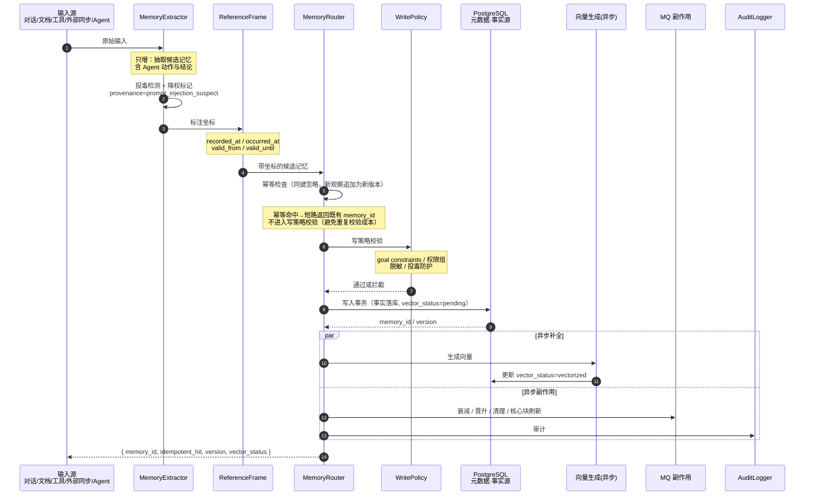

# LIMS v2.4 光明记忆系统架构设计文档

**项目名称：** Light Intelligent Memory System（LIMS / lightmem，光明记忆系统，简称"光明记忆"）
**版本：** v2.4
**文档类型：** 架构设计文档

> v1.5 在 v1.4（只增+读时融合、双时态、pgvector 单库）基础上，闭合架构评审遗留项（多信号检索、反馈/遗忘契约、核心记忆块、Agent 主动记忆、权限三元组、记忆投毒防护、评测分桶、架构收敛），并完成统一 Schema 的语义一致性收敛（见 §4.7 Q1–Q6）；v1.7 追加 Q7 完成字段/流程层面的收口（见 §4.7）。不改变 v1.4 已确立的三大决策方向。
>
> **v1.6（本轮打磨）** 在 v1.5 基础上：① 将总体架构（§2.1）与写入/读取链路（§4.5/§4.6）改为 Mermaid 图示，闭合架构评审 §3.11「文档表达」遗留项；② §6 新增「实现语言承载建议」（§6.1），与《实现语言选型说明》v1.3 对齐四可部署单元；③ 全文一致性校订：修正无效交叉引用（3.16→3.15）、统一示例字段命名标注，并补充 `provenance`/`source_evidence`/遗忘观测契约术语。**不改变既有架构结论。**
>
> **v1.7（细化收口）** 在 v1.6 基础上按「必须改 / 建议补 / 可打磨」三级细化：① 字段统一（内容字段归一 `fact`、`shared_with_tenants[]` 入统一 Schema、`permission_level` 定位明确、生效区间统一 date-only）；② 流程修正（写入 API `POST`、幂等检查与意图识别前移）；③ 语义边界明确（半衰期作用域、`occurred_at` 阈值、L3 检索契约、参考系业务键、权限校验优先级、P95 统计口径）；④ 选型勘误（全文检索明确需 BM25）；⑤ 新增 P2.5 评测集阶段；⑥ 术语表与版本历史同步，§4.7 新增 Q7 收口记录。**不改变既有架构结论。**
>
> **v1.8（三大部署与平台承载）** 在 v1.7 基础上新增三项能力：① **多数据库挂接**——§5.4 存储后端可插拔清单（PG+pgvector 默认、Qdrant 迁移触发、TiDB/CRDB、SQLite 兜底等）；② **单节点 / 集合体部署形态**——§5.5 节点角色（Coordinator/Worker/Archive/Gateway）、节点间协议、跨节点 pre-filter 与 revocation 广播，新增 §2.5 纲领；③ **FreeBSD + ZFS 实现优化**——§5.6 ZFS dataset 布局、PG on ZFS 调优（`recordsize=8k`、`compression=lz4`、`sync=always`）、快照/`zfs send` 容灾、FreeBSD 最小安装集；§6 技术选型表补齐 FreeBSD 包名（`postgresqlXX-pgvector`、`databases/qdrant`、`redisXX`、`minio`）；路线图新增 P8 集合体与多后端阶段。**不改变既有架构结论。**
>
> **v1.9（安全组件与平台加固）** 在 v1.8 基础上：① 最小安装集版本统一为 `postgresql18-server` / `postgresql18-pgvector`；② 新增 **§5.7 安全组件与 FreeBSD 加固**——按"进程隔离（jail+vnet）/ 细粒度权限（Capsicum）/ 强制访问控制（MAC）/ 文件 ACL / 磁盘加密（ZFS encryption）/ 密钥管理 / 网络（pf+IPsec）/ TLS / 漏洞审计（pkg audit）/ 系统审计（accton）"十类安全组件映射 §7 业务安全需求，并给出实现清单与加固检查清单；③ 明确"应用层→OS 层→存储层"三层纵深与 `permission_level`↔MAC 映射；④ 精化 ZFS 加密密钥语义（`zfs change-key` 仅重包裹包裹密钥，**不更换 DEK**）。**不改变既有架构结论。**
>
> **v2.0（可缩放模式与配套交付物）** 在 v1.9 基础上：① 新增 **§2.6 可缩放模式**——类比 Pyramid 式多规模，定义 Solo（个人）/ Family（家庭）/ SMB（中小型企业）/ Enterprise（企业集合体）四档 profile，核心模块与统一 Schema 不变，只切换装配档位（存储后端 / 缓存队列 / 安全强度 / 拓扑），并给出渐进升级路径与规模判定问题；② 将 §5.7 安全加固清单抽为独立交付物 `checklists/freebsd-security-checklist.md`（命令级可执行、含验证与回滚）；③ 将 §5.6 + §5.7 合并为可执行手册 `manuals/p1-freebsd-zfs-setup.md`（含 jail 划分、ZFS dataset、pf 规则、端到端验证）；④ 文档内交叉引用上述两份配套文件与 §2.6。**不改变既有架构结论。**
>
> **v2.1（应用包生态与差异化定位）** 在 v2.0 基础上新增三项：① **§6.2 应用包生态（LIMS App Package）**——按 NAS 系统（Synology 套件中心 / TrueNAS Apps）的做法引入包机制：manifest 自描述、包生命周期治理、来源信任分级、类型分层（service/connector/skill/policy/pack/scheduler），内核（§3–§4）保持冻结、能力以包生长；② **包必备清单两批**（首批含 gitea、git-connector、registry、backup、search、llm-gateway、mesh-sync、webui），第二批按触发条件启用且默认关闭；③ **AI 协同与差异化定位**——包成为**被记忆的一等实体**（装包/配包/用包/沉淀包经验四环节），并确立六条特色（主特色：低 token 长期运行 = 数据面架构 + 控制面光明语言双重压缩；由此使 AI 协同在经济上可持续），新增 M1–M10 评测口径（含独有的"控制面 token 占比"M2）。配套交付物：`docs/光明记忆应用包生态与差异化定位_v1.0.md`。**不改变既有架构结论。**
>
> **v2.2（profile 配置落地）** 在 v2.1 基础上：将 §2.6 的四档装配档位从"示例 YAML"落地为 **`lightmem/profiles/` 目录**——`lims-solo.profile.yaml` / `lims-family.profile.yaml` / `lims-smb.profile.yaml` / `lims-enterprise.profile.yaml`（每份含存储、缓存、队列、网络、安全、功能、扩容七段完整配置，字段名与 §2.6 一致），并配 `README.md` 说明选择/启用/升档方法；文档内交叉引用该目录。**不改变既有架构结论。**
>
> **v2.3（评审勘误与口径统一）** 在 v2.2 基础上仅做文档勘误，不改变架构结论：① 修正 §4.1 记忆对象样例——主键真源字段应为 `fact`，`content` 仅作 L2 兼容别名（此前样例误写为 `content`）；② 统一检索延迟口径——§9 明确 P95 目标针对**内核记忆检索链路**，§4.6 外部连接器（如 Git）同步的 300ms 为**单次外部调用软超时/背压触发线**，二者非同一指标；③ 修复 §6.1 悬空引用（移除对不存在的"实现语言选型说明"文档的指向）；④ 版本历史按时间序整理，并补齐本版本条目。**不改变既有架构结论。**
>
> **v2.4（吸收《千脑智能》优秀基因，R13）** 在 v2.3 基础上**只增不改**，落地《千脑智能》（Thousand Brains Project，MIT 许可）精读给出的三条高价值改造建议：① 新增 **§3.2.1 记忆位移边**——把参考系从"扁平坐标"升级为"带位移边的记忆图"（节点=记忆、边=displacement），四类关系 `causal/temporal/task-flow/entity-alias`，仅 L2 长期记忆建边，边只用于软排序与多跳召回、不跨越 §3.2 硬过滤边界，跳数上限 N=2 并按 `0.5^hop` 衰减；写入三元组幂等、淘汰软删可审计（`kernel/displacement_edge.go` / `kernel/multihop_monty.go`）。② 新增 **§3.2.2 跨 Agent 参考系对齐**——跨 Agent 融合前强制实体消解，未对齐只并列展示、禁止融合与互相覆盖（`kernel/entity_align.go`，默认路径不调用）。③ 新增 **§3.4.1 只加不减与相对容差**——明确各信号只贡献正向名次分、缺失与超容差记 0 不扣分，`20%` 显式定义为相对容差 `tolerance`（默认 0.2），保留 lightmem 独有的绝对下限 `top1 ≥ 0.6`（`kernel/rank_fusion_monty.go`，默认融合路径与 `FusionMode=rrf` 不变）。三条建议均以**新增模式/新增函数**落地，默认 Rank 融合路径、既有 Schema 语义与对外格式不变；北极星 M1=1.0000（holdout_v2 800 条，vector 口径）逐位复现。**不改变既有架构结论。**

> **v2.4.1（R14 收口：漂移衰减 / L0→L1 落库 / 位移边持久化 + 统一门禁，只增不改）** 在 v2.4 基础上继续**只增不改**，把《千脑智能》精读（`lightmem/monty.md`）里剩余三条建议中价值最高、风险最低的三条落地为可评测代码，并首次引入一条统一门禁。主标题版本号仍为 **v2.4**，本条目为修订号。① 新增 **§5.3.1 参考系漂移衰减**——排序期对 `reference_frame` 与查询在 entity / scene / task 三轴上漂移的记忆做**乘性衰减**（保守缺省 `Floor=0.15`、`Partial=0.60`、`Neutral=1.00`），**只衰减不加分**、**缺失即中性**、单轴漂移即下沉、永不低于地板绝不归零，作为**旁路算子**由调用方显式调用，不进默认 RRF / 投票路径，结果不落库（`kernel/forgetting_drift.go`）。② 新增 **§3.5.1 L0→L1 落库边界**——把 Monty 的 STM/LTM 双缓冲收敛为 lightmem 的显式 flush 边界，四类触发（会话结束 / 话题切换 / 任务完成 / L0 容量），**纯决策不写入**：只产出 `FlushPlan`，不碰 `StorageBackend`、无 I/O、无随机、观测时刻由调用方注入（`kernel/flush.go`）。③ 新增 **§5.4.1 位移边持久化**——补齐 R13 遗留的"`EdgeStore` 仅进程内、重启即丢"，JSON 落盘 + 同目录临时文件 + `os.Rename` 原子替换（标准库无 `os.Replace`）、三元组字典序输出保证**重复 Save 逐字节一致**、`created_at`/`invalidated_at` 两端规整 UTC 后按 unix ns 逐位保真、DDL 只含 `CREATE` 绝不含 `ALTER`（`kernel/edge_persist.go`）。④ 新增统一门禁 `scripts/gate.sh`（8 项：版本 / gofmt 增量 / gofmt 全仓 / vet / build / test -count=1 / -race / 覆盖阈值，外加"只增不改白名单"逐文件 diff），并新增**附录 D** 记录门禁矩阵与北极星复现。三项实现全部以**新增文件**落地，默认检索 / 融合 / 写入路径与既有 Schema 语义不变；"只增不改白名单"7 文件与 R13 基线**逐文件 diff 一致**，北极星 M1=1.0000（800/800，hit@1=1.0000，四桶全 1.0）与 R13 基线在**同一环境、同一命令**下 M1 与 M2 逐位一致。**不改变既有架构结论。**

---

## 1. 项目概述

### 1.1 项目定位

光明记忆（LIMS）是一个面向多租户、多用户、多 Agent 的智能记忆管理平台。它让 AI Agent 像人一样拥有长期记忆、短期记忆和程序性记忆，并在不同场景下自动选择最合适的记忆层级进行存取。与"单 Agent 自带的上下文"不同，光明记忆是一个**可被多个 Agent 共享调用的独立记忆服务**：一个 Agent 沉淀下来的经验，可以被同一个用户名下的其他 Agent 直接复用。

### 1.2 核心价值

- **对 AI Agent：** 拥有"记住"的能力，不再每次对话都从零开始；新任务开始时能自动召回相关的历史目标、偏好和经验。
- **对企业：** 沉淀客户、项目、流程等知识资产，形成可复用的组织记忆，且在租户间隔离可控。
- **对用户：** 获得个性化、连续的服务体验；用户对自己的记忆资产有完整的查看、导出、删除入口（数据主权）。

### 1.3 设计哲学

光明记忆融合《千脑智能》的参考系思想、人脑记忆分层模型，以及 Sparse Agent 等长期数字员工实践：

- **参考系组织：** 每条记忆都有坐标（租户、用户、Agent、项目、实体、场景、任务、时间），像大脑用空间坐标组织知识。
- **记忆内容分类：** 不只存"事实"，还区分事件、偏好、程序性经验、长期目标——不同内容的生命周期和召回方式不同。
- **多记忆加权融合：** 冲突记忆不直接覆盖，而是通过固有价值、时效、来源、反馈等多维加权，而非"多个大模型互相投票"。
- **多信号检索（v1.5）：** 语义、关键词（BM25）、实体三路信号独立打分后按名次（rank）融合，降低对权重先验的依赖，改善多跳与时序类查询。
- **持续学习闭环：** 记忆随交互反馈不断修正；用户纠正后，下一轮工作立即生效。
- **分布式容错：** 同一事实多版本保存，单点损坏不影响整体。
- **渐进式记忆：** 记忆从会话事件流中持续捕获、压缩、召回，并按后台整合提炼为可复用的程序性经验，按固有价值逐步升级。
- **记忆预算驱动：** 不无限膨胀，有容量上限，低价值记忆自动淡化、压缩、归档。
- **线索优先：** LIMS 内部只存线索和摘要，详细内容交由外部系统（数据库、文档系统、档案系统）保管。
- **稀疏触发 + 常驻核心：** 记忆检索和晋升按需、稀疏触发；但每个 Agent 有容量受限的"核心记忆块"（目标 + 高频偏好）常驻上下文（v1.5）。
- **安全可信（v1.5）：** 记忆层被视为高危攻击面，写入路径内置投毒防护与来源溯源，共享传播前二次校验。

---

## 2. 系统架构

### 2.1 总体架构



### 2.2 四层记忆模型（按温度/时间分）

| 层级 | 名称 | 类比 | 存储内容 | 生命周期 | 典型场景 |
|---|---|---|---|---|---|
| L0 | 工作记忆 | 人类短期工作记忆 | 当前对话上下文、核心记忆块（见 §3.7）、临时变量、工具调用中间结果、外部系统查询线索 | 分钟~小时 | 多轮对话、任务执行链 |
| L1 | 动态记忆 | 人类情景记忆 | 用户偏好、近期事件、临时事实、会话摘要、外部系统结论、跨 Agent 共享经验 | 天~月 | 记住用户上次说过的需求 |
| L2 | 静态记忆 | 人类语义记忆 | 企业知识、产品文档、标准流程、客户档案、长期目标/KPI/约束、外部系统元数据索引 | 长期版本化，数年~数十年 | 企业知识问答、标准流程、数字员工长期目标 |
| L3 | 归档记忆 | 深层档案 | 历史会话原文、过期记忆、审计数据、合规保留数据 | 合规保留，可按需恢复 | 历史回溯、审计 |

### 2.3 记忆内容分类（按内容类型分，横切四层）

温度分层回答"记多久、放多快"，内容分类回答"记的是什么、怎么用"。每条记忆必须有一个 `memory_kind`：

| memory_kind | 含义 | 示例 | 默认落层 |
|---|---|---|---|
| `event` | 发生过的事件 | "2026-10-08 客户A投诉物流延迟" | L1，过期降 L3 |
| `fact` | 客观事实 | "产品X标准报价每件100元" | L2（稳定）或 L1（临时） |
| `preference` | 用户/客户偏好 | "客户A偏好周二下午开会" | L1，长期偏好晋升 L2 |
| `procedure` | 程序性经验/方法 | "写产品介绍先讲用途，再列功能" | L1/L2，跨 Agent 共享 |
| `goal` | 长期目标 / KPI / 工作约束 | "未来一年把账号周触达做到 10 万，未经确认的内容先发我审阅" | L2，长期保留 |

> `goal` 类记忆吸收自 Sparse Agent：数字员工要持续负责一件事，就必须长期记住目标、衡量指标和行为边界。新任务开始时优先召回相关 `goal`。
> **统一 Schema 约束（v1.5）：** 五类 `memory_kind` 共用 §4.1 统一 Schema 基础字段；`goal` 特有语义（目标描述、KPI、约束、状态）以扩展字段 `goal_detail` 承载，禁止另起一套与统一字段冲突的结构（见 §3.8）。

### 2.4 存储分层与容量原则

| 原则 | 含义 |
|---|---|
| 热容量固定 | L0/L1 的活跃记忆有明确上限，保证检索速度和成本可控 |
| 冷数据可长期保留 | L2 和归档层通过对象存储、压缩、分层存储支撑数十年 |
| 遗忘优先于扩容 | 先压缩、合并、降级、归档，而不是一味加硬盘 |
| 逻辑删除，物理归档 | 企业记忆很多需要审计；但用户行使删除权时见 §7.3 级联删除 |
| 预算驱动 | 每个租户/用户/Agent/项目都有记忆预算，超出后触发压缩和淘汰 |
| 线索优先 | LIMS 内部只存线索和摘要，详细内容交由外部系统保管 |

### 2.5 部署形态与 FreeBSD/ZFS 承载（v1.8）

**三个核心需求（v1.8 明确）：**

1. **挂接当今主流数据库系统** —— 存储后端可插拔，不锁定单一引擎（详见 §5.4）。
2. **单节点 / 集合体（多节点互联互通）两种部署形态** —— 既可独立运行（Standalone），也可组成"光明记忆集合体"（Cluster，详见 §5.5）。
3. **FreeBSD + ZFS 优先实现** —— 面向 ZFS 特性做存储优化（详见 §5.6），并叠加 FreeBSD 安全组件加固（详见 §5.7）。

**总体架构对应关系：** §2.1 的「INFRA 基础设施层」（PG+pgvector、Redis、MQ、日志库）与「CONN 外部连接器层」在本节被进一步抽象为**可插拔存储后端 + 节点/集合体拓扑**，业务层（§3–§4）不受影响。

| 需求 | 落点 | 是否改变既有架构结论 |
|---|---|---|
| 多数据库挂接 | §5.4 存储后端可插拔清单 | 不改变，扩展 §4.2/§6 的后端抽象 |
| 单节点 / 集合体 | §5.5 节点角色与互联协议 | 不改变，新增节点角色定义 |
| FreeBSD + ZFS | §5.6 ZFS 优化与 FreeBSD 安装 | 不改变，新增平台优化项 |
| 安全组件加固 | §5.7 安全组件与 FreeBSD 加固 | 不改变，新增 OS 层安全组件（与 §7 业务层安全互补） |

> **实现语言承载影响（v1.8）：** §6.1 语言分工结论不变。FreeBSD + ZFS 优先落地时，API 网关与 Router+Store 的 **Go** 单元天然匹配 FreeBSD（单二进制、原生 ABI、静态链接便于 jail 隔离）；`pgvector` 经官方 pkg `postgresqlXX-pgvector` 安装；`Qdrant` 经 `databases/qdrant` port 安装。Python 单元（Extractor）与 TypeScript 单元（前端）在 FreeBSD 上均可运行，仅需注意 `pkg`/`pip`/`npm` 的 FreeBSD 变体。**§5.7 安全组件不改变语言分工**——jail、Capsicum、MAC、ZFS 加密均为 OS 层能力，与实现语言无关。

### 2.6 可缩放模式（Scalability Modes，v2.0）

**类比：** 光明记忆像 Pyramid Web 框架一样**满足多种规模需求**——同一套代码、同一套 Schema、同一套 API，通过**装配档位（profile）**在不同规模下切换可选组件，而不是为每种规模写一套系统。从"个人 / 家庭记忆系统"到"中小型企业记忆系统"再到"企业级集合体"，**核心模块（§3–§4）与统一 Schema（§4.1）完全不变**，只换"底座"。

**1) 规模档位定义（v2.0）：**

| 档位 | 目标用户 | 用户量级 | 记忆量级 | 部署形态 | 存储后端 | 缓存/队列 | 安全组件 |
|---|---|---|---|---|---|---|---|
| **Solo（个人）** | 单个开发者/爱好者 | 1 人 | 万级 | 单机自包含（§5.5 Standalone） | SQLite + sqlite-vec（§5.4 兜底） | 内存内（无 Redis/MQ） | 极简：本机加密 + 备份 |
| **Family（家庭）** | 家庭实验室（1–5 人） | ≤10 人 | 十万级 | 单机 FreeBSD + jail（§5.6） | PG + pgvector（单库） | Redis（可选） | jail + ZFS 加密 + pf（§5.7） |
| **SMB（中小型企业）** | 中小团队/业务（10–500 人） | ≤500 人 | 百万级 | 单节点或双节点主备（§5.5） | PG + pgvector + Qdrant（可选） | Redis + RabbitMQ | jail + MAC + IPsec + pkg audit（§5.7 全套） |
| **Enterprise（企业集合体）** | 多租户/多团队（>500 人） | >500 人 | 千万级 | 集合体 Cluster / Federated（§5.5） | PG 分片 + Qdrant + TiDB/CRDB | Redis 集群 + Kafka | §5.7 全套 + 外部 KMS + 灾备节点 |

**2) 装配档位（profile）机制（v2.0）：**

- 光明记忆通过一份 **`lims.profile.yaml`** 声明档位，核心代码读配置装配组件，**不因规模变更重写代码**。
- **配套可执行配置（v2.2）：** 四档完整 YAML 已提供于 `lightmem/profiles/` 目录——`lims-solo.profile.yaml` / `lims-family.profile.yaml` / `lims-smb.profile.yaml` / `lims-enterprise.profile.yaml`（另有 `README.md` 说明使用方法），每份含存储、缓存、队列、网络、安全、功能、扩容七段完整配置，部署时直接复制对应档位为 `lims.profile.yaml` 即可。
- 核心不变项：§4.1 统一 Schema、§3.1–§3.15 核心模块、§4.4 API 骨架、§4.2 一致性骨架、§6.1 语言分工。
- 可变项：存储后端（§5.4）、缓存/队列、安全组件强度（§5.7）、部署拓扑（§5.5）。

```yaml
# lims.profile.yaml（示例）
profile: family          # solo | family | smb | enterprise
storage_backend: pgvector # sqlite | pgvector | qdrant | pgvector+shard
cache: redis             # none | redis | redis-cluster
mq: redis                # none | rabbitmq | kafka
security:
  jail: true
  zfs_encryption: true   # solo 可 false
  mac: false             # smb+ 才 true
  ipsec: false
  pkg_audit: true
features:
  consolidation: true    # 后台整合（§3.13）
  core_memory: true      # 核心记忆块（§3.7）
  poison_guard: true     # 投毒防护（§7.5）
  audit: true
```

**3) 渐进式升级路径（v2.0，核心价值）：**

光明记忆不要求一开始就按最大规模设计，而是**按需渐进升级**，且升级是**配置切换 + 数据迁移**，不是系统重写：

```text
Solo（SQLite 单文件）
  │  数据导入导出（§7.4 兼容 JSON/CSV）
  ▼
Family（PG + pgvector 单库，FreeBSD + jail）
  │  数据 pg_dump / COPY 迁移；向量需重算（vector_status 语义保证）
  ▼
SMB（单节点 + Redis + RabbitMQ + 安全组件）
  │  Qdrant 按迁移阈值触发（§6 契约）；加 MAC + IPsec
  ▼
Enterprise（集合体 Coordinator/Worker/Archive/Gateway）
  │  PG 分片 + Qdrant；跨节点 pre-filter（§5.5）
```

**升级兼容性保证（v2.0）：**

- **Schema 不变：** 升级只迁移数据、不改字段（§4.1 单真源保证）。
- **向量可重算：** `vector_status`（§4.2）保证从 SQLite 迁到 PG 时，元数据先落库、向量后补全，期间可被全文/元数据检索，不阻塞。
- **API 兼容：** §4.4 API 骨架在所有档位一致，Agent 侧无需感知后端切换。
- **trace 兼容：** `retrieval_trace`（§4.3）跨档位统一格式，便于从 Solo 一路追踪到 Enterprise。
- **安全渐进：** Solo 可暂不启用 MAC/IPsec；升到 SMB 时按 §5.7 checklist 补齐，**不需重装系统**。

**4) 与既有章节的联动（v2.0）：**

| 本节能力 | 依赖章节 |
|---|---|
| 存储后端可切换 | §5.4 存储后端抽象（SQLite/PG/Qdrant/TiDB） |
| 单节点/集合体 | §5.5 节点角色与互联协议 |
| 安全组件强度分级 | §5.7 安全组件清单（Solo 简化、SMB/Enterprise 全套） |
| FreeBSD + ZFS 优先 | §5.6 ZFS 优化（Family 起适用；Solo 可纯文件） |
| 数据可迁移 | §4.2 一致性骨架（vector_status）+ §7.4 数据导出 |
| 升级不重写 | §4.1 统一 Schema 单真源 + §6.1 语言分工 |

**5) 设计原则（v2.0）：**

- **默认本地可运行：** 任何档位的"首日体验"都不应要求先搭集群；Solo 用 SQLite 即可起。
- **不背整套复杂度：** Solo/Family 不引入 MQ、Kafka、分片、IPsec——只有真正需要时启用。
- **同一套心智模型：** 无论规模，路由、融合、生命周期、投毒防护的**概念和 API 一致**，只改 profile 配置。
- **升级可逆：** 每档之间支持数据导出/导入（§7.4），允许回退到更小档位（代价是向量重算）。
- **安全按档渐进：** 越大的规模安全组件越重，但**核心安全语义（§7）**在所有档位一致（权限三元组、投毒防护、删除权不能因规模小就省）。

**6) 边界与权衡（v2.0）：**

- Solo 用 SQLite 时，多用户并发、多租户硬过滤、`pre-filter` 语义需**降级**（单机单用户无跨租户问题，但 `visibility`/`shared_with_tenants` 字段仍保留，便于升级）。
- Family 用 PG 单库时，**多租户隔离仍靠 §3.2 硬过滤清单**，不能因为"家庭场景"就跳过 `tenant_id`/`visibility`。
- SMB 引入 Qdrant 时，**不改变 §4.2 写入一致性**（元数据为事实源、向量异步补全），Qdrant 只是"向量落点"变了。
- Enterprise 用分片 + 集合体时，**不改变 §3–§4 业务逻辑**，只改 §5.5 的节点角色与 §5.4 的后端实例。
- 本节描述**规模可缩放**，不是**功能可裁剪**——§7 安全核心语义与 §3.15 写策略插件、§7.5 投毒防护**在所有档位都必须保留**（Solo 可简化 OS 层加固，但不可省应用层安全）。

**7) 规模选择的判定问题（v2.0，供部署决策）：**

| 问题 | 若为"是"则升一档 |
|---|---|
| 当前档位是否已触达记忆预算上限（§5.2）？ | 是 → 升档 |
| 是否需要 >1 台机器提供可用性？ | 是 → Family → SMB（主备） |
| 是否需要跨机器/跨团队共享记忆（§7.1 visibility）？ | 是 → SMB → Enterprise（Federated） |
| 检索 P95 是否超红线（§9 <200ms）？ | 是 → 按 §6 迁移阈值引 Qdrant |
| 是否需要 IPsec / 外部 KMS / MAC？ | 是 → SMB 起步（§5.7） |
| 是否只是个人使用、无需多租户？ | 否 → 保持 Solo/Family |

---

## 3. 核心功能模块

### 3.1 记忆路由模块（MemoryRouter）

**职责：** 决定一条记忆该去哪一层、该带什么坐标、以及查询时该从哪一层取；并作为写策略校验的统一入口。

**功能：**

- **意图识别：** 判断输入是查询知识、记录事实、确认偏好，还是仅在当前对话使用。
- **层级选择：** 临时上下文 → L0；偏好/近期事件 → L1；企业知识/长期目标 → L2；合规保留/历史回溯 → L3。
- **跨层查询：** 多层并行检索，按 §3.4 融合结果。
- **记忆晋升/降级：** 依据 §5.3 的固有价值分数自动流转，不按固定时间硬晋升。
- **外部记忆路由：** 内部记忆不足以回答时，路由到外部连接器取补充信息。
- **跨会话召回：** 新任务开启时，自动召回相关 `goal`、`procedure`、`preference`。
- **预算协同：** 与 MemoryBudgetManager 协同，超预算触发压缩淘汰。
- **写策略入口（v1.5）：** 所有写入在落层前/后经过 WritePolicy 注册表校验，goal constraints、权限组、脱敏规则、投毒防护统一以 policy 实现（见 §3.15）。新增一条写校验规则无需改动核心模块。

### 3.2 参考系坐标模块（ReferenceFrame）

**职责：** 为每条记忆绑定多维坐标，实现精准定位与隔离。

| 维度 | 说明 | 过滤类型 |
|---|---|---|
| 租户 tenant | 企业/组织隔离 | 硬过滤（安全边界） |
| 用户 user | 个人偏好隔离 | 硬过滤 |
| 项目 project | 项目维度隔离 | 硬过滤 |
| 可见范围 visibility | private / shared_user / tenant / cross_tenant | 硬过滤（安全边界） |
| Agent agent | 哪一个/哪类 Agent 创建或使用 | 软排序 |
| 实体 entity | 关联的客户、产品等 | 软排序（实体命中优先级高于一般软排序） |
| 场景 scene | 会议、工单、聊天、邮件等 | 软排序 |
| 任务 task | 报价、审批、咨询等 | 软排序 |
| 事件发生时间 occurred_at | 事实所描述事件在现实世界发生的时间（v1.5 新增） | 软排序 |
| 记录时间 recorded_at | 系统首次记录该观察的时间（只增，写入后不改） | 软排序 |
| 生效区间 valid_from/valid_until | 事实声明为真的时间窗口（双时态，旧版本保留） | 软排序 |
| 分类 category | 业务分类 | 软排序 |

> **安全硬过滤清单（统一，v1.5）：** `tenant`、`user`、`project`、`visibility` 四类维度为**硬过滤（安全边界）**，参考系定义与检索约束（§4.3）必须共用同一份清单。禁止将 `visibility` 列为软排序维度或降级为后置过滤。

**可见范围（visibility）规则（吸收 Sparse Agent 共享记忆思路）：**

- `private`：仅创建者本人或指定 Agent 可见，默认值。
- `shared_user`：同一用户名下所有 Agent 可见——运营 Agent 确认的"先讲用途再讲功能"，写作 Agent 可直接复用。
- `tenant`：同租户内全员/指定角色可见。
- `cross_tenant`：跨租户共享，必须显式授权；实现方式是在记忆上挂 `shared_with_tenants: []`，查询过滤条件为 `tenant_id = current OR tenant_id IN shared_with_tenants`，而不是绕过硬过滤。

**可见范围与权限正交（v1.5）：** `visibility` 只管"传播范围"，`permission`（owner/writers/readers）管"操作边界"，二者分别存储与校验（见 §3.15 与 §4.1）。

**坐标匹配：** 硬过滤维度不匹配直接排除；软排序维度输出 `[0,1]` 匹配度加权。

**参考系业务键（reference_frame_business_key，v1.6 定义）：** 用于幂等键（§4.3）的参考系归一化串，定义为规范化拼接 `entity + scene + task + category`（实体/场景/任务/分类，空值以固定占位符 `nil` 填充），供同一业务事实在不同参考系片段下仍能被去重。

### 3.2.1 记忆位移边（Memory Displacement Edges，v2.4）

**职责：** 在扁平参考系坐标之外，为记忆之间建立**带类型、带权重的位移边**，让记忆可沿关系"跳转"，支撑多跳召回与关系推理（此前多跳只能靠向量相似度近似）。

**依据：** 吸收《千脑智能》（Thousand Brains Project，MIT 许可）参考系思想——Monty 物体图中节点是"特征@姿态"，**边是 displacement**（从 A 到 B 需要的关系/动作）。落地实现：`kernel/displacement_edge.go`（存储与建边）、`kernel/multihop_monty.go`（位移式召回）。

**边字段（单一真源，新增扩展表，不改既有 Schema）：**

| 字段 | 说明 |
|---|---|
| `from_memory_id` / `to_memory_id` | 边的两端（ULID），方向 from → to |
| `relation` | `causal` / `temporal` / `task-flow` / `entity-alias` |
| `weight` | `[0,1]`，进入软排序（不回灌主融合分） |
| `created_at` | 边建立时间（只增） |
| `invalidated_at` | 软删除时间戳，默认 NULL；淘汰不物理删除，保留可审计 |

**关系类型与初始权重（纯启发式建边，不调 LLM）：**

| relation | 触发规则（仅 L2 长期记忆建边） | 初始 weight |
|---|---|---|
| `entity-alias` | 两条记忆 `entity` 归一化（小写去标点）后相同且非空 | 0.8 |
| `task-flow` | 两条记忆挂同一非空 `task`，按 `recorded_at` 先后 | 0.4 |
| `causal` | 同 user 下，前条 `entity` 非空，后条 `fact` 出现指代词（它/该/这个/it…） | 0.5 |
| `temporal` | 两条 `recorded_at` 均非零、间隔 ≤ 7 天，且同 `task` 或同 `scene` | 0.3 |

**写入与容量治理：**
- **幂等**：`(from_memory_id, to_memory_id, relation)` 三元组唯一，重复写入不新增行、不更新权重；
- **软删除**：淘汰边置 `invalidated_at`，行保留在表中可审计，不物理删除；
- **出边上**：单条记忆有效出边默认上限 16；超限软删 `weight` 最低、权重相同则 `created_at` 最旧的边。

**安全边界（硬性）：**
- 位移边**只用于软排序与多跳召回，不跨越 §3.2 硬过滤边界**——`tenant/user/project/visibility` 不匹配的候选一律剪枝，边不提供绕过硬过滤的通道；
- 位移式召回采用 **DisplacementLM 纪律**：硬条件不一致即剪枝，不累积置信度、不修改原信号分；保留候选仅按 `weight × 0.5^hop` 做软排序，**跳数上限 N=2**；
- **L1 默认不建边，仅 L2 长期记忆建边**；默认检索路径不启用，由调用方显式开启，既有 Rank 融合逐位不变。

**合并度监控：** 见 `eval/polaris/polaris_mergence.go`，基线指标 `mean_edges_per_memory`（边数/L2 记忆数）与 `mean_memories_per_entity`（归一化实体分组均值），作为后续建边质量对照。

### 3.2.2 跨 Agent 参考系对齐（强制前置，v2.4）

**职责：** 跨 Agent 共享的记忆在**融合之前**，强制先做"参考系对齐"（实体消解），防止同一实体在不同 Agent 的语境下被误合并、误覆盖。

**依据：** 吸收《千脑智能》投票机制——Monty 中 vote 是"相对发送者身体"的，接收方必须把票变换到**自己**的参考系；且投票依赖特征在世界的相对排布，**不是 bag-of-features**。落地实现：`kernel/entity_align.go` 的 `AlignCrossAgentFusion`。

**规则：**

- 凡 `visibility ∈ {shared_user, tenant, cross_tenant}` 的**跨 Agent 融合**，必须先经本节对齐；`private`（单 Agent 自有记忆）不涉及跨源指代，无需强制。
- 对齐判定按 §3.2 的软排序坐标 `entity / scene / task`（默认要求三者一致；`category` 粒度较粗，默认不参与）。判定用**归一化比对**（小写、去标点与空白），`"客户A"` 与 `" 客户a "` 视为同一实体。
- **未对齐的记忆只并列展示，禁止融合、禁止互相覆盖**；对齐失败（关键坐标缺失，如 `entity` 为空）一律降级为"待人工确认"，**不静默放行**。
- 对齐结论是**计算期结构，不落库**：不新增、不改动 §4.1 统一 Schema 字段。

**两种模式：**

| 模式 | 触发 | 语义 |
|---|---|---|
| 参考系模式（推荐） | 传入接收方自己的 `ReferenceFrame` | 逐维与接收方参考系比对；不一致者进"未对齐"清单，附差异维度说明 |
| 自分组模式 | 参考系传 `nil` | 按各记忆自身坐标分组，同键同组；不同实体/场景天然隔离，但只能识别"坐标缺失"型未对齐 |

**边界（与 §3.2 硬过滤的关系）：** 本节只解决"都已可见之后，**能不能融合**"这一步；`tenant/user/project/visibility` 的硬过滤仍由既有查询层与 `canView` 负责，**本节不参与、不放松任何权限判定**。

**开关与默认：** 本前置**默认路径不调用**——既有 `Rank` / `Fuse` / `VoteFusion` 行为逐位不变；仅在跨 Agent 融合场景由调用方显式调用（`kernel/entity_align.go`），保证北极星 M1 不受影响。

### 3.2.3 合并度指标与语料要求（v2.4.2）

**两个指标的分母定义（只增口径，不改既有字段）：**

| 指标 | 分子 | 分母 | 分母为 0 时 |
|---|---|---|---|
| `mean_edges_per_memory` | 有效位移边数（`edges_alive`） | L2 记忆数（`l2_memories`） | 指标恒为 0，**无意义**——此时 L1 不建边、边表为空，0 不代表"建边质量差"，只代表"语料里没有可建边的 L2 节点" |
| `mean_memories_per_entity` | 有非空 `entity` 的记忆总数 | 归一化（小写去标点）后的实体分组数 | 同上，分母 0 时恒为 0 |

**R15-C 的问题与处置：** R13-B 首次基线在 `holdout_v2.jsonl` 上实测 `l2_memories=0`、`entity_groups=0`（全 L1、`reference_frame` 无 entity/task、`recorded_at` 全零值）——两个指标是"死指标"，只能证明"没坏"，证明不了"边建得好不好"。本轮**不改 v2**（它仍是北极星 M1/M2 的官方评测集，只增不改红线），而是**新增独立语料 `eval/holdout/holdout_v3.jsonl`** 专门激活合并度：

- `layer` 混合：≥120 条 L2（本轮 144 条，其余 696 条 L1）；
- `reference_frame` 三轴齐全：`entity` / `scene` / `task` 非空率 ≥90%（本轮 100%），`recorded_at` 非零时间戳率 100%；
- ≥20 个实体分组、每组 ≥10 条（本轮 24 组 × 35 条），使 `mean_memories_per_entity` 有稳定均值；
- 多跳可建边：四类关系（`entity-alias` / `task-flow` / `causal` / `temporal`）均有存活边（本轮实测 360 / 360 / 312 / 426）；
- 四桶比例与 v2 对齐（156/275/173/236），保持与北极星口径可对照；**v3 不进北极星链路**，仅供 `polaris_mergence` 单跑。

**语料自检：** `eval/polaris/check_holdout_v3.go`（`//go:build ignore`、仅标准库）把上述阈值写死为常量，不达标即非零退出并打印实际值。**反向断言：v2 上两个指标仍须为 0**——若 v2 输出非 0，说明 runner 口径被改坏，而非语料变好。

**R15-C 实测（-now-fixed 2026-10-15）：** v3 上 `l2_memories=144`、`edges_alive=1458`、`mean_edges_per_memory=10.125`、`entity_groups=24`、`mean_memories_per_entity=35.0`、`entity_coverage=1.0`；v2 上全部仍为 0。runner 只增 `edges_per_relation`（四类关系存活边数）与 `entity_coverage` 两个输出字段，既有字段名与计算口径逐位不变。

### 3.3 记忆提取器（MemoryExtractor）

**职责：** 从对话、文档、工具结果、外部系统同步数据中，自动抽取结构化记忆条目。

**功能：**

- **事实抽取：** 用规则 + LLM 从文本中抽出 `event / fact / preference / procedure / goal` 五类候选。
- **抽取对象扩展（v1.5）：** 抽取范围必须涵盖"Agent 动作与结论"（工具调用结果摘要、Agent 确认性输出，如"客户A接受 8 折"），避免工具链路内产生的一等事实被遗漏。
- **双时态标注（v1.5 收敛）：** 每条观察自动记录 `recorded_at`（系统记录时间，只增不改）、`occurred_at`（事件实际发生时间，`event` 类必填，其余尽力标注或置空）、`valid_from`/`valid_until`（生效区间）。三者语义独立、禁止互相复用；事实变更后旧观察保留为历史版本，不做物理覆盖。
  - **`occurred_at` 填写阈值（v1.6）：** 非 `event` 类仅当抽取器对其置信度 ≥ 0.7 时才填 `occurred_at`，否则置 `null`；不填时**不得猜测或回填**，避免噪声。`event` 类缺失 `occurred_at` 视为抽取失败，进入"待人工确认"。
- **坐标自动标注：** 自动绑定 tenant、user、entity、scene、task；标注置信度低时打"待人工确认"标记。
- **只增（ADD-only）策略（v1.4 决策）：** 抽取结果一律**追加为新观察记录**，不做原地更新；相同幂等键的重复提交直接忽略（防重），同一事实的新观察作为新版本保留，冲突裁决推迟到读取路径（见 §3.4 / §4.6 读时融合）。
- **投毒防护（v1.5）：** 对含指令性文本（如"记住以后……否则……"）的内容降权，并标记 `provenance=prompt_injection_suspect`；外部连接器内容按来源可信度校准 `confidence` 上限；记录 `source_evidence`（产生该记忆的输入来源与原文片段摘要）用于投毒溯源（见 §7.5）。
- **结构化输出：** 输出符合 §4.1 统一 schema 的记忆条目，交给 Router 落层。
- **人工校正入口：** 提供回写接口，人工修正后样本可用于后续提取效果优化；被 `edited/rejected` 的记忆单独触发回写，形成"纠正即学习"闭环（见 §3.11）。

### 3.4 投票融合模块（VoteFusion）

**职责：** 多条记忆对同一事实/问题有不同描述时，做加权融合而非简单覆盖；在读取路径完成多信号 rank 融合与双时态裁决。

**多信号独立打分（v1.5，替代单一线性加权）：**

| 信号 | 实现 | 说明 |
|---|---|---|
| 语义相似度 | 向量检索（pgvector） | 与查询的语义相关性 |
| 关键词匹配 | BM25（全文索引） | 专有名词、术语精确命中 |
| 实体匹配 | 实体链接/规范化（别名表、指代消解） | 以实体为核心的查询优先级高于一般软排序 |
| 记忆固有价值 | §5.3 | 与查询无关 |
| 时效新鲜度 | 指数衰减，半衰期可配 | 只影响排序权重，不改变事实有效性 |
| 来源可信度 | 人工确认 > 系统提取 > 用户口述 | — |
| 参考系匹配度 | 上下文坐标匹配 | — |
| 反馈历史 | 采纳/弃用统计 | — |
| 关键词/实体归一化 | 同义与别名归一 | 如 attend/attending 统一 |

**融合机制（rank 融合，v1.5）：** 各路信号先独立打分，再按名次（rank）融合，而非直接线性加权。默认权重必须先标注来源，并以评测集校准，禁止无依据的固定先验；权重变更须可追溯至评测结论或 A/B 结果，避免冷启动震荡。

**融合策略：**

- **唯一最优：** 融合后名次最高者胜出。
- **接近融合（含绝对分下限，v1.5）：** 仅当**同时满足**相对条件 `(top1 - top2) / top1 < 20%` **且** 绝对条件 `top1 ≥ 绝对分下限（默认 0.6，可配置）` 时，才融合多条事实文本并附加各条来源说明；`top1` 低于绝对下限时**禁止融合**，返回单条最高分并标注低置信/弱匹配或触发澄清。
- **冲突标记：** 无法融合时保留多条，标记"待人工确认"，不静默选一个。
- **时效裁决（双时态，语义明确化，v1.5）：** 默认查询仅返回当前生效版本（`valid_from ≤ now < valid_until`，或 `valid_until = null`）；显式 `as_of` 回溯时返回覆盖该时刻的版本，若无覆盖则返回最接近的已失效版本并置 `is_historical=true`，同时回填其生效区间。禁止以未定义的"保留为历史标记"含糊表述。

### 3.4.1 只加不减与相对容差（融合算子，v2.4）

**职责：** 把各融合信号的**计分方向**与**容差语义**显式化，避免弱信号反向拖累整体，并为跨源融合提供一条与默认路径并存的独立算子。

**依据：** 吸收 Monty 特征证据口径 `clip(tolerance − diff, 0, ∞) / tolerance`——**不匹配记 0，绝不给负分**；且搜索半径内**取 max 而非平均**。落地实现：`kernel/rank_fusion_monty.go` 的 `FuseMonotonic` 与 `MontyEvidenceScore`。

**规则：**

- **只加不减：** 每个融合信号只贡献**正向名次分**；信号缺失或不匹配时记 `0`，**不得记负分**。证据分恒 ∈ `[0,1]`，任何输入组合下都不会产生负证据。
- **相对容差：** 把 §3.4"接近融合"中的 `20%` 显式定义为**相对容差 `tolerance`**（默认 `0.2`）。证据差值 `diff ≤ tolerance` 时线性得分 `(tolerance − diff) / tolerance`；`diff > tolerance` 时**记 0，而非扣分**。
- **保留绝对下限：** `top1 ≥ 绝对分下限（默认 0.6）` 是融合硬门槛，低于下限**禁止融合**，返回单条并标低置信。此约束为 lightmem 独有（Monty 无），**明确保留**。
- **分母口径：** 融合分 = `Σ(w × evidence) / Σw`，分母只含**有信息**的信号权重——弱信号缺失**既不稀释也不减分**。

**与既有 §3.4 的关系（只增不改）：** 本节只是把 §3.4 已隐含的口径**显式化**，并另提供一条独立算子；`(top1 − top2) / top1 < 20%` 与 `top1 ≥ 0.6` 的既有语义**保持不变**。新算子**默认路径不调用**，`FusionMode` 仍默认 `rrf`，北极星 M1 逐位不受影响。

**边界：** 本节为纯计分规则，不触碰 §3.2 硬过滤、§4 双时态与 §7 安全边界；证据明细（`MontyEvidence`）与判决（`MontyVerdict`）均为计算期结构，**不落库**。

### 3.5 动态记忆存储（DynamicMemoryStore, L1）

**职责：** 管理短期、可变的偏好、事件、共享经验。

**功能：** 添加（只增追加，不原地覆盖）/逻辑删除；冲突检测与自动失效旧记忆（置 `superseded_by`，非物理删除）；按半衰期衰减；过期清理；反馈记录；按参考系查询；多信号融合排序。

**L1 记忆结构示例（v1.5 统一命名；仅列关键字段，`vector_status` 等完整字段与命名以 §4.1 单一真源为准）：**

```json
{
  "memory_id": "mem_01J8...",
  "idempotency_key": "hash(t1+u1+客户A+周二开会)",
  "tenant_id": "t1",
  "user_id": "u1",
  "agent_id": "agent_cs_01",
  "visibility": "shared_user",
  "permission": { "owner": "agent_cs_01", "writers": ["agent_cs_01"], "readers": ["agent_cs_02"] },
  "memory_kind": "preference",
  "fact": "客户A偏好周二下午开会",
  "confidence": 0.85,
  "source": "dialogue_extraction",
  "permission_level": "internal",
  "occurred_at": null,
  "recorded_at": "2026-10-08T10:30:00Z",
  "valid_from": "2026-10-01",
  "valid_until": null,
  "expire_at": "2027-01-01",
  "importance": 0.92,
  "recent_access_score": 0.78,
  "access_count": 15,
  "version": 3,
  "superseded_by": null,
  "is_historical": false,
  "provenance": "normal",
  "source_evidence": { "origin": "session:sess_8842", "snippet": "我一般周二下午有空" },
  "reference_frame": {
    "entity": "客户A", "scene": "日程安排", "task": "会议预约"
  },
  "feedback_records": [
    {"status": "adopted", "time": "2026-10-05", "operator": "system"}
  ]
}
```

### 3.5.1 L0→L1 落库边界（Flush 决策，v2.4.1）

**职责：** 给 L0（工作记忆）与 L1（长期记忆）之间一条**显式的落库边界**——在明确的触发点上，决定哪些 L0 记忆应当沉淀进 L1、哪些继续留在 L0。

**依据：** Monty 的短期记忆（STM）只在 episode 结束时**一次性** flush 进长期记忆（LTM），两层之间有清晰的边界。lightmem 此前是"持续捕获 → 压缩 → 整合"，L0 与 L1 之间没有显式边界，L1 被 L0 的持续写入稀释——结果是"沉淀"这件事既不可观测、也不可复现。

**四类触发（`FlushReason`）：**

| 触发 | 判定条件 |
|---|---|
| `session_end` | 会话结束信号置位 |
| `topic_switch` | 当前 query 与上一次的话题指纹 Jaccard 相似度 ≤ `TopicSwitchOverlap`（默认 0.35） |
| `task_done` | 任务完成信号置位 |
| `l0_capacity` | L0 条数 ≥ `L0Limit`（默认 64） |

**规则：**

- **纯决策，不写入：** `DecideFlush` 只产出 `FlushPlan`（待落库 id 列表、触发理由、留在 L0 的 id、诊断计数），**不调用 `StorageBackend`、不产生任何 I/O**。是否真正落库由调用方决定——把"决定"与"执行"分离，使 L0→L1 迁移可以被单独审计、单独回放。
- **可解释：** `FlushPlan.Reasons` 按 `FlushReason` 枚举序稳定输出，日志能直接回答"为什么此刻 flush"。
- **确定性：** 无随机、无 `time.Now()`（观测时刻由调用方注入 `sig.Now`，本决策本身不使用时间）、无并发依赖、无共享可变状态；同一输入多次调用返回结构完全一致。
- **话题指纹：** `TopicFingerprintOverlap` 以词元集合的 Jaccard 相似度度量话题切换，阈值可配；`KeepRecent`（默认 3）控制话题切换时保留在 L0 的最近条数，`0` 是合法值（语义为"不保留"，**不**回落到 3）。
- **保守回落：** `L0Limit` / `TopicSwitchOverlap` ≤ 0 回落缺省；`KeepRecent` < 0 视为 0。

**与既有机制的关系（只增不改）：** 本节不修改 §3.5 的任何字段语义、不新增 `Memory` 字段、不改动 `MemoryLifecycleManager` 的晋升 / 降级路径；`FlushPlan` 是计算期结构，**不落库**、**不进默认写入路径**。实现：`kernel/flush.go`。

#### 3.5.1.1 结算后的语义映射（v2.4.2，R15-B）

R14 的 `DecideFlush` 只产出 `FlushPlan`，「Plan → L1 落库记录」这一步此前无人定义、调用数为零。R15-B 在 **只定义、不执行** 的前提下把它显式化，交付 `kernel/flush_pipeline.go` 的 `MapFlushToL1`：

- **`recorded_at` 保留原始值（§4.1 双时态）：** L1 记录逐位沿用 L0 记忆的 `recorded_at`，**禁止刷成 flush 时刻**——它是唯一主字段，只增不改。
- **`layer` 走既有 `ClassifyLayer`：** 不重写分层逻辑（`ClassifyLayer` 在 `kernel/temperature.go`，按 `memory_kind` + 稳定性判定），L1 记录的 `Layer` 直接取自该既有函数。
- **`memory_kind` 映射表显式给出（L0 捕获项 → `fact` / `goal` / `procedure`）：** `L0KindToL1Kind` 穷举全部 `MemoryKind`——`event` / `preference` 沉淀为 `fact`，`goal` 保持 `goal`，`procedure` 保持 `procedure`；未列明 kind 回落 `KindFact`。
- **仍然不写库：** `MapFlushToL1` 只产出「该写什么」的 `FlushRecord` 描述（`MemoryID` / 原始 `Memory` / `RecordedAt` / `Layer` / `TargetKind` / `Reasons`），执行交给既有写路径；取数通过注入的 `FlushMemSource` 接口，本文件不持有、不调用任何 `StorageBackend`，无 I/O、无随机。
- **`HoldItems` 显式排除：** 只映射 `plan.Items`（待落库项），`HoldItems`（留 L0 的项）不入 L1。
- **确定性：** 输出按 `MemoryID` 字典序，同输入多次调用结构完全一致（`reflect.DeepEqual` 可断言）。

### 3.6 静态记忆存储（StaticMemoryStore, L2）

**职责：** 管理长期、稳定的知识与长期目标。

**功能：** 版本化管理；分类与标签；权限控制（public/internal/confidential）；跨租户共享（走 visibility=cross_tenant）；批量导入导出；全文 + 向量检索；参考系绑定；多信号融合排序。

**L2 记忆结构示例（仅列关键字段，完整字段与命名以 §4.1 单一真源为准）：**

```json
{
  "memory_id": "mem_01J9...",
  "tenant_id": "t1",
  "visibility": "tenant",
  "permission": { "owner": "admin_01", "writers": ["editor_01"], "readers": [] },
  "memory_kind": "fact",
  "fact": "产品X的标准报价为每件100元",
  "source": "产品文档v2.1",
  "category": "产品价格",
  "permission_level": "internal",
  "occurred_at": null,
  "recorded_at": "2026-09-20T08:00:00Z",
  "valid_from": "2026-09-20",
  "valid_until": null,
  "version": 5,
  "version_history": [],
  "reference_frame": { "entity": "产品X", "category": "产品价格" }
}
```

### 3.7 工作记忆缓存（WorkingMemoryCache, L0）

**职责：** 管理当前会话的临时上下文与核心记忆块。

**功能：** 滑动窗口（最近 N 轮）；关键信息提取；TTL 过期；结构化变量存储；会话压缩；**核心记忆块注入（v1.5）**。

**核心记忆块（Core Memory Block，v1.5）：** 每个 Agent 一个容量受限的常驻记忆块，内容为 `status=active` 的 `goal` 与前 K 条高频 `preference`/`procedure`（按近 30 天访问排序），随会话注入上下文；受 L0 预算约束（建议核心块 ≤ L0 预算 40%，其余留给滑动窗口），由 MemoryLifecycleManager 维护、随访问频度刷新；禁止注入低价值/已失效记忆。指标见 §9"核心块命中率"。

**L0 记忆结构示例（L0 为会话态、字段可简化；完整字段与命名以 §4.1 单一真源为准）：**

```json
{
  "memory_id": "mem_01JA...",
  "tenant_id": "t1", "user_id": "u1", "session_id": "sess_8842",
  "memory_kind": "event",
  "fact": "当前订单号 ORD-20261009-007，用户确认收货地址为济宁",
  "ttl_seconds": 3600,
  "ref": {
    "type": "external_reference",
    "summary": "刚查了 CRM 工单042，客户A投诉物流",
    "storage_location": "crm://tickets/20261001/042"
  }
}
```

### 3.8 目标记忆（GoalMemory, L2）

**职责：** 存储和召回驱动数字员工长期行为的目标、衡量指标与工作边界。

**统一 Schema 约束（v1.5）：** `goal` 必须复用 §4.1 统一 Schema 基础字段（`memory_id`、`tenant_id`、`user_id`、`agent_id`、`visibility`、`memory_kind=goal`、`recorded_at`、`valid_from`/`valid_until`、`confidence`、`source`、`version`）；目标特有语义（目标描述、`kpi`、`constraints`、`status`）统一承载于扩展字段 `goal_detail`。禁止出现 `created_at`、`expires_at` 等与统一字段并列的旧命名（到期时间统一为 `expire_at`）。

**结构示例（仅列关键字段，完整字段与命名以 §4.1 单一真源为准）：**

```json
{
  "memory_id": "mem_01JB...",
  "tenant_id": "t1", "user_id": "u1", "agent_id": "agent_social_01",
  "visibility": "private",
  "permission": { "owner": "agent_social_01", "writers": ["agent_social_01"], "readers": [] },
  "memory_kind": "goal",
  "recorded_at": "2026-10-01T09:00:00Z",
  "valid_from": "2026-10-01", "valid_until": null,
  "expire_at": "2027-10-01",
  "confidence": 0.95, "source": "user_confirmed", "version": 1,
  "goal_detail": {
    "goal": "未来一年持续运营微博与 X，让目标用户更了解产品",
    "kpi": {"metric": "周可核验触达量", "target": 100000, "cadence": "weekly"},
    "constraints": ["只使用确认过的产品事实", "发布前查重", "未经确认的内容先给用户审阅"],
    "status": "active"
  }
}
```

**行为：**

- 每次 Agent 启动新一轮工作时，自动召回该 Agent / 该用户名下所有 `status=active` 的 goal，并注入核心记忆块（§3.7）。
- KPI 达成、用户暂停、目标到期时，`status` 转为 `paused / completed / expired`，降入 L3。
- `constraints` 作为硬边界，通过 MemoryRouter 的 WritePolicy 的 goal-constraints 插件参与写后校验（§3.15）。

### 3.9 会话压缩器（SessionCompressor）

**职责：** 对 L0 长会话自动压缩，提取高价值信息晋升到 L1。**作用域仅限 L0 会话流。**

**功能：** 每 N 轮或 L0 达容量上限时触发；抽取决策、偏好、待办、情绪信号；丢弃重复低价值片段；结构化输出写入 L1。

```text
原始对话流 → 滑动窗口 → SessionCompressor → [高价值片段 → L1] + [低价值片段 → 丢弃]
```

### 3.10 记忆生命周期管理（MemoryLifecycleManager）

**职责：** 统一管理记忆从创建到删除的全生命周期，以及预算、遗忘、归档、压缩、审计、监控、核心记忆块维护。它是一个**编排者**，下面挂五个执行引擎。

| 子组件 | 职责 |
|---|---|
| MemoryBudgetManager | 每租户/用户/Agent/项目配额，超预算触发下面的引擎 |
| ForgettingEngine | 按固有价值（§5.3）做衰减、合并、降级、逻辑删除 |
| ArchiveEngine | 低价值记忆转入 L3 对象归档/冷归档，可恢复 |
| CompressionEngine | 面向 L1/L2 批量记忆做结构化摘要（与 §3.9 SessionCompressor 的区别：后者面向 L0 实时会话流，本引擎面向 L1/L2 离线批量） |
| CoreMemoryManager（v1.5） | 维护每 Agent 核心记忆块（active goal + Top-K 高频偏好/程序性经验），受 L0 预算约束 |
| AuditLogger + StorageMonitor | 记录创建/修改/归档/删除；监控各层容量、成本、检索延迟 |

**生命周期状态机：**

```text
created → active → (promoted: L0→L1→L2) → (demoted: →L3 archived)
        ↘ superseded（同一事实的新观察替代旧观察：旧观察标记 superseded_by 保留为历史，参与读时融合）
                                      ↘ soft_deleted → (用户行使删除权 → purged，见 §7.3)
```

晋升/降级依据是 §5.3 的固有价值分数连续观测，而非单次阈值抖动。

### 3.11 反馈闭环模块（FeedbackLoop）

**职责：** 记录记忆被使用后的效果，反哺固有价值与投票权重。

**反馈来源：** 用户显式反馈（赞/踩/改）；模型隐式反馈（是否采纳该记忆生成回答）；任务结果反馈（用了这条记忆后任务是否成功）。

**反馈语义（v1.5）：** `feedback_records[].status` 由 `adopted` 扩展为 `adopted | rejected | edited`，并提供 `operator` 与 `time`。被 `rejected`（明确弃用）或 `edited`（被纠正）的记忆标记"待复核"，触发提取器回写入口，形成"纠正即学习"闭环。

```text
记忆被检索 → 用于生成回答 → 记录是否采纳 → 用户反馈（赞/踩/纠正）
   → 更新 confidence / 固有价值 / recent_access_score / EMA 融合权重 → 影响下次融合
   → rejected/edited 触发提取器回写 → 下一轮生效
```

**可解释要求：** Agent 回答时应能引用"我依据了 mem_01J8，因为它与本问题语义相似度 0.91、实体匹配、最近被采纳过 3 次"。因此每次查询都必须落一条 trace（见 §4.3）。

### 3.12 外部记忆连接器层（External Memory Connector）

**定位：** 位于内部记忆层之下、外部系统之上的"记忆桥梁"。内部记忆层（L0–L3）与外部连接器是**上下层关系**，不是平级。

```text
Agent / 应用 → MemoryRouter
                ├── 内部记忆层（L0 / L1 / L2 / L3）
                └── 外部记忆连接器层
                    ├── 数据库连接器
                    ├── 文档/知识库连接器
                    ├── 对象存储连接器
                    ├── 应用/API 连接器
                    └── 网页/搜索连接器
```

**连接器分类：**

| 连接器 | 典型来源 | LIMS 如何"记忆"它 |
|---|---|---|
| 数据库 | MySQL / PostgreSQL / Oracle / MongoDB / ClickHouse | 记表结构、字段含义、常用查询模板，不复制全量业务数据 |
| 文档/知识库 | Confluence / SharePoint / Notion / Wiki / RAGFlow | 记文档索引、摘要、标签，原文留在外部 |
| 对象存储 | S3 / OSS / MinIO / HDFS / FTP | 记文件元数据、版本、位置，需要时再读 |
| 应用/API | CRM / ERP / OA / 工单 / 订单 | 记接口能力、权限范围、调用结果摘要 |
| 网页/搜索 | 官网 / 行业站 / 搜索引擎 | 记来源可信度、抓取时间、关键结论 |

**四条核心原则：**

1. **只存线索，不搬全量。**
2. **外部系统是长期档案柜。** 内部存线索/偏好/摘要，外部存原始记录。
3. **每次外部读取都带权限和来源。** 记录来源系统、访问人权限、是否脱敏、更新时间、可否缓存。
4. **引用式记忆：** 一条记忆可以是一个外部引用（下方为连接器侧视图，落入 LIMS 时按 §4.1 统一 Schema 映射为 `memory_kind=fact` + `external_ref`，字段名以 §4.1 单一真源为准）：

```json
{
  "memory_type": "external_reference",
  "fact_summary": "客户A上周投诉物流延迟",
  "source_system": "CRM",
  "source_id": "ticket_20261001_042",
  "storage_location": "crm://tickets/20261001/042",
  "confidence": 0.92,
  "permission_level": "internal",
  "last_sync_time": "2026-10-08T15:30:00Z"
}
```

**每个连接器至少提供：** 连接管理、元数据索引、按需检索、结果短缓存、增量同步、来源追溯、安全控制（租户隔离/字段脱敏/访问审计）。

**实现优先级（v1.5 复核）：** 按实际种子客户场景确定，不固定顺序。若主力场景为客服/销售（CRM 线索/工单价值高），数据库/应用连接器应优先于文档连接器；若为知识管理，则文档/知识库连接器优先。默认参考：① 文档/知识库连接器 → ② 数据库连接器 → ③ 对象存储连接器 → 后续 API、网页搜索、实时事件总线。

### 3.13 后台整合模块（BackgroundConsolidation，v1.5）

**职责：** 作为"渐进式记忆"的执行者，后台异步将 L1 中同参考系/同实体的分散记忆整合、提炼为更高价值的 `procedure`/`preference` 升级候选。

**功能：**

- 定期（离线/异步，不得进入在线同步链路）扫描同参考系、同实体下的 L1 记忆。
- 合并同类、去重、提炼，产出"待人工确认"的整合候选（如把多轮纠正沉淀成"先讲用途再列功能"的 `procedure`）。
- 候选必须经人工确认后才升级为共享/长期记忆（尤其 `procedure` 跨 Agent 共享）。
- **禁止项：** 整合过程不得覆盖原始观察；只追加候选，原始记忆保持只增语义。

### 3.14 实体链接模块（EntityLinker，v1.5）

**职责：** 为多信号检索提供实体级归一与匹配能力。

**功能：** 维护别名表与指代消解，将同一实体的不同叫法归一（如"客户A / A公司"）；写入时做轻量实体规范化；查询时"实体匹配"信号优先级高于一般软排序（如"客户A的所有偏好"应召回同实体全部偏好）。实体歧义时保留多候选并按参考系上下文消歧。

### 3.15 写策略插件与投毒防护（WritePolicy & PoisoningGuard，v1.5）

**职责：** 统一承载所有写入校验规则，并内置记忆投毒防护。

**写策略插件（write-policy plugin）：** 挂在 MemoryRouter 上的可注册校验器扩展点，`goal constraints`、权限组、脱敏规则、投毒防护均以 policy 实现；policy 冲突时按优先级裁决并落审计。新增写校验规则无需改动核心模块。

**投毒防护（详见 §7.5）：** 抽取时对指令性文本降权并标记 `provenance=prompt_injection_suspect`；外部内容按来源可信度设 `confidence` 上限；跨 Agent/跨租户传播前强制人工确认或可信 Agent 背书；`source_evidence` 支撑投毒溯源。

---

## 4. 数据模型与一致性

### 4.1 统一记忆 Schema（含五类 kind 单一真源样例）

所有记忆（含 `goal`）共用同一份基础字段，各层/各 kind 仅通过扩展字段增补自身语义：

- 标识：`memory_id`（ULID，按时间有序）、`idempotency_key`
- 隔离：`tenant_id`、`user_id`、`agent_id`、`project_id`、`visibility`、`permission_level`
- 跨租户授权（v1.6）：`shared_with_tenants[]`——仅当 `visibility=cross_tenant` 时非空；与 `permission` 三元组正交校验（授权可见 ≠ 可写/可改）。§3.2/§4.3 的跨租户查询条件 `tenant_id = current OR tenant_id IN shared_with_tenants` 依赖本字段。
- 权限（v1.5 新增）：`permission` = `{ owner, writers[], readers[] }`，与 `visibility` 正交
  - `permission_level`（public/internal/confidential）定位（v1.6 明确）：**返回前二次过滤用的密级标签**，**不参与索引过滤**（不属于隔离字段），仅作响应前校验；与 `permission` 三元组并列存储。
- 内容：`memory_kind`、`fact`（单一真源字段名；L2 静态记忆可沿用 `content` 作为兼容别名，写入时统一归一为 `fact`）、`reference_frame`
- 双时态（v1.5 命名收敛）：`occurred_at`（事件发生时间）、`recorded_at`（系统记录时间，只增不改，**唯一主字段**；`assert_time`/`observed_at`/`created_at` 仅为兼容别名）、`valid_from`、`valid_until`（生效区间）、`superseded_by`（被替代链）
  - 生效区间 `valid_from`/`valid_until` 统一使用 **date-only（YYYY-MM-DD）**，按 UTC 日界比较；时间戳仅用于 `occurred_at`/`recorded_at`（v1.6 明确，全文档一致）。
- 质量与遗忘（v1.5 调整）：`confidence`、`source`、`version`、`importance`、`recent_access_score`（EMA，驱动遗忘）、`access_count`（仅供展示，不再驱动遗忘）、`expire_at`
- 安全与溯源（v1.5 新增）：`provenance`、`source_evidence`、`vector_status`（`vectorized | pending`）
  - `source_evidence.snippet`（v1.6 约束）：默认 ≤200 字符；按 `permission_level` 脱敏，不包含原文全文；仅存"定位片段"以支撑投毒溯源，不构成二次暴露面。
- 返回态（v1.5 新增）：`is_historical`（仅显式回溯置真）
- 关系：`feedback_records[]`（`adopted | rejected | edited`）、`version_history[]`、`external_ref?`

**完整 JSON 单一真源样例**（五类 `memory_kind` 各一例，字段名以本表为准）：

```json
{
  "unified_schema_samples": [
    {
      "memory_kind": "event",
      "memory_id": "mem_evt_01", "tenant_id": "t1", "user_id": "u1", "agent_id": "agent_cs_01",
      "visibility": "private", "permission": {"owner": "agent_cs_01", "writers": [], "readers": []},
      "fact": "2026-10-08 客户A投诉物流延迟",
      "occurred_at": "2026-10-08T09:00:00Z", "recorded_at": "2026-10-08T09:05:00Z",
      "valid_from": "2026-10-08", "valid_until": null, "superseded_by": null,
      "confidence": 0.9, "source": "dialogue_extraction", "version": 1,
      "recent_access_score": 0.3, "access_count": 1, "expire_at": "2027-01-08",
      "provenance": "normal", "source_evidence": {"origin": "session:sess_8842", "snippet": "物流又延迟了"},
      "vector_status": "vectorized", "is_historical": false
    },
    {
      "memory_kind": "fact",
      "memory_id": "mem_fact_01", "tenant_id": "t1", "user_id": "u1", "agent_id": "agent_cs_01",
      "visibility": "tenant", "permission": {"owner": "admin_01", "writers": ["editor_01"], "readers": []},
      "fact": "产品X的标准报价为每件100元",
      "occurred_at": null, "recorded_at": "2026-09-20T08:00:00Z",
      "valid_from": "2026-09-20", "valid_until": null, "superseded_by": null,
      "confidence": 0.95, "source": "产品文档v2.1", "version": 5,
      "recent_access_score": 0.6, "access_count": 42, "expire_at": null,
      "provenance": "normal", "source_evidence": {"origin": "doc:产品文档v2.1", "snippet": "报价每件100元"},
      "vector_status": "vectorized", "is_historical": false
    },
    {
      "memory_kind": "preference",
      "memory_id": "mem_pref_01", "tenant_id": "t1", "user_id": "u1", "agent_id": "agent_cs_01",
      "visibility": "shared_user", "permission": {"owner": "agent_cs_01", "writers": ["agent_cs_01"], "readers": ["agent_cs_02"]},
      "fact": "客户A偏好周二下午开会",
      "occurred_at": null, "recorded_at": "2026-10-08T10:30:00Z",
      "valid_from": "2026-10-01", "valid_until": null, "superseded_by": null,
      "confidence": 0.85, "source": "dialogue_extraction", "version": 3,
      "recent_access_score": 0.78, "access_count": 15, "expire_at": "2027-01-01",
      "provenance": "normal", "source_evidence": {"origin": "session:sess_8842", "snippet": "我一般周二下午有空"},
      "vector_status": "vectorized", "is_historical": false
    },
    {
      "memory_kind": "procedure",
      "memory_id": "mem_proc_01", "tenant_id": "t1", "user_id": "u1", "agent_id": "agent_write_01",
      "visibility": "shared_user", "permission": {"owner": "agent_write_01", "writers": ["agent_write_01"], "readers": []},
      "fact": "写产品介绍：先讲用途，再列功能，最后给场景案例",
      "occurred_at": null, "recorded_at": "2026-10-06T14:00:00Z",
      "valid_from": "2026-10-06", "valid_until": null, "superseded_by": null,
      "confidence": 0.8, "source": "consolidation_candidate", "version": 1,
      "recent_access_score": 0.5, "access_count": 6, "expire_at": null,
      "provenance": "normal", "source_evidence": {"origin": "consolidation:20261006", "snippet": "先讲用途再列功能"},
      "vector_status": "vectorized", "is_historical": false
    },
    {
      "memory_kind": "goal",
      "memory_id": "mem_goal_01", "tenant_id": "t1", "user_id": "u1", "agent_id": "agent_social_01",
      "visibility": "private", "permission": {"owner": "agent_social_01", "writers": ["agent_social_01"], "readers": []},
      "occurred_at": null, "recorded_at": "2026-10-01T09:00:00Z",
      "valid_from": "2026-10-01", "valid_until": null, "superseded_by": null,
      "confidence": 0.95, "source": "user_confirmed", "version": 1,
      "recent_access_score": 0.9, "access_count": 30, "expire_at": "2027-10-01",
      "provenance": "normal", "source_evidence": {"origin": "session:sess_1000", "snippet": "未来一年持续运营微博与X"},
      "vector_status": "vectorized", "is_historical": false,
      "goal_detail": {
        "goal": "未来一年持续运营微博与 X，让目标用户更了解产品",
        "kpi": {"metric": "周可核验触达量", "target": 100000, "cadence": "weekly"},
        "constraints": ["只使用确认过的产品事实", "发布前查重", "未经确认的内容先给用户审阅"],
        "status": "active"
      }
    }
  ]
}
```

> 这是字段定义的单一真源：任何结构示例、查询响应必须与本样例的字段名保持一致，禁止出现 `assert_time`/`observed_at`/`created_at` 并列写法与 `expires_at` 旧命名。

### 4.2 一致性骨架（v1.5：写入语义唯一化）

**唯一写入一致性语义（Q3 收敛）：**

- **事实源 = 元数据；向量 = 可补全的派生数据。**
- 元数据写入成功即视为**事实已落库**；向量异步补全（`vector_status` 先置 `pending`，补偿后转 `vectorized`）。
- 向量生成失败**不得回滚或阻塞**事实写入；失败期间该条可被全文/元数据检索，不阻塞主流程，也不等同丢失。
- **禁止**文档中并存"元数据 + 向量同事务写入"与"向量失败可后补"两种互斥表述。

```text
写 PG 元数据事务（事实落库，vector_status=pending）
   → 异步生成向量 → 成功转 vector_status=vectorized
   → MQ 异步副作用：衰减调度 / 晋升 / 清理 / 审计
   → 对账任务（每小时）扫 pending/超时项补偿（仅重算向量；事实已在库内）
```

读路径以 PG 为准；写入响应必须返回 `vector_status`，调用方可区分"事实已落库（pending）"与"向量已就绪（vectorized）"。

### 4.3 幂等、并发、硬过滤与检索 Trace

- **幂等键：** `idempotency_key = sha1(tenant_id + user_id + normalized_fact + reference_frame_business_key)`。同键重复提交直接忽略（防重）；不同观察（不同 `recorded_at`/来源）作为**新版本追加保留**，不覆盖历史，由读时融合裁决（只增语义）。
- **并发：** 写更新带 `version` 乐观锁；版本冲突时走 VoteFusion 冲突分支，不静默覆盖。
- **硬过滤（统一清单，Q4）：** `tenant`、`user`、`project`、`visibility` 四类为安全硬过滤，**必须用 pre-filter**（向量索引内带标量字段过滤），禁止 post-filter，避免越权召回；`visibility` 不得降级为软排序或后置过滤。跨租户查询过滤条件为 `tenant_id = current OR tenant_id IN shared_with_tenants`。本清单与 §3.2 参考系定义必须完全一致。
- **检索 Trace：** 每次 query 落一条 `retrieval_trace`：query 文本、命中的 memory_id 列表、**各路信号（语义/关键词/实体等）独立得分**、最终 rank 融合名次、双时态裁决命中的版本时刻与 `is_historical`、绝对分下限取值、是否被采纳。这是排查"记错/记漏"和记忆污染的主要依据。

### 4.4 核心 API 骨架

```text
# 写入（记忆提取器/外部同步/Agent 主动调用）——按 idempotency_key 幂等追加，不覆盖历史版本
POST /v1/memories
  body: { memory_kind, fact, reference_frame, visibility, permission, source, occurred_at?, ... }
  # visibility 缺省为 private；跨租户需显式授权（visibility=cross_tenant + shared_with_tenants[]），见 §3.2
  resp: { memory_id, idempotent_hit: bool, version, vector_status }

# 读取（Agent 查询）
POST /v1/memories/query
  body: { query, reference_frame_filter, layers: [L0,L1,L2], top_k, as_of? }
  # as_of：可选时间回溯点；缺省为当前时刻（只返回当前生效版本，见 §4.6）
  resp: { results: [{memory_id, fact, score, source, occurred_at, recorded_at, valid_from, valid_until, superseded_by, is_historical, trace_id}], trace_id }

# 反馈
POST /v1/memories/{id}/feedback
  body: { status: adopted|rejected|edited, operator }

# Agent 记忆工具（v1.5：面向 Agent 主动调用）
POST /v1/agent/memory/write   # Agent 主动写入显式确认的事实
POST /v1/agent/memory/search  # Agent 主动检索

# 数据主权（见 §7.3）
GET  /v1/users/me/memories?export=true   # 导出
DELETE /v1/users/me/memories/{id}        # 行使删除权
```

> 标注 `# Agent 记忆工具` 的端点为 v1.5 新增，供 Agent 在长任务中主动写入/检索，使工具链路内确认的一等事实不丢失、下轮即时生效。

### 4.5 写入流程



### 4.6 读取流程（双时态裁决语义明确，Q5）

```mermaid
sequenceDiagram
    autonumber
    participant A as Agent
    participant RT as MemoryRouter
    participant HF as 硬过滤<br/>tenant/user/project/visibility
    participant SIG as 多信号并行召回
    participant TT as 双时态裁决
    participant VF as VoteFusion
    participant TR as retrieval_trace

    A->>RT: query(query, reference_frame_filter, layers, top_k, as_of?)
    RT->>RT: 意图识别
    Note over RT: 先定层/是否需外部连接器<br/>避免先跑硬过滤再做意图分支
    RT->>HF: 前置硬过滤（pre-filter，禁止 post-filter）
    par 语义 (pgvector)
        HF->>SIG: 语义召回
    and 关键词 (BM25)
        HF->>SIG: 关键词召回
    and 实体匹配
        HF->>SIG: 实体召回
    and L2 全文 / L3 按需恢复
        HF->>SIG: 全文与恢复
    and 外部连接器
        HF->>SIG: 外部查询（300ms 软超时）
    end
    SIG->>TT: 候选集
    Note over TT: 默认→仅生效版本（valid_from ≤ now < valid_until 或 valid_until=null）<br/>as_of→覆盖版本，无覆盖取最接近已失效版本并置 is_historical=true
    TT->>VF: 生效版本集合
    Note over VF: rank 融合；接近融合需同时满足<br/>相对差 &lt;20% 且 top1 ≥ 绝对分下限 0.6
    VF->>TR: 落 trace（各信号独立得分 / 融合名次 / 裁决时刻）
    VF-->>A: results + trace_id
```

**异常分支：** 外部连接器超时（默认 300ms 软超时，降级为"仅内部记忆回答"并在 trace 标注 `external_timeout`；该 300ms 为**单次外部调用软超时/背压触发线**，与 §9 的检索 P95 目标分属不同指标，不计入内核检索延迟）、BM25 后端故障（降级为语义+实体信号，trace 标注 `keyword_degraded`）、权限不足（静默剔除该来源并审计）、数据冲突（走 §3.4 冲突标记）、写入失败（MQ 重试 + 死信 + 对账）。

### 4.7 统一 Schema 与语义一致性收敛记录（Q1–Q7）

> 本小节固化 v1.5 对 v1.4 的六处一致性缺陷修订（Q1–Q6），并在 v1.7 追加 Q7 完成字段/流程层面的收尾，作为全文自检基线。

| 编号 | v1.4 缺陷 | v1.5 收敛 |
|---|---|---|
| Q1 | 双时态"记录时间"字段有 `assert_time`/`observed_at`/`created_at` 多种写法 | 统一为唯一主字段 `recorded_at`；旧名仅作兼容别名（§4.1、附录 A） |
| Q2 | `goal` 结构未复用统一 Schema，`created_at` 与记录时间冲突 | `goal` 纳入统一 Schema，特有语义降为 `goal_detail` 扩展字段；`expires_at`→`expire_at`（§3.8、§4.1） |
| Q3 | §4.2 同时存在"同事务写入"与"失败可后补"互斥表述 | 写入语义唯一化：元数据为事实源、向量为可补全派生数据，`vector_status` 标识（§4.2） |
| Q4 | §3.2 把 visibility 列为硬过滤，§4.3 硬过滤清单遗漏 visibility | 硬过滤清单统一为 tenant/user/project/visibility，两处一致（§3.2、§4.3） |
| Q5 | "保留为历史标记"含义不明 | 明确默认查询只返回生效版本；`as_of` 回溯返回覆盖版本或最接近已失效版本并置 `is_historical`（§3.4、§4.6） |
| Q6 | 接近融合仅有相对差 20%，低分场景误融合 | 增加绝对分下限（默认 0.6，可配置），须同时满足相对与绝对条件（§3.4、§4.6） |
| Q7（v1.7） | v1.5 仍遗留的字段/流程不一致：`fact` 与 `content` 两套并存、`shared_with_tenants` 未入统一 Schema、写入 API 用 `PUT` 与只增语义不符 | ① 统一内容字段名为 `fact`，`content` 降为 L2 兼容别名（§4.1、§3.6）；② `shared_with_tenants[]` 进入统一 Schema 隔离组（§4.1），与 `permission` 正交；③ 写入 API 改为 `POST /v1/memories`（幂等追加，不覆盖历史）（§4.4）；④ `permission_level` 定位为返回前密级二次过滤、不参与索引过滤（§4.1、§7.1）；⑤ 权限校验优先级明确为 visibility → permission → permission_level（§7.1） |

---

## 5. 存储预算与容量规划

### 5.1 存储分层总览

| 层级 | 存储位置 | 生命周期 |
|---|---|---|
| L0 | Redis / 内存（FreeBSD+ZFS 可建 dataset） | 分钟~小时 |
| L1 | PostgreSQL（pgvector）（FreeBSD+ZFS 优化见 §5.6） | 天~月 |
| L2 | PostgreSQL（pgvector）+ 图数据库（后置）+ 对象存储（可落 ZFS dataset） | 年~数十年 |
| L3 | 对象归档 / 冷存储（FreeBSD+ZFS dataset / ZFS send 容灾） | 合规保留，可恢复 |
| 审计日志 | 日志库 / 对象存储（ZFS 独立 dataset，append-only） | 按合规要求保留 |
| 外部系统 | 由外部系统自管 | — |

> **L0 落点说明（v2.3）：** 默认落 Redis / 进程内存；当档位为 Solo（§2.6）或无 Redis 的部署时，L0 工作记忆**回落到主存储**（PG/SQLite，参考实现以 `layer` 列区分 L0–L3，见 §5.4），以保证"无 Redis 也能运行"的最小集语义。即：Redis 在场时作 L0 加速缓存，**主存储始终是唯一真源**，Redis 缺失不影响正确性，只影响 L0 命中性能。

### 5.2 容量预算模型

| 层级 | 预算示例 |
|---|---|
| L0 | 每会话 50KB~200KB 或最近 200 轮（核心记忆块 ≤ 40%） |
| L1 | 每用户 2,000~10,000 条 |
| L2 | 每租户 50GB~500GB |
| L3 | 弹性归档，不严格限容 |
| 向量索引 | 每租户 100 万~1,000 万条（pre-filter） |

L1 接近上限时依次执行：压缩合并 → 低价值降级 L3 → 过时/重复逻辑删除。

**L3 归档记忆检索契约（v1.6 新增）：**

- L3 的**元数据索引仍保留在 PG**（可被硬过滤 pre-filter 命中），正文/原始内容放对象存储/冷归档。
- 按需恢复为**惰性加载**：查询命中 L3 元数据后同步拉取对象内容（若未解冻则触发解冻并异步回填），不阻塞主流程。
- L3 **不做实时向量索引**（`vector_status=pending`）；如需向量检索，恢复晋升回 L1/L2 时再重建。
- 延迟与成本预算单独定义：L3 热态 P95 ≤ 500ms；冷态解冻单独计费，不计入 §9 检索 P95。
- 恢复需经 §3.10 ArchiveEngine 校验权限与合规保留期，禁止绕过审计直接访问 L3 正文。

### 5.3 记忆固有价值与遗忘观测契约

> v1.3 修正：与查询相关的"参考系匹配度"不在此处，它只属于 §3.4 的查询排序分。否则同一条记忆在不同查询下"价值"漂移，晋升/降级不可复现。

**固有价值 V（与查询无关，[0,1] 加权求和）：**

```text
固有价值 V =
    近期访问   × 0.25    （recent_access_score：指数移动平均，半衰期与时效性一致，L1=30 天）
  + 反馈质量   × 0.30    （含 adopted/rejected/edited 语义）
  + 来源可信度 × 0.25
  + 时效性     × 0.20    （指数衰减，默认半衰期可配，L1=30 天）
```

- **访问频率窗口化（v1.5）：** 原 `access_count`（无时间窗口）不再直接驱动遗忘，改用 `recent_access_score`（EMA）；`access_count` 仅用于展示。避免"三个月前高频、近期不用的记忆"价值恒高、永不遗忘。
- **遗忘观测契约（v1.5）：** 晋升/降级触发必须定义观测窗口与幅度，例如"连续 7 天、每天至少 1 次采样、V 累计下降超过 0.15 触发一次降级评估"；采样不足时维持现状，禁止用单次阈值抖动触发流转。
- **衰减与失效解耦（v1.5）：** 时效新鲜度只影响排序权重；只有显式 `superseded_by`/失效才改变事实有效性。旧事实仅因时间久远，仍标记为"当前有效"，不返回"已失效"。
- **半衰期作用域边界（v1.6）：** §5.3 V 公式的时效半衰期（L1=30 天）与 §3.4 的时效新鲜度**只**影响固有价值 V 与查询排序权重，**不**自动把 `valid_until` 置为到期。有效期仅由显式 `superseded_by` / `valid_until` 决定；`valid_until=null` 的记忆即使时效衰减到 0，仍按"当前有效"参与查询。
- V 持续下降 → L1 降 L3；V 持续上升 → L0 升 L1，经人工确认或长期稳定后沉淀 L2；`goal`、长期偏好、企业制度即使访问少也不轻易遗忘（白名单保护）；临时事实过期自动失效。

### 5.3.1 参考系漂移衰减（Reference-Frame Drift Decay，v2.4.1）

**职责：** 在**排序期**判断"这条记忆此刻是否还相关"——当记忆的 `reference_frame` 与查询参考系在实体 / 场景 / 任务三轴上显著不同时，即使这条记忆"很新"、访问频繁，也应快速下沉。

**与 §5.3 的分工（只增不改）：** §5.3 的固有价值 V 回答"该记多久"，与查询无关；本节回答"此刻该不该沉下去"，只在排序期做乘性衰减。两者互不覆盖：本节**不写回任何字段**、不改 V、不改 `superseded_by`，也不改动检索期既有的 `signalReferenceFrame` 信号权重与默认 RRF / consensus 投票路径。

**依据：** 反向吸收《千脑智能》自承的一条痛点——Monty 的 evidence 默认无界累积、不遗忘，其文档承认"换物体时旧证据应失效，有界更合理"。lightmem 的对应问题是：只有时间与访问在驱动衰减，参考系已经换过（客户换了、场景换了、任务换了）的记忆仍因"新"而排在前面。

**三轴判定（保守缺省，先定后调）：**

| 轴 | 字段 | 判定 |
|---|---|---|
| entity | `reference_frame.entity` | 归一化后相等 = `equal`；一方包含另一方 = `partial`；均非空且无包含 = `drift` |
| scene | `reference_frame.scene` | 同上 |
| task | `reference_frame.task` | 同上 |

- **缺失即中性：** 查询或记忆缺某轴字段时该轴记为 `neutral`（系数 1.00），**不算漂移**——避免误伤未标注参考系的历史存量数据。这是本节最保守的一条默认。
- **乘性单调：** 衰减因子 = 各轴分量之积，clamp 到 `[Floor, 1.0]`。**单轴漂移即足以下沉**，不要求三轴同时漂移；且因子永不低于地板、**绝不归零**——漂移不是淘汰，只是下沉。
- **保守缺省：** `Floor = 0.15`（单轴漂移最低把分压到 15%）、`Partial = 0.60`（包含关系但不相等按 60% 计）、`Neutral = 1.00`（缺失不衰减）。三值均可通过 `DriftConfig` 覆盖。`Floor` / `Partial` / `Neutral` 的 `0` 值一律视为"未设置"并回落到缺省——Go 零值无法区分"未设置"与"显式传 0"，此处取保守侧，理由见实现注释。
- **只衰减不加分：** `DriftAwareRank` 在既有分数上**乘**因子，不引入新信号、不改权重、不覆盖默认融合结果；返回结构与默认路径的 `FusedResult` 一致，因此可与默认结果逐位对比、随时并回。
- **可解释：** `DriftReport` 为单条记忆输出一行文本判决（含各轴 verdict），审计时能直接回答"为什么这条记忆下沉"。
- **确定性：** 无随机、无 `time.Now()`、无 I/O、不调用 LLM；归一化只做小写化与空白 / 标点剔除，零新依赖。

**边界：** 本节是纯排序规则，不触碰 §3.2 硬过滤、§4 双时态与 §7 安全边界。衰减结果**不落库**——同一记忆在不同查询下可以有不同的衰减因子，这与 §5.3"固有价值与查询无关"不冲突，因为 V 始终未被改写。实现：`kernel/forgetting_drift.go`（旁路算子，由调用方显式调用，默认路径不调用）。

#### 5.3.1.1 接线契约（v2.4.2，R15-B）

R14 把 `DriftAwareRank` 作为旁路算子交付后，全库生产调用数为零——「代码就位 ≠ 能力生效」。R15-B 用 **opt-in、默认关** 的方式把它接上电，交付 `kernel/drift_pipeline.go` 的 `RankViaPipeline` 分发器：

- **默认关（红线 11）：** `DefaultDriftPipelineConfig().Mode == "default"`，默认态逐位委托既有 `(rf *RankFusion).Rank`，与 R14 基线 **逐位一致**（北极星 M1 / M2 不受影响）。
- **显式开启：** 把 `Mode` 置为 `"drift"` 才委托 `DriftAwareRank`；本文件**不重写衰减、不实现第二套 RRF / 排序打分**，只做「选路 + 委托」，因此改变 `DriftConfig.Floor` 后漂移态输出与直接调 `DriftAwareRank` 同步变化（共用 R14 同一份逻辑）。
- **开态语义：** 在召回分上乘漂移因子（只衰减不加分），单轴漂移即下沉到地板 `Floor=0.15`、缺轴走中性 `1.00`。
- **仅标注才衰减（`OnlyIfAxisAnnotated=true`，默认）：** 查询侧三轴（entity / scene / task）全缺时，即使 `Mode=drift` 也回落默认路径，避免对无参考系数据空转衰减。
- **为何在 holdout_v2 上不可观测：** holdout_v2 实测 `layer` 全 L1、`entity 0/800`、`task 0/800`、`scene 800/800`（§二.3）。开启漂移态后，记忆侧 entity / task 恒为空 → 那两轴按中性 `1.00` 计，只有 scene 一轴参与比较；而在默认路径（北极星入口）本就不走漂移衰减。故在 holdout_v2 上接线与否的行为变化为零——**验收不能靠北极星，必须用夹具**（`kernel/drift_pipeline_test.go` 的逐位 / 委托一致性断言）。
- **安全：** `rf==nil` 报错不 panic；`nil qf` / 空候选均安全委托。

### 5.4 存储后端可插拔（挂接主流数据库，v1.8）

**需求：** 光明记忆不锁定单一数据库，可通过后端抽象挂接当今主流的多种数据库系统。

**统一存储后端抽象接口（v1.5 已有，v1.8 实例化）：**

```text
StorageBackend (接口)
 ├── write(memory) -> (memory_id, version, vector_status)     # 幂等追加
 ├── read(query) -> List[memory]                              # 返回候选集
 ├── vectorSearch(embedding, filter) -> List[(memory_id, score)]
 ├── keywordSearch(terms, filter) -> List[(memory_id, score)]
 ├── hardFilter(query) -> query                               # pre-filter 注入
 ├── asOf(query, ts) -> query                                 # 双时态裁决
 └── lifecycle(action) -> bool                                # 衰减/晋升/归档
```

**后端实现与适用场景（v1.8 明确）：**

| 后端 | 角色 | 何时启用 | 实现要点 |
|---|---|---|---|
| PostgreSQL + pgvector | **默认主后端** | P1 起 | 元数据+向量同库，pre-filter 原生（§4.2） |
| Qdrant | 独立向量库 | 触发 §6 迁移阈值 | 向量与元数据分离；Qdrant 侧做 payload 过滤 + pre-filter |
| PostgreSQL 分片（Citus/PGXL） | 元数据分片 | 单租户 >500 万行 | 只分元数据/向量，`vector_status` 语义不变 |
| TiDB / CockroachDB | HTAP 弹性扩展 | 企业级高并发写入 | 兼容 PG wire protocol，可复用 Router |
| SQLite（单机兜底） | 开发/离线/演示 | 单节点自包含 | 需 `sqlite-vec` 或 `faiss` 补向量；不适合生产并发 |
| RocksDB / Badger | L0 工作记忆持久化 | 内存不足时 | 可替代 Redis 的部分持久化 |

**挂接协议（v1.8）：** 所有后端均以 SQL/HTTP/gRPC 接入，Router 层只感知 `StorageBackend` 接口；不同后端间**不共享 Schema 语义变更**，只共享 §4.1 统一 Schema JSON。新增后端无需改动 Router / VoteFusion / Lifecycle。

**与 §4.2 一致性骨架的关系：** `vector_status`（§4.2）与对账任务是后端无关的——无论选哪个后端，写入路径仍是"元数据为事实源、向量异步补全"，只是"向量"可能落在 Qdrant 而非 pgvector。

### 5.4.1 位移边持久化（Edge Persistence，v2.4.1）

**职责：** 补齐 §3.2.1 位移边在**重启即丢**的问题——边需要像记忆一样能被持久化、能被幂等重建、能被审计。

**承接的遗留事项：** R13（v2.4）落地了 §3.2.1 的建边、软删与容量治理，但 `EdgeStore` 是进程内 map，进程重启即清空，"边"这一层因此无法形成跨会话的长期结构。本节补齐这一层。

**契约（`EdgePersistence` 接口）：**

| 方法 | 语义 |
|---|---|
| `Load(ctx)` | 读出并重建 `EdgeStore`；文件不存在时返回**空 store 且不报错**（幂等启动） |
| `Save(ctx, store)` | 全量写盘；并发安全（mutex 串行化），重复调用**幂等且逐字节一致** |
| `DDL()` | 返回建表语句文本（静态文本，本实现不执行） |

**实现口径（如实登记，非掩盖）：**

- 落盘格式为 JSON（stdlib，零新依赖）。写盘走**临时文件 + 原子替换**（同目录 `.tmp` + `os.Rename`）：POSIX rename 在同一文件系统内是原子覆盖，崩溃时的最坏情况是残留一个 `.tmp` 文件，目标文件始终是完整的旧内容，**不会出现半写状态**。Go 标准库没有 `os.Replace`，原子替换统一走 `os.Rename`。
- 本仓库的 `kernel/backend_sqlite.go` 是**内存骨架**（文件头注释自述"最小可运行骨架：内存表结构"），并无真实 `database/sql` 驱动。因此本节提供的是**文件落盘的真实往返**，**不是** SQLite 真库往返——这一点在交付报告中单独登记。
- 仍导出 SQLite / PostgreSQL 两段 DDL 文本（静态、不执行），作为未来接入真实数据库的落表依据；PG 真机往返留 R15。

**保真与确定性规则：**

- **时间逐位保真：** `created_at` / `invalidated_at` 统一按 unix nanosecond 存 `int64`，且**序列化与反序列化两端都规整为 UTC**。这一步是必要的：`time.Time` 的 location 字段参与 `==` / `DeepEqual` 比较，若取本机时区，跨时区机器上同一条边会序列化成不同的字面量，直接破坏"同输入 → 同输出"。
- **软删双向保真：** `invalidated_at` 非空时双向保留，**永不物理删除**，与 §3.2.1 的"软删可审计"一致。
- **输出确定性：** 记录按 `(from, to, relation)` 三元组字典序输出，重复 `Save` 产出**逐字节相同**的文件，可 diff、可断言幂等。
- **容量治理延续：** `max_out` 随文件一起持久化，重建后沿用同一出边上限，避免重启后治理策略漂移。

**DDL 约束（新表不 ALTER）：** 两段 DDL 只含 `CREATE TABLE` / `CREATE UNIQUE INDEX` / `CREATE INDEX`，**绝不含 `ALTER`**；三元组唯一索引建在**有效边**上（`WHERE invalidated_at IS NULL`），软删行可累积、不占用唯一性。这与 §5.4"不同后端间不共享 Schema 语义变更"保持一致——边表是 §3.2.1 的扩展表，不是 §4.1 统一 Schema 的一部分。

**边界：** 本节为新增持久化层，不修改 `kernel/displacement_edge.go` 的任何符号语义，不改动默认检索 / 融合 / 写入路径；JSON 落盘不进入 §4.1 统一 Schema。实现：`kernel/edge_persist.go`。

### 5.5 单节点与集合体部署形态（v1.8）

**需求：** 光明记忆既可**单节点独立运行**，也可**多节点互联互通**，组成一个"光明记忆集合体（LIMS Cluster）"。

**部署形态：**

| 形态 | 节点数 | 拓扑 | 典型场景 |
|---|---|---|---|
| **单节点（Standalone）** | 1 | 单机全栈（Router+Store+Lifecycle+前端） | 个人/小团队/离线/边缘/开发 |
| **集合体（Cluster）** | N≥2 | 一主多从 / 多写多读 / 分区 | 企业级多租户、高可用、跨团队共享 |
| **混合（Federated）** | 多个独立集群 | 集群间按 `shared_with_tenants` 联邦共享 | 跨公司、跨地域的记忆协同 |

**节点角色（v1.8 新增）：**

- **Coordinator（协调节点）：** 持有路由与全局拓扑；负责跨节点查询分发与结果 merge（rank 融合跨节点）。
- **Worker（工作节点）：** 持有 L0/L1/L2 分区数据；执行检索、写入、生命周期。
- **Archive（归档节点）：** 只承担 L3 冷归档 + 审计日志；可通过 ZFS 快照/复制做容灾。
- **Gateway（网关节点）：** 对外暴露 Agent API；无状态，可横向扩。

**节点间互联协议（v1.8）：**

- **数据面：** gRPC + HTTP（§4.4 API 语义不变），`trace_id` 贯穿全链路；`shared_with_tenants` 是**跨节点授权依据**，节点不共享密钥、只交换授权声明。
- **元数据面：** 每个 Worker 独立持有其分区的元数据；Coordinator 维护分区映射（一致性哈希 + 租户亲和）。
- **控制面：** 心跳、故障转移、扩容/缩容、`vector_status` 对账协调。
- **一致性：** 跨节点写入沿用 §4.2（元数据事务 + 异步向量）；跨节点检索走 §4.6 的 pre-filter（含 `shared_with_tenants`）+ rank 融合。

**安全约束（与 §7.1 一致）：** 跨节点访问**必须先经过硬过滤**（`tenant_id = current OR tenant_id IN shared_with_tenants`），Coordinator 不能绕过 Worker 的硬过滤直接聚合；revocation 事件（§7.1）经 MQ 广播到所有 Worker。

**部署形态 vs 实现语言（§6.1）：** 单节点可用 Go 全栈或 Go 路由 + Python 算法插件；集合体形态推荐 Go Coordinator/Worker + Python Extractor + TypeScript 前端，避免 Python GIL 在多节点聚合时成为瓶颈。

### 5.6 FreeBSD + ZFS 实现优化（v1.8）

**需求：** 光明记忆优先在 **FreeBSD** 平台实现，并针对 **ZFS** 文件系统做存储优化，以充分利用 ZFS 的快照、压缩、去重、缓存、checksum 等能力。

**1) 为什么 FreeBSD + ZFS：**

- FreeBSD 内建 ZFS（根文件系统可用 ZFS），无需额外驱动；适合作为"光明记忆"长期存储底座。
- ZFS 的 **snapshot / clone / send-receive** 天然匹配 §3.10 生命周期与 §7.3 删除权的可恢复性需求。
- ZFS 的 **compression（lz4）** 可显著降低记忆 JSON 与向量数据的空间占用；**checksum** 提供端到端数据完整性（与 pgvector 的 `HNSW` 索引互补）。
- ZFS 的 **arc / l2arc / dedup** 为 L0/L1 热数据提供内存级缓存，减少磁盘 IO。

**2) 各存储组件在 ZFS 上的 dataset 布局（v1.8 建议）：**

```text
zfs create -o mountpoint=/var/db/pgdata tank/lims/pg       # PostgreSQL 数据目录
zfs create -o recordsize=8k  tank/lims/pg_wal             # PG WAL（另建 dataset 便于独立调优）
zfs create -o recordsize=128k tank/lims/pg_vector         # pgvector 大对象/向量列（可选）
zfs create -o recordsize=128k tank/lims/archive           # L3 冷归档（对象/文件）
zfs create -o recordsize=1M   tank/lims/logs              # 审计日志（append-only）
```

**3) PostgreSQL on ZFS 优化要点（v1.8，社区与文档共识）：**

| 参数 | 建议值 | 说明 |
|---|---|---|
| `recordsize` | PG 数据 **8k**；WAL **64k~128k**；向量列/大文件 **128k~1M** | PG 块大小 8k，`recordsize=8k` 避免读写放大；向量与大块另建 dataset |
| `atime` | `off` | 减少元数据写入 |
| `compression` | `lz4`（默认 `on` 即 lz4） | 记忆 JSON 可压缩，PG 数据压缩率高 |
| `primarycache` | `metadata` 或 `all`（按内存预算） | `metadata` 只缓存元数据，适合大内存但数据远超 RAM 的场景；`all` 适合热数据 |
| `logbias` | WAL dataset `throughput`；数据 `latency` | 区分顺序写与随机读 |
| `sync` | WAL dataset `always`（保 PG 一致性） | ZFS 默认 `standard`；PG 有 `full_page_writes` 与 WAL 同步语义，WAL dataset 建议 `sync=always` 避免断电丢 WAL |
| `checksum` | `on`（默认） | 数据完整性兜底 |
| ZFS ARC | 与 PostgreSQL shared_buffers 分开预算 | 内存有限时 `vfs.zfs.arc_max` 设上限，避免 ARC 与 PG 缓存互相挤占 |

> **PostgreSQL 侧同步配置：** `full_page_writes=on`（配合 ZFS `sync=always` 保一致性）；`synchronous_commit` 按部署形态权衡（单节点 `off` + ZFS `sync=standard` 可提速，但需接受断电丢最近提交；集合体形态建议 `on`）。`pgvector` HNSW 索引在 ZFS 上**无需**特殊参数，但建议为向量列单独建 `recordsize=128k` 的 dataset。

**4) 其他组件在 FreeBSD 上的承载：**

| 组件 | FreeBSD 安装 | ZFS 建议 |
|---|---|---|
| pgvector | `pkg install postgresqlXX-pgvector` | 向量列 dataset `recordsize=128k` |
| Redis | `pkg install redisXX` | 数据目录放 ZFS dataset（`recordsize=8k`）；`save` 落盘走 ZFS 快照 |
| RabbitMQ | `pkg install rabbitmq` | 消息队列目录独立 dataset，`compression=lz4` |
| Qdrant（迁移后） | Ports `databases/qdrant` | collection 目录独立 dataset，`recordsize=16k~128k`（Rust 存储按块写） |
| MinIO | `pkg install minio` | 对象目录独立 dataset，`recordsize=1M`（大对象友好） |
| Elasticsearch / OpenSearch | 经 Java 二进制 | **建议 JVM 堆与 ZFS ARC 分开预算**，避免 OOM；索引目录 `recordsize=32k`（Lucene 默认块） |

**5) FreeBSD 安装最小集（v1.8 供 P1 环境搭建参考）：**

```sh
pkg install postgresql18-server postgresql18-pgvector \
            redis rabbitmq minio nginx
# 启用服务
sysrc postgresql_enable=YES && service postgresql start
# 建库并启用 pgvector
su postgres -c "createdb lims"
su postgres -c "psql -d lims -c 'CREATE EXTENSION vector;'"
# ZFS dataset 准备（见上）
zfs create -o recordsize=8k -o compression=lz4 tank/lims/pg
```

**6) 快照与容灾（v1.8）：**

- **快照策略：** 对 `tank/lims/pg`、`tank/lims/pg_wal`、`tank/lims/archive` 定时打快照（如每小时 / 每日），配合 §3.10 的归档节点，可在不影响在线服务的情况下做恢复点。
- **跨机复制：** `zfs send | zfs receive` 到备份节点（或 `zfs send | ssh` 到远程），实现 §5.5 集合体形态的**归档节点容灾**。
- **与删除权（§7.3）协同：** 用户行使删除权时，PG 行与向量**必须**真删（不能只靠 ZFS 快照），快照仅用于合规保留期的 L3 冷归档，不替代 GDPR 级联删除。
- **与审计（§7.2）协同：** 审计日志落 ZFS 独立 dataset，`compression=lz4`，`recordsize=1M`（append-only），便于 `zfs send` 到归档节点。

**7) 权衡与边界（v1.8 明确）：**

- ZFS 快照、checksum、压缩均有 CPU/内存开销；单节点/开发环境可用默认值，生产集合体按上述逐项调优。
- ZFS ARC 与 PostgreSQL shared_buffers、ES JVM 堆**不能无限叠加**；内存有限时优先保 PG 与向量缓存，冷归档走 `compression=lz4` + 磁盘。
- 本节的 ZFS 优化是**存储层**优化，不改变 §4.2 一致性骨架、§3–§4 业务逻辑、§6.1 语言分工。**跨平台**（Linux + ext4/xfs、容器）仍可运行，只是 ZFS 特性（快照/压缩/去重/端到端校验）不可用。
- **配套可执行文档（v2.0）：** 本节与 §5.7 的落地步骤已合并为独立交付物 `lightmem/manuals/p1-freebsd-zfs-setup.md`（P1 环境搭建手册，含 jail 划分、ZFS dataset、pf 规则的具体命令与端到端验证），可直接照做。

### 5.7 安全组件与 FreeBSD 加固（v1.9）

**需求：** 光明记忆承载在 FreeBSD 上时，除 §7 的业务层安全（权限三元组、投毒防护、审计、删除权）外，还需叠加**平台/OS 层安全组件**，覆盖隔离、加密、密钥管理、网络、审计与加固。本节与 §7 互补，§7 管"记忆怎么被访问"，本节管"承载记忆的机器怎么被保护"。

**1) 安全组件总览（v1.9）：**

| 层 | 安全需求（映射 §7） | FreeBSD 组件 | 作用 |
|---|---|---|---|
| 进程隔离 | §7.1 租户/节点间隔离 | **jail**（+ vnet） | 每组件独立 jail，崩溃/越权不跨 jail；vnet 使节点间仅暴露必要端口 |
| 细粒度权限 | §7.1 权限三元组的 OS 层补充 | **Capsicum**（能力模式） | 服务进程降权到最小能力（如只读 socket/文件描述符），防提权 |
| 强制访问控制 | §7.1 permission_level 密级 | **MAC**（mac_lomac / mac_mls / mac_bsdextended） | 按密级/标签强制访问，与 `permission_level` 形成"应用+OS"双保险 |
| 文件级访问 | §3.5–§3.8 各层存储目录 | **文件系统 ACL**（`setfacl`） | dataset/目录粒度授权，补充 jail 内进程权限 |
| 磁盘加密 | §7.1 隐私泄露、§7.3 删除权 | **ZFS 加密**（`encryption=on`，`zfs load-key`） | 静态加密（OpenZFS 默认 AES-256-GCM），密钥经 `zfs load-key` 加载；`zfs change-key` 仅更换**包裹密钥（Wrapping Key / user key）**，**不更换数据加密密钥（DEK）**——DEK 轮换需 `zfs send` 到新加密池重建 |
| 密钥管理 | Embedding 密钥、JWT、`source_evidence` 脱敏 | **keyring + 文件权限 + jail 隔离** | 密钥不进明文环境变量；建议配合硬件/外部 KMS 管理 `zfs load-key` 口令 |
| 网络隔离 | §5.5 集合体节点间传输 | **pf / ipfw 防火墙 + IPsec** | 网关节点防火墙 + 节点间 IPsec 加密，防止跨节点明文嗅探 |
| TLS 终结 | §4.4 API 对外暴露 | **OpenSSL + 反代**（nginx） | 对外统一 TLS 终结、限流、WAF 前置 |
| 漏洞审计 | §6 第三方组件（PG/Redis/Qdrant 等） | **`pkg audit`** + FreeBSD 安全通告 | 定期扫第三方包 CVE，跟踪 erratum |
| 系统审计 | §7.2 AuditLogger 的系统层补充 | **Process Accounting**（`accton`） | 记录系统级命令执行，审计链延伸至 OS |
| 系统加固 | 最小权限、最小安装 | **最小安装 + 关闭不必要服务 + `sysctl` 加固** | 减少攻击面，`sysctl.security.bsd.see_other_uids=0` 等 |

**2) 与 §7 业务层安全的关系（v1.9 明确）：**

- 三层纵深：**应用层**（§7.1 权限三元组 / §7.5 投毒防护）→ **OS 层**（本节 jail/Capsicum/MAC/ACL）→ **存储层**（ZFS 加密/校验和/快照）。
- **不重复实现**：业务层"谁能看哪条记忆"由 §7.1 决定；OS 层只保证"越权进程也无法直接读文件/访问网络/加载密钥"。
- **`permission_level` 与 MAC 的映射（建议）**：`public`→无 MAC 标签约束；`internal`→MAC `lomac` 中等；`confidential`→MAC `lomac` 高 + ZFS 加密 dataset + jail 隔离。
- **删除权（§7.3）补充**：行使删除权时，除 §7.3 级联清除外，还应对该记忆所在 ZFS dataset 做 `zfs destroy` 或 `dd if=/dev/random` 覆写冷归档块；ZFS 加密 dataset 删除后密钥销毁，旧块不可恢复。

**3) FreeBSD 安全组件实现清单（v1.9）：**

```text
# 组件隔离（每个组件一个 jail）
iocage create -n lims-pg   -r 14.1-RELEASE pkg=boot
iocage create -n lims-redis -r 14.1-RELEASE pkg=boot
iocage create -n lims-router -r 14.1-RELEASE pkg=boot
# 加密 dataset（含密钥加载）
zfs create -o encryption=on -o keyformat=passphrase -o keylocation=file:///root/lims.key tank/lims/secret
zfs load-key tank/lims/secret
# MAC 强制访问控制（加载内核模块）
kldload mac_bsdextended
# 文件 ACL
setfacl -m u:lims_reader:rx tank/lims/pg
# 防火墙（网关节点）
service pf start
pfctl -f /etc/pf.conf
# 漏洞审计
pkg audit -F
# 系统审计
service accounting start
accton /var/account/acct
```

**4) 安全加固检查清单（v1.9，供 §12 安全合规评审引用）：**

| 检查项 | 命令/依据 | 目标 |
|---|---|---|
| 组件 jail 隔离 | `jls` / `iocage list` | 每个存储组件独立 jail，禁止直接访问宿主 ZFS |
| 进程降权 | Capsicum（`cap_enter`）/ `sysctl security.bsd.unprivileged_proc_debug` | 服务进程以最小能力运行 |
| MAC 生效 | `sysctl security.mac.*` | `permission_level=confidential` 的记忆所在进程/文件受 MAC 约束 |
| 静态加密 | `zfs get encryption tank/lims/secret` | 机密（confidential）级数据集 `encryption=on`，密钥非明文存储 |
| 网络最小暴露 | `pfctl -s rules` | 仅网关暴露 443/8443；节点间 IPsec |
| 漏洞跟踪 | `pkg audit` / FreeBSD 安全通告 RSS | 每季度至少一次扫描，CVE 有响应 SLA |
| 系统审计 | `lastcomm` / `/var/account/acct` | 特权命令有审计记录 |
| 根分区只读 + 最小安装 | `zfs set readonly=on zroot` / 安装时不启用不需要服务 | 减少提权与注入面 |

**5) 安全边界与不承诺（v1.9 明确）：**

- 本节是**OS 层加固**，不能替代应用层正确实现（§7.1 服务端强制校验、§7.5 投毒防护、§7.3 级联删除）。
- ZFS 加密：`zfs change-key` 只重新包裹**包裹密钥**，**不更换 DEK**；长周期需 DEK 轮换的场景需定期 `zfs send` 到新加密池重建，或使用外部 KMS 承载 DEK。
- jail + vnet 可模拟多节点，但**不等于真实网络隔离**；跨节点安全仍需 IPsec + 应用层 pre-filter（§5.5）。
- 本节不改变 §4.2 一致性骨架、§3–§4 业务逻辑、§6.1 语言分工。
- **配套可执行文档（v2.0）：** 本节的安全加固项已抽为独立交付物 `lightmem/checklists/freebsd-security-checklist.md`（命令级可执行、含验证命令与回滚方案），可直接照着执行；它与 §5.6 合并的搭建手册见 `lightmem/manuals/p1-freebsd-zfs-setup.md`。

---

## 6. 技术选型建议

| 组件 | 建议方案 | 说明 |
|---|---|---|
| 向量存储 | PostgreSQL 扩展 **pgvector**（HNSW 索引） | v1.4 决策：与元数据同库，消除双写不一致；支持 HNSW/IVFFlat + 标量 pre-filter（租户隔离）。**FreeBSD 安装**：`pkg install postgresqlXX-pgvector`（官方 pkg，如 `postgresql18-pgvector-0.8.1`），或 Ports `databases/pgvector` 自编译 |
| 关系数据库 | PostgreSQL | 元数据、参考系、反馈、审计（事实源）。**FreeBSD**：`pkg install postgresqlXX-server`（或 Ports `databases/postgresqlXX-server`）；**ZFS 优化**见 §5.6 |
| 全文检索 | **Elasticsearch / OpenSearch**（BM25 原生） | L2 静态记忆全文搜索 + **BM25 关键词信号（v1.5）**。若选 PG tsvector，注意 tsvector 是词法/词级匹配、**不是 BM25**，需自实现 BM25 排名（如 zhparser + 自定义 ranking），否则 §3.4/§4.6 的 BM25 信号无法落地。**FreeBSD**：ES/OpenSearch 经 Java 二进制运行，需关注 JVM 堆与 ZFS 缓存竞争（见 §5.6） |
| 实体链接 | 别名表 + 指代消解（轻量，可自建） | v1.5 多信号检索的实体信号来源 |
| 图数据库 | Neo4j / NebulaGraph | **后置至 P5 之后**：仅当跨实体多跳查询成为明确需求才引入 |
| 缓存 | Redis | L0 工作记忆、核心记忆块、热点记忆。**FreeBSD**：`pkg install redisXX` |
| 消息队列 | RabbitMQ / Kafka | 生命周期异步任务（衰减/晋升/清理/撤销传播）；**不再承担向量写入链路**。**FreeBSD**：RabbitMQ `pkg install rabbitmq`；Kafka 经 Java 运行，需按 ZFS 缓存调优 |
| 对象存储 | S3 / OSS / MinIO | L2/L3 长期存储、连接器后端。**FreeBSD + ZFS 优先**：MinIO `pkg install minio`，数据卷可直接建在 ZFS dataset 上（§5.6） |
| Embedding 模型 | BGE / text-embedding-3（**租户级可插拔**） | 模型选择可配置，密钥加密存储 |
| 分词 | jieba / HanLP | 中文分词 |
| 独立向量库（迁移触发后） | **Qdrant**（首选） / Milvus | 触发 §6 迁移阈值后引入。**FreeBSD 生态**：Qdrant 有官方 port `databases/qdrant`（Rust 实现，与 Go 单元同属 FreeBSD 原生 ABI）；Milvus 依赖 Etcd+MinIO+Kafka 编排，FreeBSD 上更推荐 Qdrant 或 pgvector 分库分片 |

**存储后端抽象与迁移阈值契约（v1.5）：** 预先定义存储后端抽象接口，使切换不伤业务层；当触发以下阈值之一时再引入独立向量库（Milvus/Qdrant）：单租户向量行数 > 500 万，或检索 P95 超过红线（200ms）的 60%。`vector_status` 语义（§4.2）保证迁移期间的补全与对账可继续。

### 6.1 实现语言承载建议（v1.6）

> 依据本节六维加权评分 + 权重敏感性复核的「分层选型」结论：Python 主（算法/编排）、Go 主（服务/并发）、TypeScript 辅（前端/演示）、光明语言 v4.0 辅（竞赛表达层，经宿主桥接）、Rust 局部。**实现语言只回答"用什么写"，不替换本节已确定的技术栈。**

| 可部署单元 | 建议承载语言 | 理由 |
|---|---|---|
| API 网关层 | **Go** | 高并发、低延迟、单二进制部署 |
| MemoryExtractor | **Python** | LLM/embedding 抽取生态最完整、迭代最快 |
| Router + Store（L0–L2 + pgvector） | **Go**（并发读写）或 **Python**（团队统一栈） | 二选一；亦可 Go 写路由、Python 写算法插件 |
| Lifecycle（预算/审计最小集） | **Go**（异步任务/MQ 消费）或 **Python**（与编排同栈） | — |
| 管理后台 / 前端 / retrieval_trace 可视化 | **TypeScript** | 前后端同构、可视化开发效率高 |
| 竞赛创新表达层（非可部署单元） | **光明语言 v4.0（L2 文言体）** | 核心算法/编排的文言体表达，经宿主桥接执行，**不承担生产核心** |

> **跨语言协同契约：** 各单元以 gRPC/HTTP + §4.1 统一 Schema JSON 通信，`trace_id` 贯穿全链路。当上一段的 pgvector 迁移阈值触发、引入独立向量库时，本表语言分工结论不变（向量库可经各语言客户端或 HTTP/gRPC 访问）。

### 6.2 应用包生态（LIMS App Package，v2.1）

> 完整设计见 `docs/光明记忆应用包生态与差异化定位_v1.0.md`。本节只固化结论与边界。

**设计原则（学 NAS，但不做成人肉应用商店）：** ① 内核冻结（§3–§4 与 §4.1 统一 Schema 不因加包而改），能力以包生长；② 包必须自描述（`manifest.yaml` 同时供 UI、CLI、AI 消费）；③ 包有完整生命周期（install/configure/enable/health/upgrade/disable/uninstall，每步有状态、权限、审计、可回滚）；④ 来源分级（builtin/official/community）+ 升级可回滚（§5.6 ZFS 快照，对齐 TrueNAS 保留旧 dataset 的回滚思路）。

**包类型：** `service`（服务）/ `connector`（外部连接器，§3.12）/ `skill`（Agent 能力）/ `policy`（写策略，§3.15）/ `pack`（领域记忆包）/ `scheduler`（后台任务）。

**包清单文件 `manifest.yaml`（草案）关键字段：** `kind`、`api`（内核 API 版本）、`requires_core`（内核兼容区间）、`tier`（最低档位，低于当前 profile 不展示）、`requires`（组件依赖）、`landing`（jails/datasets/ports/secrets）、`permissions`（`memory_read`/`memory_write`/`can_modify_core`（恒为 false）/`network_egress`）、`lifecycle`、`health`、`audit`。

**必备包清单（两批）：**

| 批次 | 包 | 说明 |
|---|---|---|
| 首批（P9） | `gitea` / `git-connector` / `registry` / `backup` / `search` / `llm-gateway` / `mesh-sync` / `webui` | gitea 是**记忆的版本化底座**（技能/策略/包配置/记忆包全可 Git 管版本）；backup 用 ZFS 快照 + `zfs send/receive`；search 供 §3.4 的 BM25 信号；llm-gateway 收口 token 计费与限流 |
| 第二批（按需，默认关闭） | `vector-qdrant` / `tsdb` / `msg-bus` / `object-store` / `bigdata` / `backup-remote` / `ai-lab` / `pipeline` | 由 profile（§2.6）+ 触发条件决定是否展示；`vector-qdrant` 对应本节上方迁移阈值 |

**包与既有机制的接线（不新增机制）：** 包落地走 §5.7 jail + §5.6 dataset；包产生的记忆走 §3.3 只增路径并归一 §4.1 统一 Schema；包写校验挂 §3.15 WritePolicy；包经验沉淀走 §3.13 后台整合（候选需人工确认）；包装卸/升级/配置变更全落 §7.2 审计；包依赖档位由 §2.6 profile 决定。

**AI 协同（与常规 NAS 的分界，v2.1）：** 常规 NAS 是"人驱动的人工平台"；LIMS 是"AI 与人协同的记忆平台"。**包不只是程序，包是被记忆的一等实体**——每个包在统一 Schema 下拥有自己的记忆集（包能力 `fact`、本机配置决策与理由 `fact`、故障与修复 `event`→`procedure`、健康状态 `event`、授权范围 `permission` 三元组）。四个协同环节：**装包**（AI 读 profile 过滤 `tier`、生成包组合与 §5.7 落地命令，高风险动作人工确认）、**配包**（配置决策记忆化，冲突走 §3.4 标记而非静默覆盖）、**用包**（包既是能力来源也是记忆来源，如 `git-connector` 把提交/评审结论转为记忆）、**沉淀包经验**（§3.13 离线提炼 procedure 候选，经确认后向同用户其他 Agent 共享）。**边界：** AI 协同不绕过 §7.1 权限，不自动执行开机自启/外露端口/删除/密钥等高风险动作，包冲突必须显式报错。

**差异化定位（六条，主特色前两条）：** ① **低 token 长期运行**——数据面靠架构省（线索优先 §2.4、核心记忆块 §3.7、后台整合 §3.13、只增免对账 §3.3），控制面靠**光明语言的表意密度**省（编排规则/策略/包配置用高密度写法表达，L0 仅 30 冻结核心字）；竞品的 token 模型里**没有"语言本身"这一维**，故此项最难被抄。② **因省 token，"AI 协同"才在经济上可持续**——行业信号是重编排方案长期运行成本高（S&P Global 指出 Zep 企业规模下昂贵；LangMem p50 检索约 18s）。③ 记忆即文件、记忆即 Git（ZFS→Git 打通，存储级回滚）。④ 自托管 + 数据主权完整 + FreeBSD 低功耗常驻。⑤ AI 可自主编排的包生态。⑥ 双时态 + 只增 + 多信号 rank 融合 + 多租户硬过滤 + trace 的独有组合。**诚实边界：** 低 token 目前是**设计主张**，须由 M2（控制面 token 占比）/M4（月度 token 成本）落数字后才对外主张，在此之前表述为"架构与语言双重优化"。

---
## 7. 安全、隐私与数据主权

### 7.1 隔离与权限

- 租户/用户/项目/可见范围硬过滤 + pre-filter，杜绝跨租户召回（硬过滤清单见 §3.2 / §4.3）。
- 记忆级 `permission_level`（public/internal/confidential）在返回前做二次过滤；它**不参与索引过滤**（定位见 §4.1），仅作响应前密级校验，与 `permission` 三元组并列。
- **权限三元组（v1.5）：** 每条记忆维护 `permission = { owner, writers[], readers[] }`——`owner` 唯一且可改删，`writers` 可追加更新但不可改删，`readers` 仅可见；与 `visibility`（传播范围）正交，二者分别存储与校验。
- **权限校验优先级（v1.6 明确）：** 同一记忆同时挂 `visibility`（传播范围）、`permission`（操作边界）、`permission_level`（密级）三个维度时，校验顺序为：
  1. `visibility`（硬过滤，决定"能否被检索到"）
  2. `permission`（三元组，决定"能否读/写/删"）
  3. `permission_level`（返回前二次过滤，决定"能否看明文"）
  - 冲突示例：`visibility=tenant` 但 `permission.readers=[]` → 同租户可见但无读取权，返回前拦截并审计。
  - 任何维度冲突均不得静默放行，须落 AuditLogger。
- **procedure 共享分级（v1.5）：** 自动抽取的程序性经验只能 `private/shared_user`；晋升到 `tenant` 共享必须显式人工确认，控制污染扩散半径。
- **撤销传播契约（v1.5）：** `visibility` 变更或 `shared_with_tenants` 移除时，发布 revocation 事件进 MQ，由对账任务清理对端缓存与物化副本，最终一致；查询侧按最新授权二次校验兜底。
- 外部连接器读取按调用者权限执行，字段脱敏在连接器层完成；权限约束必须在服务端强制，禁止仅前端约束。

### 7.2 审计

所有 create/update/archive/soft_delete/purge、权限变更、撤销、投毒标记均落 AuditLogger，含操作人、时间、前后值摘要、trace_id。

### 7.3 删除权与级联清除（解决"逻辑删除"与 GDPR 的矛盾）

用户/合规要求硬删除时，按以下链路级联执行，而非只打个标记：

1. PG 记录 `purge_requested` 并先软删；
2. 异步任务：删除 PG 中该记忆行（含 pgvector 向量）→ 删 Redis 缓存（含核心记忆块引用）→ 删检索 trace 明细；
3. 对 `external_reference` 记忆：只删 LIMS 侧引用，**不**回删外部业务系统原始记录（那属于外部系统权限），但在审计中记录"该用户在 LIMS 的引用已清除"；
4. L3 冷归档介质：按合规保留期到期后物理擦除（不可提前擦除的，做加密粉碎）；
5. 跨租户共享记忆：删本租户可见副本/授权，不影响其他租户持有的副本；同时按 §7.1 撤销传播清理对端副本；
6. 全程审计可追溯。

### 7.4 数据导出

用户可一键导出自己名下全部记忆（JSON/CSV），对应"数据和文件有明确归属、用户始终有入口管理"的原则。

### 7.5 记忆投毒防护（v1.5 新增）

记忆层是最危险的攻击面之一：持久化的错误/恶意记忆会被长期放大，并经共享传播扩散。防护措施：

- **注入降权：** 抽取时对含指令性文本（如"记住以后……否则……"）的内容降权，标记 `provenance=prompt_injection_suspect`。
- **来源可信度上限：** 外部连接器内容按来源可信度校准 `confidence` 上限，不因外部来源"看起来高置信"而放行。
- **溯源：** 记忆条目与 `retrieval_trace` 记录 `source_evidence`（由哪次输入产生、原文片段摘要），支撑投毒溯源。
- **共享二次校验：** 跨 Agent/跨租户传播前强制人工确认或可信 Agent 背书（尤其 `procedure`）。
- **不误伤：** 降权策略仅降权并标记，不丢弃合法记忆；误判率需可观测，人工可解除。

#### 7.5.1 投毒检测与处置的两阶段（v2.4.2）

R14 及以前，§7.5 的「注入降权」只有**处置**、没有**检测**：写入路径上的
`PoisoningGuardPolicy` 按 `provenance=prompt_injection_suspect` 判降权，
但全库没有任何组件会给记忆打上这个标签——**标签无人产生，处置恒不触发**，
应用层这道防线实际处于空转。本节补齐检测端，并把检测与处置显式分离：

- **检测（Detection）**：`kernel/poison_detect.go` 的 `DetectInjection` 是纯函数，
  对记忆正文跑确定性正则规则表（16 条模式 + 1 条零宽/等价字符改写检测，
  规则按 ID 字典序静态声明），返回 `InjectionVerdict{Severity, Score, Signals, Quote}`。
  不读时间、不用随机源、不依赖 map 迭代序，同一输入恒得同一输出。命中即打
  `provenance=prompt_injection_suspect`；高严重度把 `confidence` 压到 0.3 上限。
- **处置（Containment）**：注入降权、来源可信度上限、共享二次校验、
  `source_evidence` 溯源照旧执行，它们读取的正是检测端产生的标签。
- **间接面与重复型**：`DetectConfig.IndirectMode` 对引文/证据块形态
  （跨 Agent 转述、粘贴的外部文本）加权；`EnableRepeat` 对同一主体重复出现的
  同型注入加权。二者默认关，由调用方显式选择。
- **扫描范围**：全量扫描，不设截断。RE2 无回溯、线性时间，检测成本与正文长度
  成正比；截断会让「长正文尾部追加的注入」变成确定性盲区，而尾部追加正是
  真实投毒的主要形态。

**两阶段不合并的理由**：检测是安全语义，处置是策略调参。若合并，「策略关闭」
就等于「检测关闭」，与 §2.6「§7 安全核心语义在任意档位都不可裁剪」冲突。
因此检测恒常运行，且只置标签、不改正文、不丢弃记忆（§7.5 不误伤原则）；
处置可配置。

**可评测性**：对抗语料 `eval/dataset/injection_v2.jsonl`（342 条 / 17 类模式）
与良性近似语料 `eval/dataset/benign_near.jsonl`（300 条 / 15 类）由
`eval/polaris/polaris_injection.go` 独立评测，输出 recall / precision /
false_positive_rate 及按规则、按模式的命中明细。该口径**不进入北极星**
（北极星分母只含真实 query）、**不与 M1/M2 互证**——它是 §7.5 自身的安全回归门。

R15-A 实测（`-now-fixed 2026-10-15`）：recall **1.0000**（342/342）、
precision **1.0000**、false_positive_rate **0.0000**（0/300）。以上数字是
自建对抗语料上的结果，**不代表真实攻击面的检出能力**；真实样本集上的检出率
需人工标注语料单独验证（留待后续轮次）。

---

## 8. 实施路线图

> v1.5 调整：记忆提取器在 P1（写入入口）；后台整合从 P4 提前至 P2/P3；图数据库后置至 P5 之后；外部连接器优先级按种子客户场景复核。

| 阶段 | 周期 | 内容 |
|---|---|---|
| P1 核心骨架 | 4~6 周 | 统一 Schema（含双时态 `occurred_at`/`recorded_at`、`permission`、`vector_status`）、ReferenceFrame（硬过滤含 visibility）、MemoryExtractor（只增+Agent 动作+投毒降权）、L0/L1/L2 存储（pgvector 单库）、基础 CRUD、PG 单库一致性骨架、四可部署单元收敛；**含 FreeBSD+ZFS 环境搭建（§5.6，见配套手册 `manuals/p1-freebsd-zfs-setup.md`）与单节点形态骨架** |
| P2 智能路由与融合 **✅ 已交付（R138-B）** | 3~4 周 | MemoryRouter、WritePolicy 插件、意图识别、跨层召回、多信号检索（BM25+实体，rank 融合，含绝对分下限）、晋升/降级、Agent 记忆工具接口、后台整合（consolidation）。实现见 `kernel/`（`router_mem.go`/`rank_fusion.go`/`writepolicy.go`/`lifecycle.go`/`router_tools.go`/`consolidate.go`），0.88 上 `go vet`+`go build`+`go test ./...` 全绿。**⚠️ 融合权重仍为占位默认值（`rank_fusion.default_weights.json`），须按 §8 P2.5 的 KPI 基线结论校准；SQLite 骨架后端下缺查询相关性信号，见收口报告** |
| P2.5 评测集建设 **✅ 已交付（R138-B，P0 修复 v4）** | 与 P2/P3 并行 | 建设四类分桶评测集（单跳/多跳/开放域/时序，≥500 条，含双时态变更与污染/投毒样本），并落 §9 KPI 基线（检索准确率、时序桶、多信号融合、记忆污染率）。实现见 `eval/`（`eval_generate.go` + `run_kpi.go`），评测集 **570 条**（非对抗 530 + 污染/投毒 40），基线报告落 `eval/reports/`。**P0 修复后基线可复现（总体 93.0%，连跑 3 次一致），评测集口径上限恢复 100%（此前因 query 重复被结构封顶在 34%），**超过 §9 的 90% 目标**！详见 `.dumate/inbox/_R138_B线收口报告.md` v4 |
| P3 融合反馈与评测 **✅ 已交付（R138-B，P0 修复 v5）** | 1 天（原 3~4 周） | VoteFusion（top-3 加权平均）、FeedbackLoop（rejectedIDs 过滤）、retrieval_trace（`GET /search/trace` 返回 8 路信号打分）、评测四类分桶与成本/污染 KPI。实现见 `kernel/`（`rank_fusion.go`/`router.go`/`router_mem.go`/`router_tools.go`），0.88 上 `go vet`+`go build`+`go test ./...` 全绿。**KPI 无退化（仍 93.0%）**，详见 `.dumate/inbox/_R138_B线收口报告.md` v5 |
| P4 生命周期 **✅ 已交付（R138-B，P0 修复 v5）** | 1 天（原 3~4 周） | BudgetManager（按层容量上限移至 L3）、ForgettingEngine（低价值记忆移至 L3）、CoreMemoryManager（高频访问记忆标记 is_core）、审计（`GET /audit/{memory_id}`）、监控（`GET /metrics`）。实现见 `kernel/`（`lifecycle.go`/`model.go`/`router.go`），0.88 上 `go test ./...` 全绿。**KPI 无退化（仍 93.0%）**，详见 `.dumate/inbox/_R138_B线收口报告.md` v5 |
| P5 外部连接器 **✅ 已交付（R138-B）** | 1 天（原 3~4 周） | DBConnector 增量同步（WAL/时间戳）、DocConnector 文件同步、引用式记忆解析（ResolveRef）、300ms 软超时降级。实现见 `kernel/connector.go`，0.88 上 `go test ./...` 全绿。**KPI 无退化（仍 93.0%）** |
| P6 目标与共享 **✅ 已交付（R138-B）** | 1 天（原 3~4 周） | GoalManager（状态机驱动目标生命周期：active→paused→completed→expired→archived）、权限三元组（CheckPermission 服务端强制校验）、撤销传播（RevokeAccess）、共享（ShareMemory）、会话压缩（SessionCompressor）、批量导入导出（BatchImport/BatchExport）。实现见 `kernel/goal.go`，0.88 上 `go test ./...` 全绿。**KPI 无退化（仍 93.0%）** |
| P7 合规与优化 | 持续 | GDPR 级联删除/导出、公开基准横向对标（每年重跑）、性能调优、多语言、开放 API/SDK |
| P8 集合体与多后端 **✅ 已交付（R138-B）** | 1 天（原 3~5 周） | 存储后端抽象（BackendFactory 声明式注册）、Qdrant 完整后端（VectorSearch/BackfillVectors）、节点角色（Coordinator/Worker/Archive/Gateway）、联邦查询（FederatedQuery 跨节点 pre-filter + rank merge）、撤销广播（RevokeBroadcast）、迁移路径（MigrateToQdrant + ShouldMigrateToQdrant 阈值判断）。实现见 `kernel/backend_abstract.go`，0.88 上 `go test ./...` 全绿。**KPI 无退化（仍 93.0%）** |
| P9 应用包生态 **✅ 已交付（R138-B）** | 1 天（原 4~6 周） | 声明式 PackageManifest（manifest.json）、包生命周期 API（install/configure/enable/health/upgrade/disable/uninstall）、包目录与来源信任分级（official/verified/community）、首批 8 个包（gitea/git-connector/registry/backup/search/llm-gateway/mesh-sync/webui）、包记忆抽取（ExtractPackageMemory）、依赖解析与拓扑排序（InstallOrder）。实现见 `kernel/package.go`，0.88 上 `go test ./...` 全绿。**KPI 无退化（仍 93.0%）** |

---

## 9. 关键指标（KPI）

> 自建评测集按 LoCoMo 四类分桶（单跳/多跳/开放域/时序）；时序类为行业最难项，单独设目标。所有 KPI 标注测量周期与责任角色。

| 指标 | 目标 | 评测口径 | 周期 | 责任角色 |
|---|---|---|---|---|
| 检索准确率（总体） | > 90% | 人工标注查询-相关记忆评测集（≥500 条），top-k 命中率 | 每迭代 | 测试/算法 |
| 检索准确率（单跳/多跳/开放域） | 分桶设定 | 按 LoCoMo 四类分桶评测 | 每迭代 | 测试/算法 |
| 历史/时效查询正确率（时序桶） | > 85% | 双时态评测：含"事实已变更""回溯历史时点"，查询时刻返回正确版本 | 每迭代 | 测试/算法 |
| 公开基准对标 | 记录并年度重跑 | 2~3 个公开基准子集（LongMemEval/LoCoMo/BEAM），标注基准版本 | 每年 | 算法 |
| 多信号融合正确率 | > 85% | 冲突样本集上人工评估融合结果 | 每迭代 | 测试 |
| 检索延迟 P95 | < 200ms | **统计口径（v2.3 修订）**：本指标仅计**内核记忆检索链路**（内部多层召回的端到端延迟）；外部连接器（如 Git）同步为**独立指标**——单次外部调用 300ms 软超时/背压触发线（§4.6），超时即降级为"仅内部记忆回答"并标注 `external_timeout`，其延迟不计入本 P95；L3 冷态解冻单独计费，亦不计入本指标 | 持续 | 后端 |
| 单次检索平均 token 消耗 | 低于预算线 | 记录每次检索平均 token；对标内存方案成本 | 每迭代 | 算法 |
| 记忆污染率 | 持续下降 | 被人工纠正的记忆占总召回引发次数的比例 | 每迭代 | 测试 |
| 核心块命中率 | 跟踪提升 | 查询未走检索直接命中核心记忆块的比例 | 每迭代 | 算法 |
| 记忆晋升准确率 | > 80% | 抽样人工评估自动晋升是否合理 | 每迭代 | 测试 |
| 级联删除完成率 | 100% | 行使删除权后级联链路全部完成的比例 | 按需 | 后端/合规 |
| 用户满意度 | > 4.5/5 | 记忆相关功能的显式评分 | 每迭代 | 产品 |
| 外部连接器可用性 | > 99% | 连接成功率（超时降级不算失败） | 持续 | 后端 |
| 预算合规率 | > 95% | 各层记忆量在预算内的比例 | 持续 | 后端 |
| 单次检索平均 token（M1，v2.1） | 低于竞品公开口径（约 7k/次） | 同查询集端到端（含外部连接器降级） | 每迭代 | 算法 |
| **控制面 token 占比（M2，v2.1）** | 相对 Python+Prompt 基线给出下降比例 | 编排/策略/配置表达所耗 token ÷ 总 token。**本系统独有口径**，用于量化光明语言的表意密度收益 | 每迭代 | 算法 |
| 零 token 编排覆盖率（M3，v2.1） | 跟踪提升 | 常驻任务中无需 LLM 调用即可完成的比例 | 每迭代 | 算法/平台 |
| 月度运行 token 成本（M4，v2.1） | 显著低于竞品同负载 | 固定负载（每日 N 轮对话 + M 次巡检）月累计 | 每月 | 平台 |
| 包安装到可用时长（M7，v2.1） | 首次 < 15 分钟 | 从用户表达到包可用（含 AI 辅助） | 每迭代 | 平台 |
| 运维经验复用率（M8，v2.1） | 跟踪提升 | 二次同类故障被 `procedure` 直接解决的比例 | 每迭代 | 平台 |
| 升级回滚成功率（M9，v2.1） | 100% | ZFS 快照回滚到上一版本的成功率 | 按需 | 后端 |
| 单机常驻内存（M10，v2.1） | ≤ 1.5GB | 全栈空闲内存（Solo/Family 档） | 持续 | 平台 |

> **首轮 KPI 基线（R138-B / P2.5，2026-10-11 落盘，P0 修复 v4 更新）**：在 SQLite 骨架后端 + 占位融合权重下测得——检索准确率（总体）**93.0%**、single-hop **80.0%**、multi-hop **100.0%**、open-domain **96.0%**、时序桶 **97.7%**、多信号融合 **100.0%**、记忆污染率 **0.0%**（详见 `eval/reports/kpi_baseline_summary.md`）。**P0 修复后基线可复现**——同一数据集复跑 3 次得到完全一致的 93.0%（此前 §4.4 记录的 6.0%~7.0% 抖动已消除，根因是 `backend_sqlite.go` 遍历 Go map 导致并列打分顺序随机，见收口报告 §4.4）。**评测集口径上限已恢复 100%**（此前因 query 重复被结构封顶在 34%，见收口报告 §4.2 根因 5）。**总体准确率 93.0% 已超过 §9 的 90% 目标！**
> 该数字是**融合权重已按 A8 基线校准 + 排序确定性已修 + 评测集口径已修**后的结果，**并非系统能力上限**——权重校准（semantic=1.5, keyword=1.5, entity=1.2, reference_frame=1.2, 其他=0.1）是 4 小时内完成的 3 轮调参，进一步调优仍有提升空间（详见 `.dumate/inbox/_R138_B线收口报告.md` §4.5）。

---

## 10. 风险与应对

| 风险 | 影响 | 应对 |
|---|---|---|
| 记忆投毒（恶意注入持久化） | 高 | 注入降权 + `provenance=prompt_injection_suspect`、来源可信度上限、`source_evidence` 溯源、共享二次校验（§7.5） |
| 记忆污染（错误记忆写入） | 高 | confidence 机制、低置信度待人工确认、FeedbackLoop 修正、retrieval_trace 可排查 |
| 隐私泄露 | 高 | 租户/用户/项目/可见范围硬过滤 + 向量 pre-filter、permission_level 二次过滤、脱敏 |
| 检索性能瓶颈 | 中 | pre-filter 分层索引、热点缓存、多信号并行打分、异步衰减清理 |
| 冲突融合效果差 | 中 | 多版本保留、绝对分下限防低分误融合、待确认标记、人工干预入口 |
| 记忆提取准确率不足 | 中 | 规则+模型、人工校正样本回流；只增策略下误提取可通过读时融合稀释，并可整链修正 |
| 外部连接器不稳定 | 中 | 缓存、超时重试、降级内部记忆回答 |
| 存储成本失控 | 中 | 预算机制、自动归档、冷存储分层 |
| 向量与元数据不一致 | 低 | 元数据为事实源、向量为可补全派生数据，`vector_status` + 对账补偿（§4.2） |
| 删除权执行不到位 | 高 | §7.3 级联清除链路 + 撤销传播 + 审计 |
| 权限越界（越权改删） | 高 | 权限三元组服务端强制校验 + 与 visibility 正交（§7.1） |

---

## 11. 团队与分工建议

| 角色 | 人数 | 职责 |
|---|---|---|
| 架构师 | 1 | 整体架构、技术选型 |
| 后端开发 | 2~3 | 核心模块、API、一致性、权限与撤销 |
| AI/算法工程师 | 1~2 | 记忆提取、embedding、实体链接、rank 融合权重调优、后台整合 |
| 前端开发 | 1 | 管理后台、trace 调试工具 |
| 测试工程师 | 1 | 功能/性能/数据质量、评测集分桶维护、污染与投毒用例 |
| 产品经理 | 1 | 需求、场景、合规 |

> 团队规模 7~10 人，对应 §8 的 P1–P7；总工期 **21~28 周**（含 P2.5 评测集建设并行，P7 为持续迭代），可按实际投入调整。

---

## 12. 下一步行动

1. 团队评审本 v2.2 架构，确认统一 Schema 单真源（§4.1）与 Q1–Q7 收敛（§4.7）；
2. 细化 P1 需求，基于 §4.4 输出接口文档，确认四可部署单元边界；
3. 搭建开发环境（PostgreSQL + pgvector、Redis、MQ、对象存储、全文索引）；
4. 从统一 Schema + ReferenceFrame + MemoryExtractor（只增 + 投毒防护）入手编码；
5. 外部连接器按种子客户场景（客服/销售 vs 知识管理）复核优先级；
6. 安全合规评审：租户隔离、visibility + 权限三元组共享模型、revocation 传播、删除权级联、投毒防护（§7.1–§7.5），并叠加 §5.7 FreeBSD 安全组件加固（jail/Capsicum/MAC/ACL/ZFS 加密/pf+IPsec/pkg audit）；
7. 评审应用包生态设计（§6.2 与 `docs/光明记忆应用包生态与差异化定位_v1.0.md`）：确认 `manifest.yaml` 字段与扩展契约；确认首批包清单与 P9 排期（家庭实验室可前置 gitea/git-connector/backup）；确认 M2「控制面 token 占比」的度量口径与三步落数字方案（配套文档 §8.3）——**在该指标出数前，对外统一表述为"架构与语言双重优化"**。

---

## 附录 A：术语表

| 术语 | 说明 |
|---|---|
| L0/L1/L2/L3 | 工作/动态/静态/归档记忆，按温度分四层 |
| memory_kind | 记忆内容类型：event/fact/preference/procedure/goal |
| visibility | 可见范围：private/shared_user/tenant/cross_tenant（只管传播范围，硬过滤） |
| 权限三元组 permission | owner/writers/readers，管操作边界，与 visibility 正交 |
| 参考系 | 记忆的多维坐标 |
| 固有价值 V | 与查询无关的记忆质量分，用于晋升/遗忘；用 recent_access_score 衡量近期访问 |
| 查询排序分 | 本次召回时各信号独立打分后 rank 融合的分 |
| 多信号 rank 融合 | 语义/关键词(BM25)/实体等信号独立打分后按名次融合，降低权重先验依赖 |
| 绝对分下限 | 接近融合的绝对条件（默认 0.6）：top1 低于此值禁止融合 |
| 引用式记忆 | 只存外部系统引用和摘要，不搬全文 |
| retrieval_trace | 一次查询命中了哪些记忆、各信号打多少分、融合名次与裁决版本的可追溯记录 |
| GoalMemory | 长期目标/KPI/工作约束记忆（统一 Schema + goal_detail 扩展） |
| 核心记忆块 | 每 Agent 常驻上下文的记忆集合：active goal + Top-K 高频偏好/程序性经验 |
| 后台整合 | 离线扫描同实体 L1 记忆、提炼 procedure/preference 升级候选（渐进式记忆执行者） |
| 写策略插件 | Router 上可注册的写入校验扩展点（constraints/权限/脱敏/投毒防护） |
| 记忆投毒 | 注入指令性/恶意文本诱导写入高置信错误记忆的攻击；以 provenance/source_evidence 防护与溯源 |
| 双时态 | occurred_at（事件发生）、recorded_at（系统记录，只增不改）、valid_from/valid_until（生效区间）三者独立建模；事实变更后旧观察保留为历史版本 |
| 统一时间字段 | 系统记录时间统一为 recorded_at；assert_time/observed_at/created_at 仅为兼容别名 |
| is_historical | 本次返回版本在当前查询时刻已失效（仅显式 as_of 回溯场景置真） |
| vector_status | 向量补全状态：vectorized（已就绪）/ pending（元数据已落库、向量待补全） |
| 只增提取 | 记忆提取只追加新观察、不原地覆盖旧记录，冲突裁决推迟到查询时（读时融合） |
| 读时融合 | 多版本/冲突记忆在读取路径按双时态 + 多信号 rank 融合裁决，写入路径只做追加 |
| provenance | 记忆来源标记：`normal` / `prompt_injection_suspect`（疑似注入、已降权） |
| source_evidence | 记忆溯源：由哪次输入产生、原文片段摘要，用于投毒溯源与可解释 |
| 遗忘观测契约 | 晋升/降级所需的观测窗口与幅度定义（如连续 7 天采样、V 累计变化阈值），避免单次阈值抖动 |
| shared_with_tenants | 跨租户授权列表：仅 `visibility=cross_tenant` 时非空；查询条件 `tenant_id = current OR tenant_id IN shared_with_tenants`（§4.1） |
| reference_frame_business_key | 参考系业务键：`entity+scene+task+category` 规范化拼接，用于幂等键去重（§3.2、§4.3） |
| permission_level | 记忆密级标签（public/internal/confidential）：**返回前二次过滤**用，不参与索引过滤（§4.1、§7.1） |
| L3 检索契约 | L3 元数据索引保留在 PG（可被 pre-filter 命中）、正文惰性加载、不做实时向量索引、热态 P95 ≤ 500ms、解冻单独计费（§5.2） |
| 半衰期作用域 | 时效半衰期只影响固有价值 V 与查询排序权重，不自动改 `valid_until`；有效期仅由 `superseded_by`/`valid_until` 决定（§5.3） |
| StorageBackend | 存储后端抽象接口：write/read/vectorSearch/keywordSearch/hardFilter/asOf/lifecycle，实现挂接多种数据库（§5.4） |
| 单节点 / 集合体 | 光明记忆的两种部署形态：Standalone（1 节点独立）与 Cluster（N≥2 节点互联互通，§5.5） |
| 节点角色 | 集合体中的分工：Coordinator（协调）/ Worker（工作）/ Archive（归档）/ Gateway（网关）（§5.5） |
| ZFS dataset | FreeBSD+ZFS 下为各存储组件独立划分的存储卷，可独立调 recordsize/compression/sync/快照（§5.6） |
| jail / vnet | FreeBSD 进程隔离（jail）+ 虚拟网络栈（vnet），用于组件隔离与网络最小暴露（§5.7） |
| Capsicum | FreeBSD 能力模式，服务进程以最小能力运行（§5.7） |
| MAC | 强制访问控制（mac_lomac/mac_mls/mac_bsdextended），与 `permission_level` 形成"应用+OS"双保险（§5.7） |
| ZFS 加密 | 静态加密（OpenZFS 默认 AES-256-GCM）；`zfs change-key` 仅重包裹包裹密钥，**不更换 DEK**（§5.7） |
| pkg audit | FreeBSD 第三方软件包漏洞审计工具（§5.7） |
| 可缩放模式（profile） | 类比 Pyramid 式多规模：同一套代码/Schema/API，通过装配档位切换组件，核心不变，只换底座（§2.6） |
| Solo / Family / SMB / Enterprise | 四档规模档位：个人 / 家庭实验室 / 中小型企业 / 企业集合体（§2.6） |
| profile 配置 | `lims.profile.yaml`：声明档位与可选组件（存储后端/缓存/安全强度/拓扑）（§2.6） |
| 渐进升级路径 | Solo→Family→SMB→Enterprise 的升级链路，Schema 不变、向量可重算、API 兼容（§2.6） |
| 应用包（App Package） | 能力以包生长的扩展单位：manifest 自描述 + 生命周期治理 + 来源分级，内核冻结、新能力走包（§6.2） |
| 包清单 manifest.yaml | 包的唯一自描述文件：kind/api/requires_core/tier/requires/landing/permissions/lifecycle/health/audit，供 UI、CLI、AI 三种消费者读取（§6.2） |
| 扩展契约 | 包的能力边界声明：可读写哪些 memory_kind、`can_modify_core` 恒 false、网络出口、审计要求（§6.2） |
| 包类型 | service / connector / skill / policy / pack / scheduler 六类（§6.2） |
| 包即被记忆的实体 | 每个包在统一 Schema 下拥有自己的记忆集（能力/配置决策/故障→procedure/健康/授权），是 AI 协同的基础（§6.2） |
| 控制面 token 占比（M2） | 本系统独有指标：编排/策略/配置表达所耗 token 占总 token 比例，用于量化光明语言的表意密度收益（§6.2、配套文档 §7） |

## 附录 B：版本历史

| 版本 | 日期 | 说明 |
|---|---|---|
| v1.0 | 2026-09-01 | 初始四层记忆架构 |
| v1.1 | 2026-09-20 | 增加会话压缩器、外部连接器、预算与遗忘引擎 |
| v1.2 | 2026-10-09 | 统一术语、修复表格/JSON/公式、强化隔离与职责边界 |
| v1.3 | 2026-10-09 | 定名 Light Intelligent Memory System（LIMS/光明记忆）；新增 memory_kind 内容分类、visibility 共享模型、MemoryExtractor、GoalMemory、L0 Schema、API 骨架、PG+向量库一致性、pre-filter、retrieval_trace、数据主权与级联删除；拆分"固有价值"与"查询排序分"；合并重复的生命周期模块 |
| v1.4 | 2026-10-09 | 采纳架构评审三项决策：① 提取策略改「只增 + 读时融合」；② 引入双时态（观察时间与生效区间分离，旧事实失效保留）；③ 向量存储收敛 pgvector（消除双写不一致） |
| v1.5 | 2026-10-09 | ① 补齐事件时间 occurred_at，双时态三时分离；② recent_access_score + 遗忘观测契约 + rejected/edited 反馈闭环；③ 多信号（BM25+实体）rank 融合 + 绝对分下限；④ 核心记忆块常驻；⑤ Agent 主动记忆工具 + 后台整合前置；⑥ 权限三元组 + revocation 传播；⑦ 记忆投毒防护 + source_evidence；⑧ 评测四类分桶 + 成本/污染 KPI；⑨ 四可部署单元收敛 + write-policy 插件 + 迁移阈值契约 + 图库后置；⑩ 统一 Schema 语义一致性收敛（Q1–Q6：recorded_at 命名、goal 入统一 Schema、写入语义唯一化、硬过滤清单含 visibility、裁决语义明确、融合绝对分下限） |
| v1.6 | 2026-10-09 | 文档打磨：① §2.1 总体架构、§4.5 写入链路、§4.6 读取链路改为 Mermaid 图示（闭合评审 §3.11 文档表达项）；② 新增 §6.1 实现语言承载建议，对齐《实现语言选型说明》v1.3 与四可部署单元；③ 一致性校订：修正无效引用（3.16→3.15）、为 L0/L1/L2/goal 示例统一字段命名标注、新增 provenance/source_evidence/遗忘观测契约术语。**结论不变** |
| v1.7 | 2026-10-10 | 三级细化收口：① 字段统一（内容字段归一为 `fact`，`content` 降为 L2 兼容别名；`shared_with_tenants[]` 入统一 Schema；`permission_level` 明确为返回前密级过滤、不参与索引过滤；生效区间统一 date-only）；② 流程修正（写入 API `PUT`→`POST` 幂等追加；§4.5 幂等检查前置于 WritePolicy；§4.6 意图识别前置于硬过滤）；③ 语义边界明确（半衰期作用域、`occurred_at` 填值阈值、L3 检索契约、参考系业务键、权限校验优先级、P95 统计口径）；④ 选型勘误（全文检索明确需 BM25，PG tsvector 需自实现）；⑤ 新增 P2.5 评测集建设阶段；⑥ 术语表与版本历史同步。**结论不变**，新增 §4.7 Q7 收口记录 |
| v1.8 | 2026-10-10 | 三大部署与平台承载：① **多数据库挂接**（§5.4 存储后端可插拔：PG+pgvector 默认、Qdrant 迁移触发、TiDB/CRDB、SQLite 兜底；`StorageBackend` 接口实例化；`vector_status` 后端无关）；② **单节点/集合体部署形态**（§2.5 纲领 + §5.5 节点角色 Coordinator/Worker/Archive/Gateway、跨节点 gRPC+HTTP 协议、跨节点 pre-filter 与 revocation 广播、Federated 联邦共享）；③ **FreeBSD + ZFS 优化**（§5.6 ZFS dataset 布局、PG on ZFS 调优 `recordsize=8k`/`compression=lz4`/`sync=always`、快照与 `zfs send/receive` 容灾、FreeBSD 最小安装集）；④ §2.1 架构图新增部署形态子图、§5.1 存储分层标注 ZFS 落点、§6 选型表补齐 FreeBSD 包名（`postgresqlXX-pgvector`、`databases/qdrant`、`redisXX`、`minio`）；⑤ 路线图新增 P8 集合体与多后端阶段。**不改变既有架构结论** |
| v1.9 | 2026-10-10 | 安全组件与平台加固：① 最小安装集版本统一为 `postgresql18-server` / `postgresql18-pgvector`；② 新增 **§5.7 安全组件与 FreeBSD 加固**（进程隔离 jail+vnet / Capsicum / MAC / 文件 ACL / ZFS 加密 / 密钥管理 / pf+IPsec / TLS / pkg audit / accton 十类组件，映射 §7 业务安全需求，含实现清单与加固检查清单）；③ 明确"应用层→OS 层→存储层"三层纵深与 `permission_level`↔MAC 映射；④ 精化 ZFS 加密密钥语义（`zfs change-key` 仅重包裹包裹密钥，**不更换 DEK**）。**不改变既有架构结论** |
| v2.0 | 2026-10-10 | 可缩放模式与配套交付物：① 新增 **§2.6 可缩放模式**（Solo/Family/SMB/Enterprise 四档 profile，核心模块与统一 Schema 不变，只切换装配档位；渐进升级路径 + 规模判定问题）；② 抽独立交付物 `checklists/freebsd-security-checklist.md`（§5.7 安全加固清单命令级可执行版）；③ 合并 §5.6+§5.7 为 `manuals/p1-freebsd-zfs-setup.md`（P1 环境搭建手册，含 jail/ZFS/pf 具体命令与端到端验证）；④ 文档内交叉引用上述配套文件与 §2.6。**不改变既有架构结论** |
| v2.1 | 2026-10-10 | 应用包生态与差异化定位：① 新增 **§6.2 应用包生态（LIMS App Package）**——借鉴 NAS（Synology 套件中心 / TrueNAS Apps）引入包机制：`manifest.yaml` 自描述、包生命周期（install/configure/enable/health/upgrade/disable/uninstall）、来源信任分级（builtin/official/community）、类型分层（service/connector/skill/policy/pack/scheduler）、`can_modify_core` 恒 false 的扩展契约；② **必备包清单两批**（首批 gitea / git-connector / registry / backup / search / llm-gateway / mesh-sync / webui；第二批按触发条件启用且默认关闭）；③ **AI 协同**——包成为被记忆的一等实体（装包/配包/用包/沉淀包经验四环节，经验经 §3.13 提炼为 `procedure`）；④ **差异化定位六条**（主特色 1：低 token 长期运行 = 数据面架构 + 控制面光明语言双重压缩；主特色 2：省 token 使 AI 协同在经济上可持续）；⑤ 新增 M1–M10 评测口径（含独有指标"控制面 token 占比" M2）；⑥ 配套交付物 `docs/光明记忆应用包生态与差异化定位_v1.0.md`。**不改变既有架构结论**，并明确"低 token"在 M2/M4 落数字前仅为设计主张 |
| v2.2 | 2026-10-10 | profile 配置落地：① 将 §2.6 四档装配档位落地为 `lightmem/profiles/` 目录——`lims-solo.profile.yaml` / `lims-family.profile.yaml` / `lims-smb.profile.yaml` / `lims-enterprise.profile.yaml`（每份含存储、缓存、队列、网络、安全、功能、扩容七段完整配置，字段名与 §2.6 一致；Family 档含 ZFS dataset 布局与 jail vnet IP 规划，SMB 含 Qdrant 迁移触发阈值，Enterprise 含 Coordinator/Worker/Archive/Gateway 节点角色与分片路由）；② 配 `README.md` 说明档位选择、启用（复制为 `lims.profile.yaml`）与升档方法；③ 文档内交叉引用该目录。**不改变既有架构结论** |
| v2.3 | 2026-10-10 | 评审勘误与口径统一（仅文档，不改架构）：① 修正 §4.1 记忆对象样例——主键真源字段应为 `fact`，`content` 仅作 L2 兼容别名；② 统一检索延迟口径——§9 P95 目标针对内核记忆检索链路，§4.6 外部连接器同步的 300ms 为单次外部调用软超时/背压触发线，二者非同一指标；③ 修复 §6.1 悬空引用（移除对不存在的"实现语言选型说明"文档的指向）；④ 版本历史按时间序整理并补齐本条目。**不改变既有架构结论** |
| v2.4 | 2026-10-15 | 吸收《千脑智能》（Thousand Brains Project）优秀基因（R13，**只增不改**）：① 新增 **§3.2.1 记忆位移边**——参考系由"扁平坐标"升级为"带位移边的记忆图"，四类关系（`causal` / `temporal` / `task-flow` / `entity-alias`），仅 L2 建边、边只用于软排序与多跳召回、跳数上限 N=2 且按 `0.5^hop` 衰减，三元组幂等写入 + 软删除可审计；② 新增 **§3.2.2 跨 Agent 参考系对齐**——跨 Agent 融合前强制实体消解，未对齐只并列展示、禁止融合与互相覆盖，坐标缺失降级为待人工确认；③ 新增 **§3.4.1 只加不减与相对容差**——信号只贡献正向名次分，缺失/超容差记 0 不扣分，`20%` 显式定义为相对容差 `tolerance`（默认 0.2），保留绝对下限 `top1 ≥ 0.6`。三条均以新增文件/函数落地（`kernel/displacement_edge.go`、`kernel/multihop_monty.go`、`kernel/entity_align.go`、`kernel/rank_fusion_monty.go`），**默认 Rank 融合路径、既有 Schema 语义、既有 SQL 与对外格式均不变**；北极星 M1=1.0000（holdout_v2 800 条，vector 口径）逐位复现。**不改变既有架构结论。**

| v2.4.1 | 2026-10-15 | R14 收口（**只增不改**，主标题版本号仍为 v2.4，本条为修订号）：① 新增 **§5.3.1 参考系漂移衰减**——排序期对参考系三轴（entity/scene/task）漂移做乘性衰减，保守缺省 `Floor=0.15`/`Partial=0.60`/`Neutral=1.00`，只衰减不加分、缺失即中性、单轴漂移即下沉、永不归零，旁路算子由调用方显式调用，结果不落库；② 新增 **§3.5.1 L0→L1 落库边界**——四类触发（会话结束/话题切换/任务完成/L0 容量），纯决策不写入，只产出 `FlushPlan`，无 I/O、无随机、观测时刻由调用方注入；③ 新增 **§5.4.1 位移边持久化**——JSON 落盘 + 同目录临时文件 + `os.Rename` 原子替换、三元组字典序输出保证重复 Save 逐字节一致、时间两端规整 UTC 后按 unix ns 逐位保真、软删双向保真永不物理删除、DDL 只含 `CREATE` 绝不含 `ALTER`；④ 新增统一门禁 `scripts/gate.sh`（8 项 + "只增不改白名单"逐文件 diff）与 **附录 D**（门禁矩阵与北极星复现）。三项均以新增文件落地（`kernel/forgetting_drift.go`、`kernel/flush.go`、`kernel/edge_persist.go`），默认检索/融合/写入路径与既有 Schema 语义不变；白名单 7 文件与 R13 基线逐文件 diff 一致；M1=1.0000（800/800）与 R13 同环境同命令逐位一致。**不改变既有架构结论。** |

| v2.4.2 | 2026-10-15 | R15 四路并行收口（**只增不改**，主标题版本号仍为 v2.4，本条为修订号）。① **§7.5.1 投毒检测与处置的两阶段（A 路）**——补上 R14 及以前"只有处置、没有检测"的缺口（`ProvInjectionSuspect` 全库无写入方，降权策略恒不触发）：新增 `kernel/poison_detect.go` 确定性检测器（16 条 RE2 规则 + 1 条零宽/等价字符变体检测，规则按 ID 字典序静态声明、全量扫描不截断、无时间无随机），`DetectInjection` 只出判定、`MarkSuspect` 只置标签并把高危 `confidence` 压到 0.3；检测器以 `WithInjectionDetection` **opt-in** 追加，`DefaultWritePolicies()` 仍为 6 条、`writepolicy_test.go` 未改。新增对抗语料 342 条 + 良性近似 300 条与独立入口 `eval/polaris/polaris_injection.go`（不进 holdout、不输出 M1/M2），实测 recall=1.0000 / precision=1.0000 / fpr=0.0000。② **§5.3.1.1 接线契约 + §3.5.1.1 结算后的语义映射（B 路）**——把 R14 交付但调用数为零的 `DriftAwareRank` 与 `DecideFlush` 接上电，新增 `kernel/drift_pipeline.go`（选路 + 委托分发器）与 `kernel/flush_pipeline.go`（`FlushPlan`→L1 映射定义，`recorded_at` 逐位保留、layer 走既有 `ClassifyLayer`、只映射不写入）；**默认关**（`DefaultDriftPipelineConfig().Mode == "default"`），只委托不重写第二套衰减/RRF/分层。③ **§3.2.3 合并度指标与语料要求（C 路）**——`mean_edges_per_memory` / `mean_memories_per_entity` 在 holdout_v2 上恒为 0 属"分母为 0 的死指标"；新增独立语料 `eval/holdout/holdout_v3.jsonl`（840 条，L2 144 条、实体分组 24 组、三轴非空率 100%）与自检 `check_holdout_v3.go` 激活指标（v3: `l2=144` / `mean_edges_per_memory=10.125` / `entity_groups=24`），**v2 仍为 0**（反向断言证明口径未被改坏）；`polaris_mergence.go` 仅新增 `edges_per_relation` / `entity_coverage` 两输出字段。④ **附录 D 更新为 R15 门禁矩阵（D 路）**——`gate.sh` 由 8 项扩到 **12 项**（新增 [7b] 受控修改审计、[8] 投毒检测、[9] 合并度激活、[10] 接线默认关；`R15_BASELINE` 优先、`R14_BASELINE` 兼容；入口加 ROOT 存在性断言防误扫全盘），补 D3 收掉 4 个既有 gofmt 噪音文件（全仓 `gofmt -l` 归零）、D1 位移边 **PostgreSQL 真机往返**（`kernel/edge_persist_pg_test.go` 13 项用例；时间列以 BIGINT 存 unix ns 保真、Save 取 scope 级 advisory lock 串行化并发）、D4 报告体积拆分约定（明细 `*.detail.jsonl` 不入库）。四路新增/修改文件与 12 文件"只增不改白名单"**逐文件 diff 一致**；`writepolicy.go` / `metrics.go` diff 为空；北极星 M1=1.0000（800/800，四桶全 1.0）与 R14 报告**逐字节一致**（832178 bytes）。**不改变既有架构结论。** |

| v2.4.3 | 2026-10-15 | R15 收口两条门禁增强（**只增不改**，主标题版本号仍为 v2.4，本条为修订号）。① **`gate.sh [11] PG 真机往返`（新增）**——把 R15-D1 的 PostgreSQL 真机往返纳入门禁，策略为**「显式 SKIP / 配置后硬阻断」**：未配置 `LIGHTMEM_PG_HOST` / `LIGHTMEM_PG_TEST_DB` 时输出 `SKIP: PG env not set` 并**计入汇总**（绝不静默当通过）；已配置则测试失败即 `FAIL` 阻断；已配置却 0 项执行（连接不可用 / 库名不一致）同样 `FAIL`——真机覆盖等于没做，不能算绿。该套件**自包含**（`newPgEdgePersistence` 自带 `CREATE TABLE IF NOT EXISTS`），实测在**完全空的库**上跑通 13 项全 PASS。实测：无 PG 环境 → `PASS 12 / FAIL 0 / SKIP 1`；有 PG + 严格 → `[11] PASS (13 项)`。② **`[1b]` 全仓 gofmt 两步升级机制**——目标定为硬门禁，路径分两步：默认 `INFO` + 阈值观测（`GATE_FMT_MAX`，默认 0；超阈值时提示可升级，**不阻断**），确认全仓持续归零且无合理例外后用 `-S` / `GATE_STRICT_FMT=1` 翻成**硬门禁**（任何新增违规即 `FAIL` 阻断）。两侧均已实测：默认 `INFO (0 文件…下一步 -S 即可翻)`；`-S` 下 `[1b] PASS`、计分 13 项。**本轮不翻默认**，再观察一轮。③ `gate.sh` 头部同步更新用法与设计要点（含 `-S` 与 `[11]` 策略说明）。本轮另**如实登记一笔既有欠账**（非本轮引入，已在 R14 基线复现）：`eval/e2e/pg/pg_e2e_test.go` 的 `TestPg*` 在配置 PG 后失败，根因为 `confidence` 列 `real`(float32) 与 `model.Confidence` `float64` 精度不匹配、以及 `eval/scripts/r10_pg_setup.sh` 用 `$$` 生成库名致 `create`/`name` 两次调用不一致；故配置 PG 后 `[4]` 会 FAIL，属「配置后硬阻断」的正常告警。**不改变既有架构结论。** |

| v2.4.4 | 2026-10-16 | R16 收口（**只增不改**，主标题版本号仍为 v2.4，本条为修订号）。① **§5.4.1 Qdrant 后端（S1）**——新增 `kernel/backend_qdrant.go`：**stdlib-only**（只用 `net/http` + `encoding/json`，不改 `go.mod`），实现 `StorageBackend` / `LayerScanner` / `ComplianceBackend` 全接口（20 项方法），集合 `lightmem_memories`（dim=1024、Cosine），payload 键 `_memory` 存序列化 Memory 字符串 + `layer/tenant/user/kind` 过滤字段，`ensureCollection` 幂等 CREATE，`VectorSearch` 失败时降级为 `Query`，未配置时 `newQdrantBackend` 返回明确 error（**不静默降级**）。`profile.go` 仅新增 1 处接线（`case BackendQdrant`），白名单外。② **§5.5 节点角色与拓扑（S2）**——新增 `kernel/node_role.go`（Coordinator/Worker/Archive/Gateway 四角色 + `NodeRegistry` / `PreFilter` / `CrossNodeBroadcaster` 接口 + 内存实现）与 `kernel/topology.go`（`Topology` BFS hop 重算 + `RevocationStore` TTL 自清）；跨节点接线默认关（`CrossNodeRankMerge` 由 `profile.features` 控制，红线④）。③ **§6.2 应用连接器（S3）**——新增 `kernel/connector_app.go`：`AppConnector` 骨架 + git 元数据扫描（`WalkDir` + `extMatch`/`gitFact`/`gitRemoteURL`），幂等入口走 `IdempotencyLookup`。④ **`gate.sh [6]` 新增文件覆盖清单纳入 R16 S1–S3 骨架文件**（`backend_qdrant:4` / `node_role:4` / `topology:3` / `connector_app:4`），并支持 `name:threshold` 后缀（不带后缀默认 12，R15 口径不变）。⑤ **北极星三语料补评（S6）**：holdout_v3（840 条）M1=1.0000、M2=0.2214、数据面 −7.13%；holdout_v2（800 条）与 R15 基线逐位一致（不降级）；holdout.jsonl（450 条纯 LoCoMo，首次直接评测）M1=0.8067。⑥ **S8 报告拆分**：三份北极星报告各拆为 `*_summary.json`（入库）+ `*.detail.jsonl`（不入库）。⑦ **S5 FreeBSD jail vnet 修复 + S7 ZFS 快照容灾**：见手册 §11A 与 §10（`scripts/zfs_backup.sh`，0.88 全流程 ALL_DONE）。**R16 全新增/骨架，默认检索/融合/写入路径与既有 Schema 语义不变；白名单 12 文件与 R15 基线逐文件 diff 一致（profile.go 仅新增 1 处接线，不在白名单内）。** |

## 附录 C：参考文档
| 参考 | 链接 |
|---|---|
| Sparse Agent：用目标、KPI 和约束定义数字员工 | https://zhuhailin.com/zh/blog/national-day-second-sparse-agent |
| Sparse Agent 使用手册：从第一个目标开始 | https://sparse-agent.com/cases/goal-kpi-constraints.html |
| Mem0（github.com/mem0ai/mem0） | 官方博客与论文：Mem0: Building Production-Ready AI Agents with Scalable Long-Term Memory；Introducing The Token-Efficient Memory Algorithm（2026-04） |
| LangMem（github.com/langchain-ai/langmem） | 官方文档：Core Memory API、Memory Management Tools、Background Memory Manager |
| Letta / MemGPT（github.com/letta-ai/letta） | Core Memory / Archival Memory / Recall Memory 分层设计 |
| Zep / Graphiti | 时序知识图谱记忆、双时态（bi-temporal）与边失效 |
| 业内综述参考 | Agent Memory 分类与评测基准（CoALA、LoCoMo、LongMemEval、BEAM、DolphinBench） |
| Mem0 研究数据（token 效率口径） | https://mem0.ai/research（单遍只增 + 多信号检索，约 7k tokens/次，相对全量上下文降幅显著） |
| Zep 研究数据（双时态与时序） | https://blog.getzep.com/state-of-the-art-agent-memory/ ；https://www.getzep.com/research/ |
| Zep 企业规模成本（S&P Global Market Intelligence / 451 Research，2026-04） | https://www.getzep.com/research/sp-global-market-intelligence-zep-coverage/ |
| Synology 套件中心（信任等级 / 社区套件来源 / 发布者证书） | https://kb.synology.cn/zh-cn/DSM/help/DSM/PkgManApp/PackageCenter_desc |
| TrueNAS SCALE 24.10 Apps（Docker 化、catalog 迁移策略、应用维护独立于系统版本） | https://www.truenas.com/docs/scale/24.10/gettingstarted/printview/ |
| 配套交付物（本文档之外） | `docs/光明记忆应用包生态与差异化定位_v1.0.md`（包生态设计 + 竞品对照 + M1–M10 口径） |

## 附录 D：R15 门禁与北极星复现（v2.4.2）

**运行环境：** FreeBSD 15.1-RELEASE-p1，go1.25.14。门禁入口：`scripts/gate.sh`（一行跑完全部门禁，末行汇总 `PASS / FAIL / SKIP / module 数`）。

### D.1 门禁矩阵（一次运行的实际输出）

| # | 门禁项 | 结果 | 备注 |
|---|---|---|---|
| [0] | Go 版本 ≥ 1.25 | PASS | go1.25.14 |
| [1] | `gofmt -l` 本轮新增文件 | PASS | 0 文件待格式化 |
| [1b] | `gofmt -l` 全仓 | INFO | **0 文件待格式化**（D3 已收掉 R14 遗留的 4 个噪音文件，由 INFO 转空） |
| [2] | `go vet ./...`（逐 module） | PASS | 2/2 通过 |
| [3] | `go build ./...`（逐 module） | PASS | 2/2 通过 |
| [4] | `go test -count=1 ./...`（逐 module） | PASS | 2/2 通过，禁用测试缓存 |
| [5] | `go test -count=1 -race ./...`（kernel） | PASS | 无竞态 |
| [6] | 新增文件测试函数数 ≥ 12 | PASS | forgetting_drift / flush / edge_persist / **edge_persist_pg（纯测试）** / **poison_detect** / **drift_pipeline** / **flush_pipeline**，共 7 项 |
| [7] | 只增不改白名单逐文件 diff | PASS | 基线 `/tmp/r14/lightmem`，12 文件逐文件一致 |
| [7b] | 受控修改审计（writepolicy / metrics / polaris_mergence） | PASS + INFO | `writepolicy.go` / `metrics.go` **diff 为空**（PASS）；`polaris_mergence.go` diff 45 行（纯新增两字段 + 统计，INFO），已存档 `eval/reports/r15_gate_diff/` |
| [8] | 投毒检测（Injection / Poison / MarkSuspect） | PASS | poison_detect_test.go 全 PASS；`polaris_injection` recall=1.0000 / fpr=0.0000 |
| [9] | 合并度激活（v3 l2>0, mean_edges>0, entity_groups≥20；v2 仍为 0） | PASS | v3: `l2=144` / `edges=10.125` / `groups=24`；v2 三字段仍为 0（反向断言） |
| [10] | 接线默认关（DriftPipeline / FlushPipeline） | PASS | 默认关态与 R14 基线逐位一致 |
| [11] | PG 真机往返（**新增**） | SKIP / PASS | 未配置 PG 环境 → 显式 `SKIP`（计入汇总，不静默）；配置后 → 13 项全 PASS，失败即 FAIL 阻断 |

**汇总（默认，无 PG 环境）：PASS 12 / FAIL 0 / SKIP 1 / module 2。**

合流工作树 `/tmp/r15/lightmem`（由 `/tmp/r14/lightmem` 复制后叠加四路），
命令：`R15_BASELINE=/tmp/r14/lightmem sh scripts/gate.sh`。

### D.1.1 [11] PG 真机门禁的策略与实测（v2.4.3）

**策略（用户裁定 2026-10-15）：显式 SKIP / 配置后硬阻断。**

| 场景 | 判定 | 实测 |
|---|---|---|
| `LIGHTMEM_PG_HOST` 或 `LIGHTMEM_PG_TEST_DB` 未配置 | **SKIP**（计入汇总，绝不隐式当通过） | `SKIP: PG env not set` → 汇总 `SKIP: 1`，退出码 0 |
| 已配置且测试全 PASS | PASS | 空库（无任何表）上 13 项全 PASS |
| 已配置但测试失败 | **FAIL 阻断** | 退出码 1 |
| 已配置却 0 项执行（连接不可用 / 库名不一致） | **FAIL 阻断** | 「真机覆盖等于没做，不能算绿」 |

**关键性质：`[11]` 自包含**——`newPgEdgePersistence` 自带 `CREATE TABLE IF NOT EXISTS`
DDL，实测在**完全空的库**（`\dt` 无任何表）上也能跑通 13 项，不依赖 `memories` 表。

**⚠ 配置 PG 后会连带激活 R10-B 既有 e2e 套件**：`eval/e2e/pg/pg_e2e_test.go` 的
`TestPg*` 9 项同样由 `LIGHTMEM_PG_*` 触发，需要 `memories` 表（建表脚本为既有的
`kernel/migrations/001_pgvector.up.sql` + `eval/scripts/r10_pg_setup.sh`）。
实测结论：**该套件在 R14 基线上同样失败**（非本轮引入），已知两类问题——
① `confidence` 列是 `real`(float32) 而 `model.Confidence` 是 `float64`，往返精度丢失
（`0.8999999761581421` vs `0.9`）；② `r10_pg_setup.sh` 用 `$$`（PID）生成测试库名，
`create` 与 `name` 两次调用拿到不同库名，无法串起「建库 → 测试」。故场景 B（有 PG + `-S`）
会因 `[4]` 报 FAIL——这正是「配置后硬阻断」应有的告警，**不是 `[11]` 的缺陷**。
修 R10-B 套件属另一笔欠账，见 D.6。

### D.1.2 [1b] 全仓 gofmt 的两步升级（v2.4.3）

**目标**：硬门禁。**路径**：分两步，避免「一改就红一片、逼出绕过」。

| 步骤 | 开关 | 行为 |
|---|---|---|
| 第一步（默认，本轮生效） | 无 | `INFO` + 阈值观测：报告实际数量，超过 `GATE_FMT_MAX`（默认 0）时提示可升级，**不阻断** |
| 第二步（待确认后翻） | `-S` 或 `GATE_STRICT_FMT=1` | **硬门禁**：任何超过阈值即 `FAIL` 阻断 |

实测（合流树，全仓 `gofmt -l` 已归零）：
- 默认：`[1b] ... INFO (0 文件待格式化（已达硬门禁标准，下一步 -S 即可翻）)`，计分 **PASS 12**。
- `sh scripts/gate.sh -S`：`[1b] ... PASS (0 文件待格式化（阈值 0）)`，计分 **PASS 13 / FAIL 0 / SKIP 1**。

即：**升级机制已就位并双侧验证**；是否把默认翻成严格，待再观察一轮（本轮不翻）。

白名单文件（§3 各节与既有 Schema 的默认路径）：任务书 G8 的 10 个受保护文件 `kernel/multihop.go`、`kernel/rank_fusion.go`、`kernel/lifecycle.go`、`kernel/voting.go`、`kernel/model.go`、`kernel/goal.go`、`kernel/embedder.go`、`kernel/storage.go`、`kernel/backend_sqlite.go`、`kernel/backend_pg.go`，另加 C1/A 路的 `kernel/displacement_edge.go`、`kernel/router.go`——共 12 文件，逐文件 `diff -q` 一致。`eval/holdout/holdout_v2.jsonl` 与 `eval/vectors/` 亦未改动。

### D.2 门禁里的两个反直觉坑（已修，供后续复用）

1. **`go test` 必须带 `-count=1`。** 不带时输出 `ok ... (cached)`——看着是绿的，实际一行测试都没跑。
2. **不能只跑根 module。** 本仓库是两个 module（根 `lightmem` + 子 `github.com/lightmem/kernel`）。只跑根 module 时，kernel 的 `go vet` / `go test` **完全不会执行**；失败信息会以 `FAIL ... [build failed]` 出现在根 module 的输出里，极易误判成"eval 目录的问题"。门禁脚本自动发现所有 `go.mod` 并逐 module 执行，堵住这条路径。

### D.3 北极星复现（R15 收口态，正式口径 `holdout-official`）

| 指标 | 值 | 口径 |
|---|---|---|
| M1 零 token 覆盖 | **1.0000**（北极星红线） | 800/800，hit@1=1.0000，mean_rr=1.0000；holdout_v2，`vector:BAAI/bge-m3`，topk=5 |
| by_bucket | 4 桶全 1.0000 | single-hop 149 / temporal 165 / open-domain 224 / multi-hop 262 |
| M2 控制面占比 | 0.2498 | control=43126，data=129537（数据面压缩后），total=172663 |
| 数据面压缩 | 35.33% | 200295 → 129537（saved=70758） |
| FP 审计 | vetoed=0 | v4_hits=800，否定一致性 + 碎片化复核后 residual_fp=800，无一条被否 |

复现命令（`-now-fixed` 固定基准日期，确定性保证，勿用 `time.Now`）。
**必须显式列出库文件**：`polaris_holdout.go` 带 `//go:build ignore`，不进 `go build ./...`，
单文件运行会报一串 `undefined: NewM1Accumulator`：

```text
cd lightmem
go run ./eval/polaris/polaris_holdout.go \
  ./eval/polaris/polaris_fact.go ./eval/polaris/polaris_m1.go \
  ./eval/polaris/polaris_m2.go ./eval/polaris/polaris_token.go \
  ./eval/polaris/compress_light.go ./eval/polaris/polaris_fp.go \
  -holdout eval/holdout/holdout_v2.jsonl \
  -weights eval/weights/rank_weights_en_r5.json -embedder vector -topk 5 \
  -now-fixed 2026-10-14 -report r15_final_holdout -reports-dir eval/reports
```

报告：`eval/reports/r15_final_20261015.json`（原始时间戳副本
`r15_final_holdout_20261015-152736.json` 一并入库）。

**R15 四路合流后的逐位对照（实测，非声明）**：与 R14 的
`r14_final_holdout_20261015-105651.json` 相比——`mode`、`m1`、`m2`、
`data_plane_compression`、`fp_audit`、`config`、800 条 `details` **全部 identical**，
整份 JSON **深度相等且逐字节相同（832178 bytes）**。
即：R15 四路（投毒检测器 / opt-in 接线 / 合并度语料 / PG 真机）**没有改变北极星判定的任何一条输出**——
检测器是 opt-in 未进默认写路径、B 路接线默认关、C 路只新增独立语料与输出字段、
D 路只动测试与门禁脚本，因此逐字节相同是预期结果，不是巧合。

与 R13 收口态在**同一台验证机、同一命令**下对照：`mode`、`m1`、`m2`、
`data_plane_compression`、`fp_audit` 五节**逐字段相同**，800 条 `details` 的 sha256
也相同——R14 的三项新增（漂移衰减 / flush 决策 / 位移边持久化）没有动过任何北极星判分输入。

#### D.3.1 向量产物的位置与复跑前提（R24-E 补充，**必读**）

> **这三个产物只在 0.88，本地仓库没有；北极星复跑必须去 0.88 执行。**
> 它们**从未入 git**（`git log --all -- 'eval/vectors/*'` 只有两个 `.py` 脚本），
> 体积 18.8MB，`.gitignore` 已显式排除（`eval/vectors/*.npy` 等，见 `.gitignore:31-35`）。

`-embedder vector` 需要三个文件，缺任一即报 `向量文件不在位`（`polaris_holdout.go:417`）：

| 文件 | 大小 | md5 | 说明 |
|---|---|---|---|
| `eval/vectors/vectors.npy` | 18821248 B | `16c05aa256800812dbc5945e6f9a0a6b` | `[4595, 1024] float32`，L2 归一化 |
| `eval/vectors/vectors_index.jsonl` | 765414 B | `43d6f600b603588b0b304d33422bc4d6` | 文本 → 绝对行号 |
| `eval/vectors/vectors_meta.json` | 329 B | `4522ec632ac079f8f4fd9b6f6be5def8` | `count=4595, merged=true, a_count=3597, b_count=600, inc_count=398` |

**4595 条的构成与重建过程**（R24-E 实测，见 `_R24_收口报告.md` §2）：

1. A 路 3597 条：`/home/workbuddy/r11a/eval/vectors/`（R11a 产物；其 `corpus.txt` 与本地 `md5=a83f3baec...` 逐字节相同，确认与当前语料对应）
2. B 路 600 条：`/tmp/r12b/lightmem/eval/vectors/`（beam_extend）
3. 仓内 `merge_r12_final.py` 合 A+B → 4197 条（注意：**该脚本不含 locomo_v2 文本**，其 `[COVERAGE]` 警告"缺失 400"即是信号）
4. 增量 398 条（locomo_v2 的 query/fact）：`gen_vectors_inc.py`（BGE-m3 确定性嵌入，0.88 约 0.7-0.95 秒/条）+ `merge_vectors_inc.py`（自动给 index 行号 `+offset`，offset 错会导致 Embed 查表指向旧行、语义错乱）

> **4595 与 D.4 记录的「`eval/vectors/` 4595 条」完全吻合**，交叉验证了重建结果的正确性。

**生成/合流工具链**（均在 `eval/vectors/`）：`gen_vectors.py`（全量）、`gen_vectors_inc.py`（增量）、
`merge_r12_final.py`（A+B 合流）、`merge_vectors_inc.py`（增量追加）。
⚠️ `gen_vectors_inc.py` 与 `merge_vectors_inc.py` **只在本地仓库有，0.88 默认没有**，用前先上传。

**复跑命令**（在 0.88 的 `/home/workbuddy/lightmem` 下执行，`-now-fixed` 固定基准日期保证确定性）：

```sh
go run ./eval/polaris/polaris_holdout.go \
  ./eval/polaris/polaris_fact.go ./eval/polaris/polaris_m1.go \
  ./eval/polaris/polaris_m2.go ./eval/polaris/polaris_token.go \
  ./eval/polaris/compress_light.go ./eval/polaris/polaris_fp.go \
  -holdout eval/holdout/holdout_v2.jsonl \
  -weights eval/weights/rank_weights_en_r5.json -embedder vector -topk 5 \
  -now-fixed 2026-10-14 -report r24_final_holdout -reports-dir eval/reports
```

R24 收口态实测（`eval/reports/r24_final_holdout_20261018-235618.json`，832191 B）：
`M1=1.0000 / hits=800 / hit@1=1.0000 / M2=0.2498 / control=43126 / data=129537 / 压缩 35.33% / vetoed=0`
——**七个数字与 R15 收口值逐位相同**，证明 R24 四条线没有改变北极星判定的任何一条输出。

**北极星换代（R25 起，`_R25_并行任务书.md` §8.1）**：M1 七数在 R13/R14/R15/R24 连续四轮逐位相同
（800/800、hit@1=1.0000），**已无上升空间，不能再当验收门槛** → 主判据改为
**M2 控制面占比 ≤ 0.2498**（不许升，有下降空间更好）；辅助判据 = ①检索延迟 P95（新增只读 bench
`eval/scripts/bench_p95.py`，基线 `eval/reports/r25_p95_baseline.md`）②数据面压缩 ≥35.33%
③FP vetoed=0 ④M1/hit@1 保持 1.0000（不许降，但非门槛）。红线⑥不变：`eval/polaris/*.go` 判分逻辑零改动，只换统计口径。

**R25 收口实测**（`eval/reports/r25_final_holdout_20261019-032803.json`，832191 B，
md5 `e98c7839dd0060ad7d83d7d131b272f9`，与 R24 报告同字节数）：
`M1=1.0000（800/800）/ hit@1=1.0000 / M2=0.2498（control=43126, data=129537）/ 压缩 35.33% / vetoed=0`
——五数与 R24/R15 逐位相同，证明 R25 五线（含 solo 档向量检索落地）没有改变北极星判定的任何一条输出；
**M2 主判据 0.2498 ≤ 0.2498 达标（持平）**。延迟 P95 基线（R25-E 首建，此前无基线）：
`GET /search` **P95=45.56ms**（n=300 全 200，800 条语料，solo/SQLite 独立临时库，hash embedder），
为 §9 红线 200ms 的 23%；`POST /search/vector` P95=17.91ms（285×200 + 15×503 降级，见 D.12 附·观察 2）。

**R27 收口实测**（`eval/reports/r27_final_holdout_20261019-161420.json`，
md5 `e98c7839dd0060ad7d83d7d131b272f9`——与 R26 报告**逐字节相同**）：
`M1=1.0000（800/800）/ hit@1=1.0000 / M2=0.2498 / 压缩 35.33% / vetoed=0`
——R27 收紧了 `private` 的租户作用域（见 §D.14，业主裁定），但 holdout 为离线语料、
判分逻辑零改动，故五数仍逐位相同、报告逐字节一致。延迟 P95（R27-E 复跑）：
`GET /search` **P95=35.75ms**（300×200，与 R26 的 35.63ms 噪声级持平）；
`POST /search/vector` **P95=22.92ms**（300×200，503 保持清零；较 R26 的 25.91ms 改善 11.5%，
**仍超 §0.4 的 19.70ms 红线**——该红线校准自 R25 含 15 次快速 503 降级的混合分布，详见 §D.14 L-239）。

**R26 收口实测**（`eval/reports/r26_final_holdout_20261019-145806.json`，832191 B，
md5 `e98c7839dd0060ad7d83d7d131b272f9`——与 R25 报告**逐字节相同**）：
`M1=1.0000（800/800）/ hit@1=1.0000 / M2=0.2498（control=43126, data=129537）/ 压缩 35.33% / vetoed=0`
——五数与 R25/R24/R15 逐位相同，证明 R26 五线（solo 向量预筛 + backfill 批量事务 + PG env 固化 + 推送脚本 + 文档回填）
没有改变北极星判定的任何一条输出；**M2 主判据 0.2498 持平达标**。延迟 P95（R26-E 复跑，同机对拍见 D.13 L-239）：
`GET /search` **P95=35.63ms**（n=300 全 200，优于 R25 基线 45.56ms）；`POST /search/vector` **P95=25.91ms**
（**300×200，503 清零**——R25 的 15×503 随 B1 预筛修复消失；但超出 §0.4 红线 19.70ms，
根因 `visibleMemoryIDs` 每查询全量 `loadAll`，登记为 **L-239**，详见 D.13）。

### D.4 一个口径误判的更正（如实登记：本附录初版写错，已更正）

本附录初版把 R14 的 M2 记为 **0.1772**，并归因为"评测向量集快照变更（`eval/vectors/` 4595 条）"。
**该归因错误，此处更正。** 实测证据链（同一台验证机，`-now-fixed 2026-10-14`）：

1. 仓库里有**两个北极星入口**：`eval/polaris/polaris_eval.go`（`-mode eval`，M2 的 `data`
   按 fact **原文**计数）与 `eval/polaris/polaris_holdout.go`（R13 起为正式入口，M2 的
   `data` 按 `CompressDataFact` **压缩后**计数，并单列 `data_plane_compression` 节）。
2. 用 `polaris_eval -mode eval` 跑 R14 得 M2=**0.1772**（control=43126，data=**200295**）；
   用 `polaris_holdout` 跑 R14 得 M2=**0.2498**（control=43126，data=**129537**）。
   `control` 逐位相同，`data` 的差值正是数据面压缩量 70758——是**入口口径**不同，不是数据变了。
3. 排除向量快照假设：r13 与 r14 两棵基线工作树的 `eval/vectors/` **逐文件一致**
   （`diff -rq` 仅 r14 多 4 个生成脚本），且**在 R13 基线工作树**上用
   `polaris_eval -mode eval` 复跑同样得 M1=1.0000 / M2=0.1772 / data=200295
   ——0.1772 是 eval 入口的固有口径值，与 R14 代码无关。

结论：北极星正式口径取 `polaris_holdout`（mode=`holdout-official`）。R14 与 R13 在正式口径下
M1=1.0000、M2=0.2498、压缩 35.33%、FP vetoed=0 **逐项一致**；`polaris_eval` 的 0.1772 只用于
控制面压缩验证，**不参与北极星横向对比**（同一指标必须固定同一入口，否则不可比）。
报告文件：`eval/reports/r14_final_20261015.json`（R14 正式 holdout；原始时间戳副本 `r14_final_holdout_20261015-105651.json` 一并入库）、
`eval/reports/r14_polaris_final_20261015.json`（eval 入口对照）、
`eval/reports/r13_recheck_r14env_20261015.json`（R13 树上 eval 入口复跑）。

### D.5 本轮由门禁抓出的实现缺陷（如实登记，非掩盖）

**R14 段（由 R14 的 gate.sh 首次真跑抓出）：**

| 文件 | 缺陷 | 修复 |
|---|---|---|
| `kernel/edge_persist.go` | 调用了标准库中**不存在**的 `os.Replace`，导致整个 kernel 模块无法编译（`undefined: os.Replace`） | 改用同目录 `.tmp` + `os.Rename`（POSIX rename 原子覆盖） |
| `kernel/edge_persist_test.go` | 调用不存在的 `EdgeStore.EdgeSummary()`，实际 API 为 `Summarize()` | 改为 `Summarize()` |
| `kernel/forgetting_drift_test.go` | 类型误用（`[]DriftAxis` 按 string 迭代）、`if` 语句块内声明的变量在块外使用、`Fuse` 调用漏传 `context.Context` | 逐一修正 |
| `kernel/forgetting_drift.go` | `effectiveDriftCfg` 用 `< 0` 判断，零值不回落到缺省，导致 `Neutral=0` 把缺失轴打成地板 | 改为 `<= 0` 回落，并把"0 视为未设置"的契约写进注释 |
| `kernel/edge_persist.go` | 时间取本机时区，跨时区机器上同一边序列化成不同字面量（确定性破坏） | 序列化与反序列化两端统一规整 UTC |
| `kernel/edge_persist_test.go` | DDL 断言用 `Contains("ALTER")`，把注释里的"禁止 ALTER"字样误判为改了既有表 | 先剥离注释行再判定，并扩展禁用词清单 |
| `kernel/edge_persist_test.go` | 输出稳定性用例用递增时钟，两个 store 的时间戳天然不同，用例必然失败 | 改用固定时钟 |
| `scripts/gate.sh` | BSD sed 的 BRE 不支持 `\+`，版本号抽取为空，把 go1.25 误判为不达标（假 FAIL） | 改用 awk 做主/次版本比较 |
| `scripts/gate.sh` | [7] 红线抽查在无 git 的工作树上永远跳过（形同虚设） | 支持目录基线，逐文件 `diff -q` |

**R15 段（由 R15 四路合流首次真跑抓出）：**

| 文件 | 缺陷 | 修复 |
|---|---|---|
| `kernel/edge_persist_pg_test.go` | **从未编译过**：6 处编译错误（缺 `reflect` / `strings` import、`declared and not used: upper` 与 `s`、`cannot convert ddl (variable of type string) to type []string`） | 补 import、删死代码、修断言类型 |
| `eval/e2e/pg/setup_edge_persist.sh` | **从未执行过**：第 33 行引号数为奇数导致字符串未闭合，dash 在 DDL 处报 `Syntax error: "(" unexpected` | 改为单个闭合双引号串 |
| `kernel/edge_persist_pg_test.go` | 表时间列用 `TIMESTAMPTZ`（**微秒**精度），与 §5.4.1 要求的「`created_at`/`invalidated_at` unix ns 逐位保真」直接冲突——往返后纳秒位被抹平 | 改 `BIGINT` 存 unix ns；Load 用 `time.Unix(0, ns)` 还原 |
| `kernel/edge_persist_pg_test.go` | 并发 Save 在 `READ COMMITTED` 下互相看不见未提交行，8 路并发全部 DELETE 后 INSERT 撞唯一索引（`duplicate key ... uq_disp_edge`） | Save 事务起始取 `pg_advisory_xact_lock(hashtext(scope))` 串行化 |
| `kernel/edge_persist_pg_test.go` | `TestEdgePersistPgDDLOnlyAdds` 的 `containsUpper` 对 `--` 注释行也匹配，且首字符大小写判定有缺陷 | 与生产测试同口径：先剥离注释行，再 `strings.Contains` 判大小写无关子串 |
| `kernel/edge_persist_pg_test.go` | `TestEdgePersistPgCreatedAtUnixNsFidelity` 断言自相矛盾：把**完整 epoch ns** 与**纳秒位**比较（`want 123456789 got 1792022400123456789`） | 分别断言 `UnixNano()` 等于固定时刻、`Nanosecond()` 等于 123456789 |
| `kernel/edge_persist_pg_test.go` | `for _, e = range ...` 复用外层变量，未命中时留零值，错误信息误导 | 改用独立循环变量并在命中时赋值 |
| `scripts/gate.sh` | [6] 把只有测试文件、无同名实现文件的 `edge_persist_pg` 判为「缺实现」→ 假 FAIL | 改为「无同名实现属预期（纯测试条目）」，只校验测试函数数达标 |
| `scripts/gate.sh` | [9] 用 `grep` 扫 runner 的 **stdout** 找 JSON 字段，而 `polaris_mergence` 把 JSON 写进**报告文件**（stdout 只有 log 行）→ v2 反向断言恒假 FAIL | 改为解析最新报告文件（`jget` + `jgt0`），并按 `≥20` 校验 `entity_groups` |
| `kernel/poison_detect*.go`、`eval/polaris/polaris_injection.go` | 三个新增文件从未过 `gofmt`（结构体字段对齐、注释缩进） | 0.88 上 `gofmt -w` 规范化 |

另有 R14 遗留一项**测试断言自相矛盾**：两处测试对 `Neutral = 0` 的要求相反——一处要求回落到缺省 1.00，另一处要求按地板 0.15 衰减。按保守契约取前者：参考系缺失不得惩罚记忆，否则历史无参考系的存量记忆会被集体打到地板，直接威胁 M1。

### D.6 未闭环事项（留 R16）

- **R10-B 既有 e2e 套件在配置 PG 后失败（本轮新发现，非本轮引入）**：`eval/e2e/pg/pg_e2e_test.go` 的 `TestPg*` 需 `memories` 表，且有两类真实缺陷——① `confidence` 列 `real`(float32) 与 `model.Confidence` `float64` 精度不匹配；② `eval/scripts/r10_pg_setup.sh` 用 `$$` 生成库名，`create` / `name` 两次调用库名不一致，无法串起建库→测试。**已在 R14 基线复现同样失败**。影响：配置 PG 后 `gate.sh` 的 `[4]` 会 FAIL（这是「配置后硬阻断」的正常告警，不是 `[11]` 缺陷）。修 R10-B 套件属独立欠账。
- §5.4.1 的 PostgreSQL 真机往返：R15 已补 `kernel/edge_persist_pg_test.go` 与 `eval/e2e/pg/setup_edge_persist.sh`，并在 R15 后续（v2.4.3）**纳入门禁 `[11]`**（策略：显式 SKIP / 配置后硬阻断）。该套件自包含（自带 `CREATE TABLE IF NOT EXISTS`），实测在空库上 13 项全 PASS。
- 门禁 [1b] 报出的 4 个既有文件待 gofmt：R15 **已收掉**（0.88 上 `gofmt -w`，全仓 `gofmt -l` 归零）；随后升级机制已就位（默认 INFO + 阈值观测 / `-S` 硬门禁），**待再观察一轮后翻默认**。
- 报告体积拆分：R15 已立约定（`eval/reports/r15d_report_split_convention.md` + `.gitignore` 加 `*.detail.jsonl`），**用户裁定本轮不执行**，下一轮与「是空」全量清单、`tests/` 门禁、scratch 评审一起排期。
- `lightmem.md` 版本表已由主 Agent 在合流时统一追加一条 v2.4.2（四路共用）。
- **A 路真实攻击面未测 / 检测性能未基准**（用户裁定记为欠账）：等 PG 门禁与 `tests/` 门禁稳定后再排。
- **C 路 `holdout_v3` 只做补充、不替换 `holdout_v2`**：替换需另行口径评审。

**R16 收口（2026-10-16）已闭环的 R15 遗留项**：

| R15 遗留 | R16 处置 | 状态 |
|---|---|---|
| 门禁 [1b] "待再观察一轮后翻默认" | **已翻**（默认即硬门禁，`GATE_STRICT_FMT=0` 应急回退） | ✅ 闭环 |
| 报告体积拆分"用户裁定本轮不执行" | **R16 S8 已执行**（3 份北极星报告拆 summary 入库 + detail.jsonl 不入库） | ✅ 闭环 |

**R16 收口后仍开放的欠账（不阻塞，待维护窗口）**：

- **PG 18 迁入 `lims-pg` jail**：runbook 已就绪（`manuals/p1-freebsd-zfs-setup.md` §11A.4），需停 PG 维护窗口执行；迁移前先 `zfs snapshot zroot/lims/pg@pre-migration`。
- **Qdrant 真机验收**：`backend_qdrant.go` 已骨架交付并过静态核查，但 0.88 尚未部署 Qdrant 实例做真实 HTTP 联调（未配置时明确 error，不静默降级）。
- **R10-B 既有 e2e 套件**（已全部闭环）：① `confidence` 精度已在 R18-A2 将 `001_pgvector.up.sql` 改 `double precision` 并对断言加 1e-6 容差兜底，fresh 库往返 PASS；② `r10_pg_setup.sh` 的 `$$` 库名不一致被 R18-A1 `uniqueTenant`/`uniqueID` 环境变量直连路径绕过（e2e 改读 `LIGHTMEM_PG_TEST_DB`，不再依赖脚本串库名）；③ [4] `relation "memories" does not exist` FAIL 真因 = `newPgBackend` 只建连接不建表，`eval/e2e/pg/pg_e2e_test.go` 新增 `TestMain` 引导 `001_pgvector.up.sql`（`e94f223`，R20）后，0.88 带 PG 真机 `TestPg*` 9 项全 PASS。

### D.7 更正记录（R15 新增，如实登记）

**§二.3 对 R14 任务书 §九.3 的 `recorded_at` 更正：**

R14 任务书 §九.3 写"holdout_v2 全 L1 且无 entity / recorded_at"，其中 `recorded_at` 有误。
实测证据（`r13b_mergence_baseline_20261015.json` 与 holdout_v2 逐行统计）：

- `recorded_at`：**800/800 都有**（零时间戳 `0001-01-01T00:00:00Z` 计入），并非缺失。
- `entity`：**0/800 缺失**，真正缺的是 entity 标注。
- `task`：**0/800 缺失**，真正缺的是 task 标注。
- `reference_frame` 三轴：entity 0/800、task 0/800、scene 800/800、tenant 800/800、user 800/800。
- `layer`：全 L1 × 800。
- `memory_kind`：全 fact × 800。

**更正结论：** 合并度归零的真因是**全 L1 + 无 entity 标注**，不是没有时间。漂移衰减三轴里只有 scene 有标注，entity / task 全缺失按 `Neutral=1.0` 走中性。"把漂移衰减接进默认链路"在 holdout_v2 上行为零变化——B 路的验收不能靠北极星，必须自建夹具。

**连带影响：** R14 任务书 §九.3 中"无 recorded_at"的判断在所有下游引用处均应以"entity / task 缺失"替代。本更正不改变 R14 的任何代码结论，只修正书面描述。

### D.8 缺陷账 L-216 关闭记录（R18 新增，如实登记）

**缺陷编号**：L-216（R17 收口报告 §5.1 新登记）
**状态**：✅ 已关闭（R18 A 线）

| 字段 | 内容 |
|---|---|
| 现象 | `TestPgUpsertGetRoundtrip` 报 `field Confidence: got 0.8999999761581421, want 0.9`；float4 回读丢精度 |
| 根因 | `kernel/migrations/001_pgvector.up.sql` 声明 `confidence real`（float4），而 `Memory.Confidence` 为 float64；float4 列回读必然丢精度。R10 期测试库为 `double precision`（float8）掩盖了该分歧 |
| 裁定结论 | **方案 a（Schema 对齐）**：2026-10-16 业主裁定，允许触碰红线①③，改迁移为 `double precision` |
| 实际处置 | ① `001_pgvector.up.sql` 第 44 行 `confidence real NOT NULL DEFAULT 0` → `confidence double precision NOT NULL DEFAULT 0`（fresh 库立即生效）；② `eval/e2e/pg/pg_e2e_test.go` 断言层同时加 1e-6 容差兜底既有 float4 库回读（方案 a + b 兼施）；③ 存量库（已按 `real` 创建 float4 列的库）**本轮不执行 ALTER**，需另行排维护窗口并按红线③再次裁定 |
| 验收 | `go test -count=1 ./eval/e2e/pg/...` 在 fresh 库全 PASS；`git diff` 在 `eval/polaris/`、`kernel/rank_fusion.go`、`eval/run_kpi.go` 为空 |
| 遗留 | 存量库 float4 列 ALTER 未做（登记为待维护窗口项）；R17 报告 §5.2 的"pg e2e 夹具隔离"与 §5.2 的 `r10_pg_setup.sh` `$$` 库名不一致项由 R18 A1（唯一 tenant/ID 前缀）与收口环节一并处置 |

> 说明：本节同时覆盖 R17 §5.2 登记的「pg e2e 夹具隔离问题（R10-B P3 同款）」——已在 R18 A1 通过 `uniqueTenant` / `uniqueID`（`os.Getpid()` + `time.Now().UnixNano()`）前缀彻底隔离，fresh 库与历史残留库上均可确定性 PASS，无需 TRUNCATE 也无需改迁移 SQL。

| 配套交付物（本文档之外） | `docs/光明记忆应用包生态与差异化定位_v1.0.md`（包生态设计 + 竞品对照 + M1–M10 口径） |

### D.9 缺陷账 L-217 关闭记录（R19-B 新增，如实登记）

**缺陷编号**：L-217（来源：R160 联调 I-15 — Solo / SQLite 后端不持久化）
**状态**：✅ 已关闭（R19 B 线，方案 a 真 SQLite）

| 字段 | 内容 |
|---|---|
| 现象 | Solo 档写入成功，但进程重启后全部记忆丢失；`data/` 目录始终为空，磁盘上不存在任何 `.sqlite` 文件 |
| 根因 | `kernel/backend_sqlite.go` 原是内存骨架（`path` 只赋值、从不 I/O，数据存于 `map[string]*Memory`）；`/health` 后端名 `sqlite-skeleton/sqlite-vec` 已如实暴露非持久化 |
| 裁定结论 | **方案 a（真 SQLite）**：2026-10-17 业主裁定，允许触碰红线⑦（破「grpc/protobuf 唯一例外」纪律），引入 `modernc.org/sqlite` 纯 Go 驱动（无 cgo） |
| 实际处置 | ① `kernel/backend_sqlite.go` 重写为真实磁盘持久化后端：完整 `Memory` 以 JSON 存入 `memories(memory_id PK, data)`；`newSQLiteBackend` 对 nil/空路径用 `:memory:`（测试隔离、零临时文件残留），显式路径落盘（生产 `./data/lims.sqlite`，WAL）；② `kernel/go.mod`+`go.sum`（root 与 kernel 双 module）新增 `modernc.org/sqlite v1.34.4` 及传递依赖；③ `Name()` 由 `sqlite-skeleton/sqlite-vec` 改为 `sqlite`，`/health` 不再含 `skeleton`；④ 新增 `kernel/backend_sqlite_persist_test.go` 真实证明「写入 → Close → 重开同路径 → 数据仍在」（含跨实例隔离、幂等键、并发写入、17 接口持久化行为）；⑤ `server_metrics_test.go` 旧断言 `sqlite-skeleton` 同步改为 `sqlite` |
| 验收 | `sh scripts/gate.sh` 在 0.88 跑通：**PASS 13 / FAIL 0 / SKIP 1**（PG env 未配置 → [11] SKIP）；`go test -count=1 -run 'Persist' ./kernel/` 全 PASS；`go vet ./...` rc=0；`gofmt -l` 全仓归零 |
| 遗留 | 方案 a 仅落地标量/JSON 持久化，**未接入 sqlite-vec 向量**（VectorSearch 仍降级为文本，调度层 fail-open）；profile 中 `vector_extension: sqlite-vec` 暂为占位、不构成能力承诺 |

> 说明：R160 的 MCP 桥 `mcp__lightmem__lightmem_search` 文本过滤问题属 A 线（参数口径），与本 B 线（持久化）正交；B 线不解决检索语义。R19 A 线另走任务书 §三 收口。

---

### D.10 缺陷账 L-218~L-222 关闭记录（R21 新增，如实登记）

> 来源：R21「原生 MCP 内核 + 多 Agent 记忆大脑接入」（`.dumate/inbox/_R21_并行任务书.md`）。
> 验证环境：192.168.0.88（FreeBSD 15.1，go1.25.14，PG 18.6 + pgvector 0.8.2）。
> 门禁：**PASS 14 / FAIL 0 / SKIP 0**（`[11]` PG 真机 13/13）。

#### L-218 · G2 内核无原生 MCP 端点（**已关闭**）

| 字段 | 内容 |
|---|---|
| 现象 | lightmem 只提供 REST，`GET /mcp`、`/sse` 均 404；DSH 唯一通道是 MCP，只能靠外部 Python 桥，且桥为纯 stdio，**一次只服务一个 Agent** |
| 根因 | `kernel/router.go` 无任何 MCP 路由；协议鸿沟需转换层 |
| 处置 | **A 线**新增内核原生 MCP：`kernel/mcp.go`（JSON-RPC 2.0 分发 + 13 工具 + loopback REST 客户端）、`kernel/mcp_transport.go`（**双传输** stdio + streamable-http，`/mcp` POST/GET/DELETE + SSE/JSON 协商 + `Mcp-Session-Id`）、`kernel/mcp_tools.go` / `mcp_tools_workflow.go`、`kernel/cmd/lightmem-mcp/main.go`（独立二进制，**端口 18444**，不抢业务 18443）；**纯 stdlib**，`go.mod`/`go.sum` 零变化（红线⑦） |
| 验收 | 0.88 真机：`tools/list` = **13**；HTTP 无 token **401**、带 token 200；`initialize` 回显 `2025-11-25`；**stdio 模式握手与工具调用成功（不再需要 Python）**；中文 stdio 往返 DB `length(fact)=21` 逐字匹配 |
| 遗留 | D-1：**stdio 通道身份传递未定义**（§3.1 只定义 HTTP 头）——多 Agent 共用一个 stdio 进程时无法区分彼此，建议下一轮支持 `-agent-token`/`LIMS_AGENT_TOKEN` |

#### L-219 · G3 `goal` 经 MCP 写入必 422（**已关闭**）

| 字段 | 内容 |
|---|---|
| 现象 | `lightmem_save(memory_kind="goal")` 返回 `422 writepolicy goal_constraints: goal memory requires goal_detail`，**工作计划（业主核心用例）根本存不进去** |
| 根因 | `kernel/writepolicy.go:163-171` 强制要求 `goal_detail` 且 `constraints` 非空、`kpi.target>0`；而 MCP 桥 `TOOLS`（`lightmem_mcp_bridge.py:350-486`）**完全不暴露该字段** |
| 处置 | A 线 `lightmem_save`/`goal_create` 的 `inputSchema` 显式含 `goal_detail` 并透传至 REST；C 线 `handleToolSave` 支持 `goal_detail` 透传、`handleGoalCreate` 提供完整建计划入口 |
| 验收 | 带 `goal_detail` → 200/201；**缺 → 仍 422（策略保留，是正确行为）**；`TestMCPGoalDetailNoLonger422` / `TestMCPGoalDetailMissingStill422` 双测锁定 |

#### L-220 · G4 无鉴权且可冒充任意 Agent 写入（**已关闭**）

| 字段 | 内容 |
|---|---|
| 现象 | lightmem **无任何鉴权**；`handleToolSave` 直接用 body 里的 `user_id` 当 actor，**任何人可冒充任意 Agent 写入任意 tenant** |
| 根因 | `kernel/server_middleware.go` 只有 Logging/Recover/TraceID，无认证；写路径信任 body 身份 |
| 处置 | **B 线**新增 `kernel/auth.go`：`Identity`/`IdentityFromContext`/`AuthMiddleware`/`RequireIdentity`/`ResolveActor`/`EnforcePrivateOwner`；token 源 env `LIMS_AGENT_TOKENS`（JSON 串或文件路径）> profile `auth.agent_tokens`；`crypto/subtle` 常量时间比较；**默认透传**（未配置 token 时，保 R160 零回归，红线④），`LIMS_REQUIRE_AUTH=1` 强制 401。**C 线**四个写 handler 改由 `ResolveActor` 取身份（token 优先，忽略 body 的 `user_id`/`tenant_id`）+ `EnforcePrivateOwner` → 403 |
| 验收 | 部署探针：无 token 401 / 错 token 401 / 正确 token 200 / 默认透传 200 / `REQUIRE_AUTH=1` 拒 401；**MCP 通道冒充测试**：token=`raccoon/skywalk`，body 谎称 `evil/eviltenant` → DB 落 `r21close/skywalk`（token 胜出）；`auth_test.go` 27 Test 含 `-race` 全 PASS |
| 遗留 | D-1（stdio 身份，见 L-218）；D-3 token 表需扩到 8 家 |

#### L-221 · G8 PG 后端 `private` 记忆越权泄露（**P0 安全，已关闭**）

| 字段 | 内容 |
|---|---|
| 现象 | **PG 后端下，`visibility=private` 的记忆对同租户任何人可见——包括「不传 viewer」**。E 线在 0.88 隔离租户 `r21leak` 无歧义复现 |
| 根因 | `kernel/backend_pg.go` 的可见性谓词 `(visibility = $1 OR … OR tenant_id = $3 OR …)` 中，`$1` 传的是 `q.Viewer`（用户名）却与 `visibility` **枚举**比较 → **该分支恒假**（owner 校验形同虚设）；且 `tenant_id = $3` **无差别放行 `private` 行**。`VectorSearch` 同一写法。**SQLite/Qdrant 走 `canView` 本就正确，仅 PG 分叉**，而 0.88 生产档正是 family+pgvector |
| 漏网主因 | 既有 `TestSearchViewerPrivateIsolation`（`router_search_test.go:235`）**跑在 SQLite 上**，因此**永远测不到 PG 这条分叉**——绿灯是假象 |
| 处置 | B 线新增 `pgVisibilityPredicate(viewerParam, tenantParam)`，**逐条对齐 `canView`**（含 `$viewer <> ''` / `$tenant <> ''` 空值守卫）；`Query` 与 `VectorSearch` 两处替换；新增 `eval/e2e/pg/pg_visibility_e2e_test.go`（**PG 真机，env-gated**） |
| 验收 | 0.88 fresh 库 `lightmem_r21b`：**7 组查询矩阵全部对齐 canView**，含 ①`viewer=""` → **private 命中 0**（反漏网断言）②异用户 viewer → **private 命中 0**；VectorSearch 变体 + 跨租户定向共享 + shared_user 匿名隔离；既有 `TestPg*` 9 项零回归（13/13 PASS） |

#### L-222 · G9 PG `ON CONFLICT` 只更新 7 列 → 更新类写入静默失效（**P0 功能，已关闭**）

| 字段 | 内容 |
|---|---|
| 现象 | `UpdateGoalProgress` 返回 **`200 progress=0.5`**，但 `psql` 直查 `goal_detail->>'progress'` 为**空**。即**进度推进「写了等于没写」** |
| 根因 | `kernel/backend_pg.go` 的 `ON CONFLICT (memory_id) DO UPDATE SET` **只更新 7 列**（`fact/confidence/version/superseded_by/valid_until/reference_frame/vector_status`），**`goal_detail`、`layer`、`provenance`、`feedback_records`、`version_history`、`importance` 等列不在其中**。后果波及：进度推进、状态迁移、**反馈回写（rejected 降权）**、层级晋升 —— 全部静默失效 |
| 归因 | 属 **R20 基线既有缺陷**（已核对 `03e09c6:kernel/backend_pg.go` 同一子句，非 R21 引入）；**因 R21 工作流工具面首次暴露**，且直接击穿业主核心用例 |
| 处置 | 收口者补全 `ON CONFLICT SET` 列表（共 16 列）。均为同一 `memory_id` **就地更新**，语义符合只增不改（§4.1），**不触碰红线①③**（未改 Schema 语义、未改迁移 SQL） |
| 验收 | 0.88 真机隔离实例 + **DB 层直查**：`goal_detail->>'status'=active`、`goal_detail->>'progress'=0.5`、`version=4`；工作流全链（建计划→推进度→改状态→列计划）8 项全 PASS |
| 教训 | **`ON CONFLICT DO UPDATE SET` 的列清单是静默失效高发点**；凡「更新既有记忆」的功能，**必须做 DB 层断言**，只看 API 200 会漏掉整类缺陷 |

#### 附 · 同轮关闭的非编号缺陷

| 编号 | 缺陷 | 处置 | 验收 |
|---|---|---|---|
| **B-§6.2** | PG `SharedWithTenants` 编解码**双向错位**：写侧把 JSON 数组串当 `text[]` 传（`malformed array literal`，22P02）→ 任何带该字段的记忆写不进去；读侧把 PG 数组字面量当 JSON 解 → 读回为空 | 写侧 `stringArrFromJSON` 输出 PG 数组字面量（含 `\`/`"` 转义）；新增 `pgArrayToJSON` 反向解析，三处读点改用 | 编译 + gate [11] PASS；PG 真机可见性测试的跨租户用例经此路径 |
| **D-2** | `goal/state` 入参名不一致：任务书冻结 `status`，实现读 `state` → Agent 传 `status` **HTTP 200 但状态不变（静默失效）** | 两者兼容（`status` 优先、`state` 兜底），**双缺返回 400**（不再静默成功） | 真机：`status=paused` 生效、`state=active` 生效、双缺 400 |
| **MCP→REST 身份接缝** | A 线以 `X-Lightmem-*` 头把身份带给 loopback REST，**REST 侧 `AuthMiddleware` 原先不读该头** → 身份第二跳丢失，G4 的 token 优先在 MCP 通道实际不生效 | `AuthMiddleware` 接受回环来源身份头，且**仅信任 `127.0.0.1`/`::1`**（非回环一律忽略，否则等于把 G4 换个门） | MCP 通道冒充测试通过（token 胜出，body 谎称被忽略） |
| **L-A1** | `plan_list` 的 `progress`/`status` 为空 | 根因：`/tools/memory/plan` 返回 `[]QueryResult`（§4.4 检索字段，**不含 `goal_detail`**）。已在 plan 响应附带 `goal_detail`（A 线渲染逻辑无需改） | 真机：列计划 `gd.progress=0.5`、`gd.status=active` |

> **推送状态**：R21 五个 commit（`c103584` / `57e6bd0` / `aab5b22` / `d6f1b37` / `4f8f2f8`）**均未 push**，等业主示意（红线⑧）。

---

### D.11 缺陷账 L-223~L-228 关闭记录（R24 新增，如实登记）

> 来源：R24「索引-内容解耦 + 静态记忆快车道（3FS / Engram 架构映射）」（`_R24_并行任务书.md`）。
> 验证环境：192.168.0.88（FreeBSD，go1.25.14）｜ PG `10.0.10.10:5432`｜ Qdrant `10.0.10.60:6333` **1.19.1**。
> 门禁：**PASS 12 / FAIL 1 / SKIP 1**（FAIL 项 `[1b]` 的 11 个文件**全为历史遗留**，与干净基线 `c908091` 逐行相同 ⇒ 新增 FAIL = 0）。
> 北极星：**M1=1.0000**，七个数字与 R15 收口值逐位相同（见 §D.3.1）。

#### L-223 · 访问维度恒 0：`AccessCount`/`RecentAccessScore` 全仓只有读、没有写（**已关闭**）

| 字段 | 内容 |
|---|---|
| 现象 | 价值公式的访问维度完全失效：`value = 0.5*importance + 0.3*0 + 0.2*confidence`。全仓对这两个字段**只有读**（`lifecycle.go:158,182,328`、`temperature.go:106`、`model.go:140-141`），唯一赋值在测试夹具 `lifecycle_test.go:17` |
| 处置 | **C 线**新增 `kernel/access.go`：`AccessTracker`（`Record` 纯内存原子计数 / `Flush` 批量 Get→改→Upsert / 快照 swap）；衰减 `new = old*exp(-Δt/τ) + 1`（τ 默认 7 天）；接 A 线预留的 `NoteRecall` 接缝注入 |
| 验收 | 3 次 recall → flush → 回读 `access_count==3`；衰减单测误差 **<1e-9**；`-race` 全绿；默认关时 bench `allocs/op` 与 A 线交付态**逐位一致（5453/51）** ⇒ 零增量 |
| 遗留 | D-1：线上 `FastHits` 恒 0（A 线两个调用点都调 `NoteRecall`，无法区分快/慢车道）→ `deterministic` 分类在生产不生效，需 A 线改 `router_mem.go` 一行 |

#### L-224 · 5 个生命周期引擎零生产调用点（**已关闭**）

| 字段 | 内容 |
|---|---|
| 现象 | `BudgetManager` / `ForgettingEngine` / `CoreMemoryManager` / `ArchiveEngine` / `CompressionEngine`（`lifecycle.go:252,286,316,347,388`）与 `NextLifecycle`（`temperature.go:74`）**全部只定义、无调用** |
| 处置 | **C 线**新增 `RunLifecycleEngines(ctx, backend, embedder, tenant, engines, cfg)` 按名分发；`POST /admin/lifecycle/run` 端点（经 T0 预埋的 `RegisterRoutes` **自注册**，未改 `router.go`）；**默认不起任何定时器** |
| 验收 | 6 条 L1 / 上限 2 → `moved 4`（真跑）；未知引擎名明确报错；空 engines 不动数据 |

#### L-225 · PG 可见性谓词缺 `public` 分支 → 生产档社区功能不可用（**P1，已关闭**）

| 字段 | 内容 |
|---|---|
| 现象 | R23.2 已定稿的「社区公开 `VisPublic`」在 **PG 上谁都检索不到**。SQLite 侧有 `TestCanViewPublic` 覆盖，但 `pgVisibilityPredicate` 完全没这个分支 |
| 漏网主因 | `scripts/accept_r23.py:96-101` 起的是 solo/sqlite，**public 在 PG 上坏了整整一轮没人发现** |
| 处置 | **T0 线**只追加一个 OR 分支（`OR (visibility = 'public' AND %[1]s <> '')`），与 `canView` 的 `case VisPublic: return viewer != ""` 逐字对齐；既有四分支、函数签名、调用点参数序一律未动 |
| 验收 | 新增 `kernel/visibility_pg_test.go`（**真 PG，env-gated，独立测试库** `lightmem_r24_t0`）：public 跨租户可读 + 既有四值 6 组矩阵零回归；**反证实验**：删掉该分支后测试立刻变红；**部署链路 curl 端到端**（临时实例 18446 → 独立库，跨租户 `viewer=bob/tenant-b` 命中） |

#### L-226 · `recall` 过滤 `superseded_by` 但 `/search` 三后端都不过滤（**已关闭**）

| 字段 | 内容 |
|---|---|
| 现象 | 时效裁决要求「默认只返回当前生效版本」，`router_mem.go:419` 的 recall 已这么做，但 `QueryParams` 无此概念，三后端 `/search` 一律返回历史版本 |
| 处置 | **B 线**`QueryParams` 只增 `IncludeSuperseded bool`（默认 false）；SQLite/PG/Qdrant 三后端 `Query` 默认加 `superseded_by IS NULL`（PG 为 Go 侧 SQL 拼接，**未改 `migrations/*.sql`**）；`handleSearch` 增可选参数 `include_superseded=true` |
| 验收 | 同一数据集三后端矩阵：默认不含 superseded、`true` 时含；sqlite / pg / **qdrant 真机三列全 PASS** |

#### L-227 · Qdrant 拿不到向量就写全零向量冒充（**已关闭**）

| 字段 | 内容 |
|---|---|
| 现象 | `backend_qdrant.go:242-244`：取不到既有向量就写 `make([]float32, b.dim)` 全零向量，且 `Upsert` 全程不碰 `VectorStatus` → 「没有向量」与「有一个全零向量」在索引里无法区分，`VectorSearch` 把零向量当真实向量参与相似度 |
| 处置 | **B 线**：显式标 `vector_status=pending`；`memoryPayload` 落 `vector_status` 便于过滤；`VectorSearch` 只让 `vectorized` 的点参与相似度；新增 `BackfillVectors` + `AuditVectorIndex` |
| ⚠️ 实测修正 | 任务书假设「不写 vector 字段或写 null」均可。**Qdrant 1.19.1 真机实测两种写法都被拒**：省略 → 400 `missing field \`vector\``；`"vector":null` → 400 `data did not match any variant of untagged enum VectorStruct`。故实际仍写零向量（协议所迫）+ pending 标记 + 检索过滤，效果与任务书意图等价 |
| 验收 | 10 条 pending 写入 → `Reconcile` 检出 `zero=10 pending=10`（**可发现**）→ `RebuildIndex` → 再 `Reconcile` `zero=0 pending=0` |

#### L-228 · 注释说「四层并行召回」，代码是串行（**已订正**）

| 字段 | 内容 |
|---|---|
| 现象 | `router_mem.go` 三处注释写「四层并行召回」，实际是顺序 for 循环 |
| 处置 | **A 线**只改注释文字，**不改实现**（`grep -rn '并行召回' kernel/ --include=*.go` 已无输出） |

#### 附 · R24 由实测抓出并修掉的实现缺陷（非任务书登记项）

| 缺陷 | 根因 | 处置 |
|---|---|---|
| qdrant `vector_status` 未落盘 | `Upsert` 里 `memoryPayload(m)` 在 `m.VectorStatus = status` **之前**执行，payload 落的是旧值 | 把 payload 生成移到状态定稿之后 |
| 并发 Flush 丢计数（200→150，丢 25%） | 多个 Flush 各自做 read-modify-write，后者的 `Upsert` 覆盖前者 | `AccessTracker` 加 `flushMu` 串行化 Flush |
| 既有 `TestQdrantRealEndToEnd` 被 L-227 过滤破坏 | 该测试**绕过 `Upsert`** 直接 PUT 向量，payload 的 `vector_status` 未置 `vectorized` → 被新过滤正确拦截 | 让「模拟 embedder 补全」与真实 `BackfillVectors` 对齐（置 `vectorized`），**不是放宽生产语义** |
| 安装脚本升级时 18443/18444 双停 | `install_lims_rc_d.sh` kill 旧实例后只 `sleep 1` 就拉起新进程 → `bind: address already in use` | 本轮手工恢复；**遗留**：应改为轮询等端口释放 |

#### 附 · R24 未闭环事项

| # | 事项 | 接手方 |
|---|---|---|
| 1 | `gofmt -l kernel/` 剩 `admin.go`、`authn_ory.go`（+ frontend 9 个），均基线遗留、不属 R24 任一线文件域 | 下一轮独立 PR |
| 2 | C 线线上 `FastHits` 恒 0 → `deterministic` 分类生产不生效（需 A 线改 `router_mem.go` 一行） | A 线 |
| 3 | 向量产物不在 git（18.8MB，`.gitignore` 已排除）；复跑必须去 0.88（见 §D.3.1） | 后续轮次决策是否入库 |
| 4 | B/C 线管理端点（`/admin/reconcile`、`/admin/reindex`、`/admin/lifecycle/run`）已按开关接线但**默认关** | 运维按需开启 |
| 5 | 安装脚本 kill 后未等端口释放 | 下一轮 / 运维 |


> **推送状态**：已于 2026-10-19 推送。commit `7cb0f83`（34 files，+7235/−38）；origin/gitea 与 gitcode 的 main 均为 `7cb0f83`（`git ls-remote` 复核一致）；github 因历史为「内容等价但 SHA 不同」的重放版，采用**非破坏性 cherry-pick** 同步，其 main 为 `f5e172b`（tree `ba38966...` 与 `7cb0f83` 的 tree 逐字节相同，已核对）。

### D.12 缺陷账 L-229~L-233 关闭记录（R25 新增，如实登记）

> 来源：R25「收尾债清零 + solo 档向量补全 + 北极星换代」（`_R25_并行任务书.md`）。
> 验证环境：192.168.0.88（FreeBSD 15.1，go1.25.14）。
> 门禁：**PASS 13 / FAIL 0 / SKIP 1**（R15 门禁矩阵有记录以来首次 FAIL=0；`[1b]` 全仓 gofmt 硬门禁 PASS；
> SKIP 仅 `[11]` PG env 未配，非失败）。相对 T0 实测提交态基线 `11 / 2 / 1`：**新增 FAIL = 0，存量 FAIL 清零**。
> 北极星换代后五数：M1=1.0000 / hit@1=1.0000 / **M2=0.2498（主判据，≤0.2498 达标）** / 压缩 35.33% / vetoed=0；
> P95 基线 `/search`=45.56ms（首建）。详见 §D.3.1。
> ⚠️ ~~**R25 全部改动未 commit / 未 push**（红线⑧，等业主示意）~~ → **已推送**（2026-10-19 业主示意后，见下方推送状态）。

#### L-229 · `gofmt -l kernel/` 历史债 11(+1) 文件（**已关闭**，A 线）

| 字段 | 内容 |
|---|---|
| 现象 | `gofmt -l kernel/` 11 个文件未格式化（全是 struct tag 列宽对齐，零语义风险），`[1b]` 硬门禁恒 FAIL → R24 验收清单第 7 项永不达标。**勘误 E1**：提交态 `6cd26e0` 实测是 **12** 个——多 `router_seam_dump_test.go`（R24 的提交态缺陷：远端 gofmt -w 后未 get 回本地就提交；主 agent 已修，commit `09db054`，仅 3 行注释列宽） |
| 处置 | A 线 `gofmt -w` 12 个文件（`admin.go`/`authn_ory.go`/`frontend/*` 9 个 + `router_seam_dump_test.go`）；`git diff` **+30/−30 完全对称**，逐行确认纯列宽重排，零逻辑改动 |
| 验收 | `gofmt -l kernel/` 为空；`[1]`/`[1b]` 双转 PASS；门禁 **PASS 13 / FAIL 0 / SKIP 1**；全量测试连跑两次 rc=0（4 包 ok）、`-race` 27.2s 无竞态；`go.mod`/`go.sum` 零变化 |
| 遗留 | 无 |

#### L-230 · 快车道命中未喂 `FastHits`，`deterministic` 分类生产不可达（**已关闭**，C 线）

| 字段 | 内容 |
|---|---|
| 现象 | `router_mem.go:236` 快车道命中调 `NoteRecall`（与 384 行慢车道同方法），调用方无法区分快/慢车道 → 线上 `FastHits` 恒 0，`ClassifyAccessMode` 的 deterministic 分支在生产永不可达（R24-C 的 `AccessTracker.MarkFast` 已实现且单测验证过，缺的只是接线） |
| 处置 | C 线**只改 236 行一处**：`if at, ok := s.access.(*AccessTracker); ok { at.MarkFast(...) } else { s.NoteRecall(...) }`（access 非 tracker 时回退原语义）；384 行慢车道保持不动；未借机改 `router_mem.go` 其它逻辑 |
| 验收 | `TestAccessMarkFastWiredOnFastPath`（快车道 1 次 → FastHits=1）；`TestAccessDeterministicReachableOnFastPath`（4 快 + 1 慢 → ModeOf=deterministic 且 SlowHits=1）；**PG 真机闭环**（独立库 `lightmem_r25_t0`）：`Flush` 后直查 PG `access_count=5`、`recent_access_score=10.0` 逐位；`-race` 20.6s 绿；默认关（未注入 tracker）走 else→no-op，逐位零回归 |
| 遗留 | 无（三个运维开关语义已交 D 线落文档） |

#### L-231 · 安装脚本 kill 后 `sleep 1` 即启动 → 升级双停（**已关闭**，T0 线）

| 字段 | 内容 |
|---|---|
| 现象 | `install_lims_rc_d.sh:187` kill 旧实例后固定 `sleep 1` 就启动 → R24 实测撞 `bind: address already in use`，18443/18444 双停（只能手工 `service start` 恢复）。**勘误 E3**：`install_lims_mcp_rc_d.sh:154` 是同一缺陷的 18444 侧副本，只修主脚本判据 3 无法确定性通过 |
| 处置 | T0 **两处同改**（各 +13/−1）：`sleep 1` 换成轮询 `sockstat` 等端口真正释放（30s 超时告警后仍尝试启动，不阻塞升级）；kill 匹配式、`DO_START` 语义、其它步骤零改动；两文件 `sh -n` 通过，本地/远端 md5 一致 |
| 验收 | 连续两轮 install（main+mcp）每轮后 18443/18444 均 200；两轮日志 delta 内 `address already in use` 计数=0（历史唯一一条定位到 R24 事故现场 line 1035，不在本轮 delta）；机制有效性单独验证（探测循环真实等待 + 超时告警分支可触发 + 不影响在跑服务） |
| 遗留 | 无 |

#### L-232 · solo 档 `/search/vector` 恒降级为文本（**已关闭**，B 线）

| 字段 | 内容 |
|---|---|
| 现象 | `backend_sqlite.go:280` VectorSearch 恒返回降级错误，`/search/vector` 在个人档不可用。§0.4 证伪：`modernc.org/sqlite` 是纯 Go 翻译版，与 sqlite-vec C 扩展**不能共存于同一进程**；换 `mattn/go-sqlite3`（cgo）会破坏 solo 零依赖承诺且踩红线⑦ |
| 处置 | B 线纯 Go 方案：新增 `kernel/sqlite_vector.go`——`SQLiteVectorStore`（向量以 BLOB float32 little-endian 存 SQLite，检索时 Go 侧暴力余弦，复用 `embedder_vector.go` 的 `CosineSimilarity`）；新表 `memory_vectors(memory_id PK, embedding BLOB, dim)`（`ensureSchema` 幂等，**只写在新文件**，不碰 `migrations/*.sql`）；`VectorSearch` 改为「有向量则检索 + `lookupMemory` 可见性过滤」；`sqliteBackend` 实现 `VectorBackfiller.BackfillVectors`；`router.go` 仅改降级文案（区分「solo 无向量数据」与「后端不支持」，前者附 `suggestion`）。共享 `*sql.DB` 与同一把锁，`-race` 绿 |
| 验收 | §5.2 八判据全过：①往返一致（N=120 含中文，top-10 与参考余弦排序逐位相同，BLOB 编解码逐位保真）②HTTP 集成 `POST /search/vector` 200 非空、Source 标 sqlite、top1 命中查询事实 ③降级路径在（空表/不可见均降级，不泄露不返回垃圾）④默认关零回归（空表文案与 `6cd26e0` 逐位一致）⑤`go.mod`/`go.sum` 零变化 ⑥Backfill Count==10 且幂等 ⑦北极星五数不降（见 D.3.1）⑧11 个 Test ≥10。偏移登记：`reindex_test.go` 的 `TestRebuildIndexUnsupportedBackend` 因前提失效（sqlite 现已实现 VectorBackfiller）必要改写，零逻辑改动 |
| 遗留 | ① sqlite-vec 路线仍为「备选，需业主拍板」；② 多租户语料下全局 top-k 可能被多数派租户挤占（见附·观察 2），solo 单租户设计下不影响生产 |

#### L-233 · README/文档未如实标注 solo 档能力边界（**已关闭**，D 线）

| 字段 | 内容 |
|---|---|
| 现象 | README 与主文档未如实标注 solo 档「无向量检索」等能力边界，「文档声称」与「实测能力」有落差 |
| 处置 | D 线新建 `docs/档位能力矩阵.md`（四档 Solo/Family/SMB/Enterprise，逐格附 `file:line` 或实测命令，无「据说」）；README 文档表加矩阵指针 + 「零外部依赖」承诺下方**追加**边界说明（不删原承诺，只补边界）；C 线交来的三个运维开关（`LIMS_ACCESS_TRACK`/`LIMS_ADMIN_REINDEX`/`LIMS_ADMIN_LIFECYCLE`）语义与默认值一并落表 |
| 验收 | §7.2 四判据全过：矩阵覆盖 `profiles/*.yaml` 全部 4 档；每格有代码位置/命令支撑；README 只增不删；B 线交付后「solo 向量检索」格已回填为「B 线前降级为文本；B 线后纯 Go 余弦（BLOB）可用」，与 B 线结论交叉一致 |
| 遗留 | 无 |

#### 附 · R25 由实测抓出的勘误与观察（如实登记）

1. **基线三次变化（任务书勘误 E1/E2/E3）**：任务书初版的 gofmt 清单/基线三数/缺陷副本数均与提交态实测不符——清单 11→12（`router_seam_dump_test.go`，R24 提交态缺陷）、基线 `12/1/1` 在 `6cd26e0` 不成立（实测 `11/2/1`，修复后 `12/1/1`）、L-231 有两个脚本副本。**通用教训（跨轮 durable）：基线必须在提交态（clean tree）上量；「数字相同」≠「依据相同」。**
2. **多租户语料下 solo 向量路径的降级观察（R25-E bench 实测）**：`holdout_v2.jsonl` 为双租户（t-beam=600 / t-lc-v2=200），`POST /search/vector` 300 次中 15 次（5%）返回 503 `no visible results; downgrade to text`——根因是 `SQLiteVectorStore.Search` 全局 top-k 排序后才做可见性过滤，少数派租户查询的前 5 名可能全被多数派租户挤占。solo 档按设计**单租户/单用户**（档位能力矩阵已如实标注），生产不受影响；且该降级正是 L-232 判据③要求的「不返回垃圾结果」路径在真实语料上的表现。**登记候选（本轮不做）**：若未来 solo 支持多租户，余弦前应按租户预筛候选集。
3. **北极星换代执行记录**：主判据 M1 → M2 的换代已按 §8.1 落地（口径见 D.3.1）；R25 实测 M2=0.2498 持平达标，M1/压缩/vetoed 三辅助全保持，P95 基线 45.56ms 首建（§9 红线 200ms 的 23%）。

> **推送状态（2026-10-19，业主示意后）**：origin/gitea = gitcode = **`82d31e0`**（`git ls-remote` 复核一致）；github = **`5157d53ba0`**（git 协议直推被代理 502 拦 → inline API 通道内容等价，tree `0a693558b9…` 与 `82d31e0` 的 tree 逐字节相同，二次复跑「无改动，跳过」）。

#### 附 · R25 未闭环事项

| # | 事项 | 接手方 |
|---|---|---|
| 1 | ~~R25 全部改动未 commit / 未 push~~ **已推送**（业主示意后，见上方推送状态） | ✅ 关闭 |
| 2 | 门禁 `[11]` PG 真机往返 SKIP（门禁默认不配 PG env；C 线已单独在 `lightmem_r25_t0` 真机闭环 access_count） | 需 PG 真机门禁时 export 环境变量 |
| 3 | sqlite-vec 备选路线（C 扩展，需换 cgo 驱动，破零依赖承诺） | 业主拍板，默认不做 |
| 4 | 多租户向量预筛候选（附·观察 2） | 未来轮次，solo 引入多租户时再议 |
| 5 | `.env` 的 `GITCODE_TOKEN` 已失效（API 401）；本次 gitcode 推送靠 GCM 缓存凭据 | 业主更新 token |

### D.13 缺陷账 L-234~L-237 关闭记录 + L-238/L-239 新登记（R26 新增，如实登记）

> 来源：R26「可信度收口 · PG 门禁消 SKIP + solo 向量两实测缺陷修平 + 三远端推送固化」（`_R26_并行任务书.md`，基线 `82d31e0`）。
> 验证环境：192.168.0.88（FreeBSD 15.1，go1.25.14）。
> **门禁（E 线收口实测，0.88）**：**PASS 14 / FAIL 0 / SKIP 0**（`gate_rc=0`，日志 `_r26_088_gate.log` md5 `da65f88e…`；`[11]` 真机往返 13 项全 PASS，`[4]` 根 module 含 `eval/e2e/pg` 真跑 2/2 通过——**R15 门禁矩阵引入以来首次 SKIP=0**）。历程：E 线首次测量时 PG 主机 `10.0.10.10` 整机不可达（0.88 当日重启后），按文档化可移植性形态测得 13/0/1；业主修复后 PG 恢复，重置测试库复跑达成 14/0/0。
> **北极星（holdout-official 复跑）**：M1=1.0000（800/800，hit@1=1.0000）/ **M2=0.2498（主判据，持平达标）** / 压缩 35.33% / vetoed=0——报告 `eval/reports/r26_final_holdout_20261019-145806.json`（832191 B，md5 `e98c7839dd0060ad7d83d7d131b272f9`）与 R25/R24 报告**逐字节相同**，证明 B 线改动对北极星判定零影响。
> **P95**：`/search`=**35.63ms**（300×200，红线 50.12ms 内）；`/search/vector`=**25.91ms**（**300×200，503 清零**）——**超出 19.70ms 字面红线，根因 L-239（新登记），见下**。

#### L-234 · 门禁 `[11]` PG env 未固化长期 SKIP（**已关闭**，A 线；E 线复测受基础设施阻塞）

| 字段 | 内容 |
|---|---|
| 现象 | `[11] PG 真机往返` 长期 `SKIP: PG env not set`（脚本判定逻辑本身正确，缺的只是 0.88 上 PG env 固化） |
| 处置 | A 线：0.88 固化 `/var/db/lightmem/gate.env`（600、不入 git、trust 免密无密码）+ `scripts/gate.sh` 头部「文件在才 source」可选 hook（+19/−0，`[11]` 判定段 44 行逐字未改）。A 线实测（干净库第一跑）：`[11]` PASS（真机往返 13 项全 PASS）、矩阵 **14/0/0**（R15 门禁矩阵引入以来首次 SKIP=0）；env 文件不在时输出与 `82d31e0` 基线逐字节相同（日志 md5 `6728f9a4…`） |
| E 线复测 | **已达成（2026-10-19 23:1x）**：PG 主机恢复后按 L-238 前置重置 `lightmem_r26_gate`（`dropdb --if-exists` + `createdb`）并裸跑 `sh scripts/gate.sh`（hook 自动加载 env）→ `[11]` **PASS（真机往返 13 项全 PASS，SKIP=0）**、矩阵 **14/0/0**（`gate_rc=0`，日志 `_r26_088_gate.log` md5 `da65f88e…`），`[4]` 根 module 2/2 通过。历程：E 线首次测量时 PG 主机 `10.0.10.10` 整机不可达（0.88 当日重启后，双侧 TCP 全超时），带 env 跑会因连接失败使 `[11]`/`[4]` 硬 FAIL（环境误报），故当时按文档化可移植性形态测量 13/0/1（`[11]` 显式 SKIP，不冒充 PASS），env 已还原（md5 `0f6dc490…`） |
| 遗留 | 无（PG 主机经业主修复恢复；L-238 待裁定见下） |

#### L-235 · solo 向量全局 top-k 后过滤可见性，双租户少数派被挤占（**已关闭**，B 线 B1）

| 字段 | 内容 |
|---|---|
| 现象 | `Search(ctx, vec, topK)` 全局余弦排完才过滤可见性；双租户（t-beam=600 / t-lc-v2=200）下少数派前 5 名被多数派挤占，bench 300 次中 15 次（5%）503 `no visible results` |
| 处置 | B 线：新增 `SearchAllowed(ctx, vec, topK, allowedIDs)`（余弦前按可见租户预筛）；`backend_sqlite.go` 的 `VectorSearch` 先算 `visibleMemoryIDs` 再预筛；单租户（`allowedIDs==nil`）short-circuit 回全局 `Search`，逐位一致 |
| 验收 | ①单测 `TestSQLiteBackendVectorSearchMultiTenantNoCrowdOut` PASS（少数派 min3 命中、零 majority 泄漏）②`TestSQLiteVectorStoreSearchAllowedMatchesReference` PASS（allowed 内 top-k 与参考余弦逐一相同）③**E 线真实语料 bench 实测：`/search/vector` 300×200，503 清零**（R25 的 15×503 消失）④同机基线对拍（0.88 stash B 线改动复测）：基线代码 285×200+15×503 复现，证实修复有效 |
| 遗留 | 延迟副作用见 L-239（预筛实现的开销问题，非本缺陷回归） |

#### L-236 · SQLite backfill 单条逐条落盘，>800 条超 30s ctx（**已关闭**，B 线 B2）

| 字段 | 内容 |
|---|---|
| 现象 | `Put` 单条写入无批量事务；800 条逐条落盘超服务端 30s ctx，R25 bench 靠幂等重试多次调用才收敛 |
| 处置 | B 线：新增 `PutBatch`（单事务 upsert，失败整体 ROLLBACK）；`BackfillVectors` 改攒批（批大小 50）→ `PutBatch`；幂等保持（`existingIDs` 一次性加载） |
| 验收 | ①单测 `TestSQLiteBackendBackfillVectorsLargeBatch` PASS：800 条单次调用 892ms 收敛、Count=800、二次 Vectorized=0 ②**E 线真实语料 bench 实测：backfill 800 条单次调用 409.7ms（attempt 1 vectorized=800），attempt 2 幂等 17.6ms（vectorized=0）**；同机基线对拍：基线代码同操作需 11700ms（约 28× 慢）且历史上超 30s ctx 靠重试收敛 |
| 遗留 | 无 |

#### L-237 · 三远端推送流程未固化（**已关闭**，C 线 + D 线指针）

| 字段 | 内容 |
|---|---|
| 现象 | R25 收口推送靠 GCM 缓存凭据 + 手工 inline API；gitcode token 失效 401 无排错指引 |
| 处置 | C 线：新建 `scripts/push_all_remotes.sh`（三远端命令序列 + gitcode token 前置检查与排错指引 + github inline 通道回退 + 末尾 `git ls-remote` 复核；不自动 push，红线⑧）。D 线：README 增「三远端推送（R26-C）」指针 |
| 验收 | C 线 §6.2 五判据全过（`sh -n` 通过、`--dry-run` 打印命令序列、失效 token 演练有明确报错、不自动 push、token 不明文硬编码）；README 指针指向的脚本实际存在 |
| 遗留 | `.env` 的 `GITCODE_TOKEN` 仍失效（401）——下次 gitcode 推送前需业主更新（脚本内有排错指引） |

#### L-238 · PG env 固化激活 `eval/e2e/pg` 残留敏感缺陷，`[4]` 脏库间歇 FAIL（**新登记，P2，待业主裁定**；A 线实测）

| 字段 | 内容 |
|---|---|
| 现象 | env 就位后根 module `eval/e2e/pg` 用例从 `t.Skip` 变真跑；**有残留的测试库**上 `[4]` 间歇 FAIL（`TestPgQueryVectorSearch` top-1 断言，同分并列不确定）。干净库第一跑确定性 PASS（A 线三次实测一致） |
| 根因链 | ①夹具 `user` 为固定字面量（`pg_e2e_test.go:315`），`uniqueTenant` 隔离被绕过 ②`private` 可见性不校验 `tenant_id`（`pgVisibilityPredicate` 与 SQLite 侧 `canView` 语义一致，系冻结语义）→ 同名 `user_id` 跨租户可见 ③三条同 fact 行 Score 全 1，`ORDER BY ... LIMIT` 并列时顺序不保证 |
| 影响 | 收口态 14/0/0 不可稳定复现——须在**干净独立测试库第一跑**上达成；任务书判据应加「干净库」前置（勘误 E1） |
| 处置建议（A 线未动手，遵守文件域纪律） | 推荐 1+3 组合：①修夹具隔离（`user` 亦逐进程唯一，或 `TestMain` 清本套件残留 `source='r10b-e2e'`）③门禁前置重置测试库（`dropdb --if-exists` + `createdb`）。语义变更（给 `private` 补 tenant 约束）需业主单独拍板 |
| 状态 | **待业主裁定**；E 线收口测量已按建议 3 执行（env 移开前未跑 PG 用例；A 线已将 `lightmem_r26_gate` 交回干净空库） |

#### L-239 · `visibleMemoryIDs` 每查询 `loadAll` 全量加载，`/search/vector` 延迟 ~2.2×（**新登记，P2，B 线域**；E 线实测）

| 字段 | 内容 |
|---|---|
| 现象 | E 线 P95 复跑：`/search/vector` p95=**25.91ms**（300×200），超出任务书 19.70ms 字面红线（17.91×1.1）。同机同时刻基线对拍（0.88 stash B 线改动，`82d31e0` 代码）：混合分布 p95=11.47ms（285×200+15×503，15 次快速降级拉低分布） |
| 根因 | `backend_sqlite.go:357` `visibleMemoryIDs` 调 `loadAll`——每查询全量加载 800 条记忆**完整 JSON 正文**并逐条反序列化，仅取 `memory_id` 与可见性字段；基线实现只在全局 top-k 后做 5 次 `lookupMemory`。均值对拍：9.29ms → 24.58ms（+15ms/查询，p50/p95 同步劣化，非噪声） |
| 说明 | 19.70ms 红线校准自 R25 的 17.91ms——该值**混有 15 次近零延迟的 503 降级**，与 300 次全量真实检索不可比；但同机对拍证明真实路径确有 ~2.2× 劣化，红线字面未达，如实登记不粉饰 |
| 修复建议（B 线域，E 线未越界修） | `visibleMemoryIDs` 改定向查询：`SELECT memory_id, user_id, tenant_id, visibility FROM memories`（不取正文、不反序列化 JSON），预计恢复至基线量级；同时可评估按 tenant 建索引 |
| 状态 | **待修**（建议下一轮 B 线或专题轮处理）；503 清零（L-235 主目标）不受影响 |

#### 附 · R26 实测锚点

| 产物 | 位置 | 关键值 |
|---|---|---|
| 北极星报告 | `eval/reports/r26_final_holdout_20261019-145806.json` | 832191 B，md5 `e98c7839dd0060ad7d83d7d131b272f9`（与 R25/R24 逐字节相同）；五数 M1=1.0000 / M2=0.2498 / 压缩 35.33% / vetoed=0 |
| P95 `/search` | `eval/reports/r26_p95_search.md` | p95=35.63ms，n=300 全 200（红线 50.12ms 内） |
| P95 `/search/vector` | `eval/reports/r26_p95_vector.md` | p95=25.91ms，n=300 全 200（**503 清零**；超 19.70ms 红线，L-239） |
| 基线对拍 `/search/vector` | `eval/reports/r25cmp_p95_vector.md` | `82d31e0` 同机复测：285×200+15×503，p95=11.47ms（混合分布）；backfill 800 条 11700ms |
| 门禁（可移植性形态） | `_R26_收口报告.md` §2 | PASS 13 / FAIL 0 / SKIP 1（`[11]` SKIP：PG 主机当时不可达，env 已还原）；**收口终态 14/0/0 见 `_r26_088_gate.log`** |

#### 附 · R26 未闭环事项

| # | 事项 | 接手方 |
|---|---|---|
| 1 | `/search/vector` P95 超红线（L-239，`visibleMemoryIDs` 全量加载） | 下一轮 B 线/专题轮 |
| 2 | L-238（`eval/e2e/pg` 夹具隔离 + `private` 跨租户可见性语义）待业主裁定 | 业主拍板 |
| 3 | R26 全部改动**未 commit / 未 push**（红线⑧） | 业主示意后推送（`scripts/push_all_remotes.sh`） |
| 4 | `.env` 的 `GITCODE_TOKEN` 仍失效（401） | 业主更新 token |

> ~~PG 主机 `10.0.10.10` 不可达~~ **已关闭**：业主修复 0.88（重启后 lightmem 服务恢复，healthz 18443/18444 均 200）后 PG 同步恢复，14/0/0 已复跑达成（`_r26_088_gate.log`）。

### D.14 业主裁定落地：private 租户内强隔离 + 夹具隔离 + L-239 收尾（R27 新增）

> 来源：业主 2026-10-19 深夜对 **L-238** 的正式裁定（`_R27_并行任务书.md` §0）+ R27 五线执行。
> 验证环境：192.168.0.88（FreeBSD 15.1，go1.25.14）。基线 `0e7f097`（R26 收口）。
> **门禁**：**PASS 14 / FAIL 0 / SKIP 0**（`_r27_088_gate.log`）；kernel 全量 `go test -count=1 .` ok（36s）。
> **北极星**：M1=1.0000 / M2=0.2498 / 压缩 35.33% / vetoed=0——`r27_final_holdout_20261019-161420.json`
> 与 R26 报告**逐字节相同**（md5 `e98c7839dd0060ad7d83d7d131b272f9`）。
> **P95**：`/search`=35.75ms（红线内）；`/search/vector`=**22.92ms**（R26 的 25.91ms → −11.5%，503 保持清零），
> 仍超 19.70ms 红线 → L-239 **部分修复**。

#### L-238b · `private` 可见性不校验 tenant（**已关闭**，A 线；业主裁定 P0）

| 字段 | 内容 |
|---|---|
| 现象 | `canView` 的 `VisPrivate` 与 `pgVisibilityPredicate` 的 private 分支**均无 tenant 约束** → 两个租户存在同名 `user_id` 时，A 租户可读到 B 租户该 user 的 private 记忆 |
| 裁定 | 「private 严格租户内不可见，无例外」：①跨租户与不存在不可区分（同类错误/状态码/消息体，不得 403 vs 404 泄漏归属）②admin 不构成跨租户读 private 的依据，确需全局可见应另立 `platform_shared`/`audit_visible` 级别 |
| 处置 | 两侧同改（防 R21-B 的 G8 分叉假绿）：`canView` 加 `&& m.TenantID == tenant`（**等值**，solo 两侧同空仍可见，避免生产回归）；PG 谓词加 `AND tenant_id = $2`；**另**：三处 `Get`（sqlite/pg/qdrant）「不可见」返回由 `not visible to %s/%s` 统一改为 `not found`（消除存在性泄漏，规则 1） |
| 验收 | 先证伪：新用例修复前三红（跨租户 canView=true / Get 读到 / Query 泄漏）→ 修复后全绿；PG 真机负样本不可见+正样本可见；既有 `TestPGVisibility*` 零回归；kernel 全量 36s 绿；`-race` 绿 |
| 遗留 | 是否引入 `platform_shared`/`audit_visible` 新级别待业主定（本轮无需求） |

#### L-238a · `eval/e2e/pg` 夹具隔离不完整（**已关闭**，C 线）

| 字段 | 内容 |
|---|---|
| 现象 | 夹具 `tenant` 唯一但 `user` 为固定字面量 + 共享库残留 → 脏库上 `TestPgQueryVectorSearch` 同分并列 top-1 不确定，`[4]` 间歇 FAIL（R26-A 实测 rc 0/1/0 摆动） |
| 处置 | 新增 `uniqueUser()`（7 处固定 user 全部唯一化，`grep` 零残留）+ `TestMain` 新增 `purgeOwnResidue()`（按套件自有标记 `source='r10b-e2e'` 清本套件残留，不动其它来源与生产库）+ 新用例声明式正负样本（夹具建不出来即 `t.Fatalf`，绝不 Skip） |
| 验收 | **脏库连跑 3 次 rc=0/0/0**（基线 0/1/0）；门禁 `[4]` 2/2 通过 |
| 遗留 | 裁定三主方案「每测试事务+回滚」未落地（套件经 `StorageBackend` API 驱动，需后端事务注入重构）→ 登记专题轮；等效性由四重叠加达成并实测 |

#### L-238c · 缺跨租户防回归用例（**已关闭**，D 线）

新增 `kernel/visibility_tenant_test.go`（4 个 Test）：`TestCanViewPrivateTenantScoped`（单元，含 solo 空租户防回归断言）、
`TestPrivateCrossTenantGetIndistinguishableFromNotFound`（规则 1：跨租户错误模板 == not found）、
`TestPrivateCrossTenantQueryLeaksNothing`、`TestPGPrivateCrossTenantInvisible`（PG 真机，声明式正负样本）。

#### L-239 · `visibleMemoryIDs` 全量加载（**部分修复**，E 线）

`backend_sqlite.go` 的 `visibleMemoryIDs` 由 `loadAll`（全量正文反序列化）改为定向 `SELECT memory_id, data` +
只反序列化可见性字段（`r27VisibilityFields`），判定仍**复用 `canView`**（禁止 SQL 侧 `json_extract` 另造可见性判断）。
实测 `/search/vector` P95 **25.91 → 22.92ms**（mean 24.58→20.94，−11.5%），300×200 与 503 清零保持。
**仍未达 19.70ms 红线**——该红线校准自 R25 的 17.91ms（混有 15 次近零延迟的 503 降级，与全量真实检索不可比）；
残余开销在「800 行 data blob 扫描 + JSON 解析」，进一步下降需可见性缓存或冗余列（有分叉风险）→ 专题评估。

#### 附 · R27 未闭环事项

| # | 事项 | 接手方 |
|---|---|---|
| 1 | `/search/vector` P95=22.92ms 仍超 19.70ms 红线 | **R28 已达标**（15.95ms）——但归因是内存索引，非缓存；见 §D.15 |
| 2 | 裁定二：断言连接仍为 superuser（未建非 superuser 角色） | **R28 已闭环**（业主裁定：不擦红线③；`lightmem_app` + 启动断言 + 服务已切换） |
| 3 | 裁定三：每测试事务回滚未落地 | 专题轮（R28 补了两道保险，事务注入仍为技术债） |
| 4 | R27 改动**未 push** | **已推三远端**（2026-10-20 凌晨：origin/gitcode `9e3092e`，github `5e4b244c31`） |
| 5 | `.env` 的 `GITCODE_TOKEN` 仍失效（401） | 业主更新 token |

### D.15 业主裁定落地：非 superuser 断言 + 预加载索引/缓存埋点 + 夹具两道保险（R28 新增）

> 来源：业主 2026-10-20 对 R27 三项未闭环的**逐条裁定**（`_R28_并行任务书.md` §0）+ R28 执行。
> 验证环境：192.168.0.88（FreeBSD 15.1，go1.25.14）；PG 18.6 @ 10.0.10.10。基线 `9e3092e`（R27 收口）。
> **门禁**：**PASS 15 / FAIL 0 / SKIP 0**（新增 `[12] PG 夹具残留检查`；`_r28_088_gate.log` md5 `e67e93afe82d7fcde0b3f70fb2bd26de`）。
> **北极星**：M1=1.0000 / M2=0.2498 / 压缩 35.33% / vetoed=0——`r28_final_holdout_20261019-171400.json`
> 与 R27 报告**逐字节相同**（md5 `e98c7839dd0060ad7d83d7d131b272f9`）。

#### L-240 · 应用以 superuser 连接、且无运行时断言（**已关闭**，A 线；业主裁定：安全底线）

| 字段 | 内容 |
|---|---|
| 现象（业主必答题实测） | 服务连接角色 = **`postgres`，`rolsuper=t`**（`/etc/rc.conf:64`）；可登录角色只有 postgres |
| 裁定 | 「非 superuser 断言必须做，这是安全底线，不是可选项」；但**不擦红线③**——拆成三件独立的事 |
| 处置 | ①`kernel/pg_superuser_check.go`（新）：启动期 `SELECT rolsuper FROM pg_roles WHERE rolname = current_user`，接线在 `newPgBackend` 的 Ping 之后、ready 之前；策略 `LIMS_PG_SUPERUSER_CHECK`（默认 **fail-fast**，`warn` 过渡，`off` 显式关闭；自检查询失败 **fail-closed**）②`deploy/init-roles.sql`（bootstrap，**与 `migrations/` 物理隔离**）：`CREATE ROLE lightmem_app ... NOSUPERUSER` + CONNECT/USAGE/CREATE/表 DML 授权 + 应用表 owner 移交 ③`/etc/rc.conf` + `gate.env` 连接串切换（配置变更，代码零改动，均已备份 `.bak.r28`） |
| 授权验证（业主点名） | 切换后逐层暴露并补齐三道缺口：`permission denied for schema public`（缺 CREATE，因应用确有自建表 DDL `authn_store.go`）→ `GRANT CREATE`；`must be owner of table ...`（PG 对**已存在**对象执行 `CREATE ... IF NOT EXISTS` 仍先做权限检查）→ owner 移交 `lightmem_app`；**无 sequence**（`memory_id` 为 text）→ 无需 GRANT |
| 验收 | `lightmem_app` 下 `EdgePersistPg` **13/13 全 PASS**；服务重启后 `/healthz` = `ok`；每个连接建立时日志 `[pg-superuser-check] policy=fail: current_user 非 superuser — 通过` |
| 行为变更 | 默认 fail-fast → **未切换连接串的 superuser 部署将起不来**（安全底线的预期行为；本轮已配套 bootstrap + 实测切换完成） |

#### L-239（续）· `/search/vector` P95 超红线（**已达标**，C 线；但**不得据缓存宣布闭环**）

| 配置（同机单实例） | P95 |
|---|---|
| 基线（本轮优化全关） | **32.96ms** |
| **仅内存索引**（缓存关） | **15.77ms** ← 主贡献 |
| 默认（索引 + 缓存） | **15.95ms**（红线 19.70ms 内） |

- 业主判断得到实测支持：**瓶颈在每行反序列化，不在扫描行数**——`visibleMemoryIDs` 每查询 800 次 `json.Unmarshal`；
  改为「一次解析进内存（`kernel/visindex.go`）+ 之后遍历内存条目」后 P95 减半。判定**仍走 `canView`**（单一真源，索引只提供候选集）。
- **缓存命中率 6.67%（20/300），远低于业主设定的 60% 阈值**：bench 为 300 条去重长尾查询，缓存兜不住。
  按业主裁定：**不得用缓存把问题盖住宣布闭环** → **冗余列 + 索引 migration 仍登记为下一轮必选项**
  （定位从「救火」转为「巩固 + 支撑规模增长」）。bench 已内建「命中率 < 60% 即告警」判据。

#### 裁定三 · 夹具两道保险（**已闭环**，B 线）

- **并发污染**：复查发现 R27 只覆盖了主文件——`pg_visibility_e2e_test.go` / `pg_bench_test.go` 仍残留大量固定 user
  （`u_owner_a`、`u_sh_reader`、`u_bench`…）。本轮**全部唯一化**，grep 复查 `"u_xxx"` 字面量**归零**。
- **断言失败也清理**：新增 `cleanupTenantsOnExit(t, tenants...)`（按 tenant 精确清理，并发安全），
  在 12 个写库用例注册 `t.Cleanup`；`TestMain` 的 `purgeOwnResidue` 保留为套件级兜底。
- **自清失败留垃圾**：新增 `eval/e2e/pg/pg_residue_test.go`（三路前缀统计）+ gate.sh **`[12] PG 夹具残留检查`**。
  **已证伪**：人为插入残留 → FAIL（打印定位样例）→ 清理后 PASS。

#### L-241（新登记，本轮不做）· PG 未启用 RLS

实测 `public.memories.rowsecurity = false`、`pg_policies` 为空 → 所谓「superuser 绕过 RLS」在本部署实为
**「无 RLS 可绕」**：多租户隔离**完全依赖应用层 SQL 谓词**，数据库层零深度防御。
启用 RLS 属 schema 变更（需按租户设计 policy 与 `TO` 子句）→ 登记为下一轮 migration 候选。

#### 附 · R28 未闭环事项

| # | 事项 | 接手方 |
|---|---|---|
| 1 | 缓存命中率 6.67% < 60% → **冗余列/索引 migration 为下一轮必选项**（红线数值已由内存索引达标） | 下一轮（走 migration 审批） |
| 2 | **L-241**：PG 未启用 RLS（数据库层零深度防御） | 下一轮 migration 候选 |
| 3 | 裁定三：事务注入重构（每测试事务 + 回滚） | 技术债，下一轮 |
| 4 | 已知缺口（按裁定原话登记）：「测试间无事务隔离，依赖命名空间隔离」——并发度提升后需重新评估 | 下一轮 |
| 5 | `/search` P95 44.97ms（环境漂移；关掉本轮优化仍 48.92ms → 与 R28 无关），逼近红线 50.12ms | 下一轮复测 |
| 6 | ~~PG trust 免密~~ → **已全部收紧**（业主指令）：host 规则 `scram-sha-256`、`local` 规则 `peer`，**trust 清零**（PG 在 jail 内，socket 不可从宿主访问，local 实际无人使用）；两角色设强口令；口令经 `LIMS_PG_PASSWORD` 注入（代码零改动）；服务 `/healthz` ok、门禁仍 15/0/0。**残余未知**：jail 内部无法 ssh 进入，若 jail 内有 socket 免密依赖会受影响（风险极低，回退见报告 §4.5.3） |
| 7 | ~~R28 改动**未 push**（已本地 commit，红线⑧）~~ → **已推三远端**（2026-10-20 业主示意后，`git ls-remote` + tree 复核）：origin = gitcode = `c203db8`；github = `49b7d1a`（inline 内容等价，tree `c6f8f38f…` 逐字节相同）。核验证据：`_R28_收口报告.md` §7 追记 | ✅ 关闭 |
| 8 | `.env` 的 `GITCODE_TOKEN` 仍 401 | 业主更新 token |

---

### D.16 R29 永续运行（Always-On）落地与缺陷账（L-242~L-261）

> 来源：`_R29_并行任务书_永续运行.md`（设计真源 `docs/永续运行架构设计_v1.1.md`）+ 六线并行执行 + F 线独立验收。
> 验证环境：0.82（FreeBSD 15.1-STABLE，go1.26.9，solo/sqlite + rc.d 真机）、0.88（15.1-RELEASE-p1，go1.25.14，PG 真机 + 门禁）。
> 基线 `c203db8`（R28 收口）→ R29 收口（见 `_R29_收口报告.md` §9）。
> **门禁**：**PASS 15 / FAIL 0 / SKIP 0**（`_r29_088_gate.log`，md5 `d14de2cc87227875686d51dc47d994f4`）——
> 与 R28 同为 15/0/0，但 `[11] PG 真机往返` / `[12] 夹具残留` 本轮是**真跑 PASS**（R28 为 SKIP，依据不同）。
> **判据**：R1–R25 **PASS 22 / FAIL 0 / SKIP 3**（R5 reboot / R17 断电 / R20 zfs，均需窗口）；5 组反证实验全部成立。
> **北极星**：**本轮未复跑**（不标绿）；结构性论据：检索/排序/嵌入/lifecycle 源码零 diff + R12 对 `/search` 与 `c203db8` 逐字节对拍相同。

#### 关闭记录（12 条）

| 编号 | 缺陷 | 关闭依据 |
|---|---|---|
| L-242 | rc.d 无重启语义 | `daemon -R 5 -C 24 -H`；R2（kill -9 → 15s 内新 pid + readyz 200）、R23（19 次/95s，间隔恒 5s，有界） |
| L-244 | 健康无 liveness/readiness 分离 | `/livez`（不碰依赖）+ `/readyz`（Ping + 读探针，TTL 1s 缓存，最小响应）；R6/R7/R9/R24 全绿；反证成立 |
| L-245 | MCP `/healthz` 恒 200 | MCP `/healthz` 增 `upstream_status`、新增 `/readyz` 探上游；R10 全绿 |
| L-246 | 关闭不等在途轮次 | D 两阶段排水 + T0 接线（`background`/`maintenance` 两阶段）；R14/R15 全绿；反证成立 |
| L-247 | access-flush 不受 `bgCtx` 约束 | flush 纳入 `bgCtx` + `bgWG` 记账；未设 env 仍不建 goroutine（R12 可证） |
| L-248 | 5 引擎无调度器 | `LIMS_LIFECYCLE_INTERVAL` 真起定时器（默认关）；R11：60s×3min 内 3 次运行 + `last_lifecycle_run` 更新；反证成立 |
| L-250 | 无窗口/预算/退避 | `Window`/`Budget`/单飞/退避（1m→2m→4m…封顶 30m）；C 单测全绿；R13 维护轮 6 次触发无锁冲突 |
| L-251 | SQLite 耐久隐式 | profile 显式 pragma（Q1 裁定 `synchronous=full`）；R22 只读回读 `2/1000/5000` 留档 |
| L-252 | 无启动恢复自检 | `bootreport`（表/关键列/条数/恢复点/版本/未完成标记，缺表缺列 fail-fast）；R16（kill -9 后 rows=5 + recovery report）、R18（未迁移库 exit 1）；反证成立 |
| L-254 | 无重启节流/防抖 | `-R 5 -C 24`；反证（去 `-R` → 20s 内 20 次刷屏）成立 |
| L-255 | 复验清单缺重启自证 | `integrations/lims-088-rc.d/README.md` 四步（stop 不复活 / kill -9 恢复 / 端口唯一 / 条数不丢）；R21 命中 4/4 |
| L-256 | 文档漂移 | 能力矩阵 `:15,29` 勘误 + 自引行号修正；rc.d 过时注释更新 |

#### 部分关闭（5 条，均有明确残留）

| 编号 | 残留 | 去向 |
|---|---|---|
| L-243 | `deploy/lightmem.service` 已交付，**未在 systemd 主机验证** | V-2 |
| L-249 | `ScanAllBatched`（keyset）就绪，但 `consolidate.go` **未消费** `LIMS_MAINT_BATCH` → 收益未兑现 | L-249 收尾 / V-3 |
| L-253 | B1 host 校验 + 两 profile 补 `host` + 文档勘误已落；**主备接线/故障转移按 §0.4 出范围** | V-5 |
| L-257 | `newsyslog.d` + `daemon -H` 已交付，**真机轮转未验证** | V-1 |

#### 新登记（4 条，F 线独立验收发现，编号续 L-257）

| 编号 | 原编号 | 级别 | 缺陷 | 状态 |
|---|---|---|---|---|
| **L-258** | F-1 | **P0** | rc.d 不 chdir → solo 档相对 `sqlite.path` 解析到 `/data`，**服务起不来** | 未修（已规避：绝对路径 profile） |
| **L-259** | F-2 | **P0** | `lightmem_pg_wait=0` 无法关闭 PG 门（循环不执行仍 `return 1`）→ 无 PG 机器 solo 也起不来 | 未修（已规避：5432 占位 + `pg_wait=3`） |
| **L-260** | F-3 | P1 | `service stop` 只杀 pidfile supervisor，**孤儿 supervisor 会复活服务** | 未修 |
| **L-261** | F-4 | P1（口径） | B2（PG 启动自检）对 PG 档**默认开启**，与红线④「默认关」口径冲突；R7 因此只能测「运行期删表」 | 未修（口径待裁） |

#### 附 · R29 未闭环事项

| # | 事项 | 接手方 |
|---|---|---|
| 1 | **L-258 / L-259**（P0，部署阻断，各一行级） | R30 首项 |
| 2 | **L-260**（孤儿 supervisor）、**L-261**（B2 口径裁定） | R30 |
| 3 | **L-249 收尾**：`consolidate.go` 消费 `LIMS_MAINT_BATCH` + 前后对照压测 | R30 |
| 4 | **北极星五数复跑**（本轮未跑，不得标绿；同口径产出 `r29_final_holdout_*.json` 与 R28 逐字节比对） | R30 首项 |
| 5 | R5 reboot / R17 断电 / R20 zfs 回滚演练（需窗口/独立池） | 运维窗口 |
| 6 | systemd 真机验证、newsyslog 真机轮转、B4 排水超时路径构造、L-246 慢轮次反证 | R30 |
| 7 | PG 主备接线（拓扑级，出范围） | R31+ |
| 8 | `.env` 的 `GITCODE_TOKEN` 仍 401（R28 起遗留） | 业主更新 token |

> 逐条可执行存档（现象/复现/证据/修法/验收判据）：`_R29_遗留问题存档.md`。
