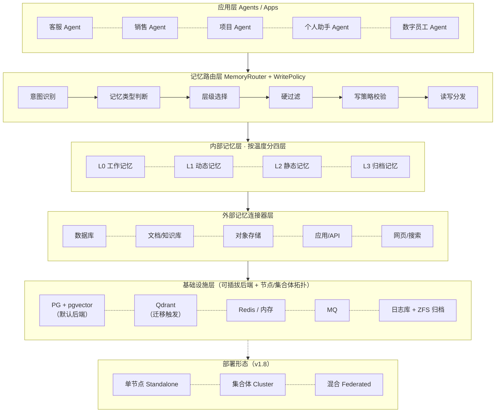
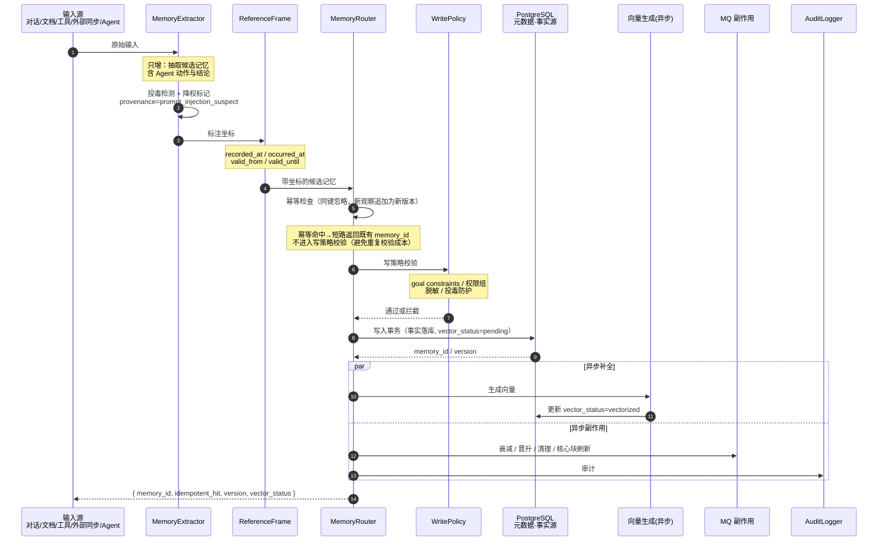

# LIMS v2.3 光明记忆系统架构设计文档

**项目名称：** Light Intelligent Memory System（LIMS / lightmem，光明记忆系统，简称"光明记忆"）
**版本：** v2.3
**文档类型：** 架构设计文档

> v1.5 在 v1.4（只增+读时融合、双时态、pgvector 单库）基础上，闭合架构评审遗留项（多信号检索、反馈/遗忘契约、核心记忆块、Agent 主动记忆、权限三元组、记忆投毒防护、评测分桶、架构收敛），并完成统一 Schema 的语义一致性收敛（见 §4.7 Q1–Q6）；v1.7 追加 Q7 完成字段/流程层面的收口（见 §4.7）。不改变 v1.4 已确立的三大决策方向。
>
> **v1.6（本轮打磨）** 在 v1.5 基础上：① 将总体架构（§2.1）与写入/读取链路（§4.5/§4.6）改为 Mermaid 图示，闭合架构评审 §3.11「文档表达」遗留项；② §6 新增「实现语言承载建议」（§6.1），与《实现语言选型说明》v1.3 对齐四可部署单元；③ 全文一致性校订：修正无效交叉引用（3.16→3.15）、统一示例字段命名标注，并补充 `provenance`/`source_evidence`/遗忘观测契约术语。**不改变既有架构结论。**
>
> **v1.7（细化收口）** 在 v1.6 基础上按「必须改 / 建议补 / 可打磨」三级细化：① 字段统一（内容字段归一 `fact`、`shared_with_tenants[]` 入统一 Schema、`permission_level` 定位明确、生效区间统一 date-only）；② 流程修正（写入 API `POST`、幂等检查与意图识别前移）；③ 语义边界明确（半衰期作用域、`occurred_at` 阈值、L3 检索契约、参考系业务键、权限校验优先级、P95 统计口径）；④ 选型勘误（全文检索明确需 BM25）；⑤ 新增 P2.5 评测集阶段；⑥ 术语表与版本历史同步，§4.7 新增 Q7 收口记录。**不改变既有架构结论。**
>
> **v1.8（三大部署与平台承载）** 在 v1.7 基础上新增三项能力：① **多数据库挂接**——§5.4 存储后端可插拔清单（PG+pgvector 默认、Qdrant 迁移触发、TiDB/CRDB、SQLite 兜底等）；② **单节点 / 集合体部署形态**——§5.5 节点角色（Coordinator/Worker/Archive/Gateway）、节点间协议、跨节点 pre-filter 与 revocation 广播，新增 §2.5 纲领；③ **FreeBSD + ZFS 实现优化**——§5.6 ZFS dataset 布局、PG on ZFS 调优（`recordsize=8k`、`compression=lz4`、`sync=always`）、快照/`zfs send` 容灾、FreeBSD 最小安装集；§6 技术选型表补齐 FreeBSD 包名（`postgresqlXX-pgvector`、`databases/qdrant`、`redisXX`、`minio`）；路线图新增 P8 集合体与多后端阶段。**不改变既有架构结论。**
>
> **v1.9（安全组件与平台加固）** 在 v1.8 基础上：① 最小安装集版本统一为 `postgresql18-server` / `postgresql18-pgvector`；② 新增 **§5.7 安全组件与 FreeBSD 加固**——按"进程隔离（jail+vnet）/ 细粒度权限（Capsicum）/ 强制访问控制（MAC）/ 文件 ACL / 磁盘加密（ZFS encryption）/ 密钥管理 / 网络（pf+IPsec）/ TLS / 漏洞审计（pkg audit）/ 系统审计（accton）"十类安全组件映射 §7 业务安全需求，并给出实现清单与加固检查清单；③ 明确"应用层→OS 层→存储层"三层纵深与 `permission_level`↔MAC 映射；④ 精化 ZFS 加密密钥语义（`zfs change-key` 仅重包裹包裹密钥，**不更换 DEK**）。**不改变既有架构结论。**
>
> **v2.0（可缩放模式与配套交付物）** 在 v1.9 基础上：① 新增 **§2.6 可缩放模式**——类比 Pyramid 式多规模，定义 Solo（个人）/ Family（家庭）/ SMB（中小型企业）/ Enterprise（企业集合体）四档 profile，核心模块与统一 Schema 不变，只切换装配档位（存储后端 / 缓存队列 / 安全强度 / 拓扑），并给出渐进升级路径与规模判定问题；② 将 §5.7 安全加固清单抽为独立交付物 `checklists/freebsd-security-checklist.md`（命令级可执行、含验证与回滚）；③ 将 §5.6 + §5.7 合并为可执行手册 `manuals/p1-freebsd-zfs-setup.md`（含 jail 划分、ZFS dataset、pf 规则、端到端验证）；④ 文档内交叉引用上述两份配套文件与 §2.6。**不改变既有架构结论。**
>
> **v2.1（应用包生态与差异化定位）** 在 v2.0 基础上新增三项：① **§6.2 应用包生态（LIMS App Package）**——按 NAS 系统（Synology 套件中心 / TrueNAS Apps）的做法引入包机制：manifest 自描述、包生命周期治理、来源信任分级、类型分层（service/connector/skill/policy/pack/scheduler），内核（§3–§4）保持冻结、能力以包生长；② **包必备清单两批**（首批含 gitea、git-connector、registry、backup、search、llm-gateway、mesh-sync、webui），第二批按触发条件启用且默认关闭；③ **AI 协同与差异化定位**——包成为**被记忆的一等实体**（装包/配包/用包/沉淀包经验四环节），并确立六条特色（主特色：低 token 长期运行 = 数据面架构 + 控制面光明语言双重压缩；由此使 AI 协同在经济上可持续），新增 M1–M10 评测口径（含独有的"控制面 token 占比"M2）。配套交付物：`docs/光明记忆应用包生态与差异化定位_v1.0.md`。**不改变既有架构结论。**
>
> **v2.2（profile 配置落地）** 在 v2.1 基础上：将 §2.6 的四档装配档位从"示例 YAML"落地为 **`lightmem/profiles/` 目录**——`lims-solo.profile.yaml` / `lims-family.profile.yaml` / `lims-smb.profile.yaml` / `lims-enterprise.profile.yaml`（每份含存储、缓存、队列、网络、安全、功能、扩容七段完整配置，字段名与 §2.6 一致），并配 `README.md` 说明选择/启用/升档方法；文档内交叉引用该目录。**不改变既有架构结论。**
>
> **v2.3（评审勘误与口径统一）** 在 v2.2 基础上仅做文档勘误，不改变架构结论：① 修正 §4.1 记忆对象样例——主键真源字段应为 `fact`，`content` 仅作 L2 兼容别名（此前样例误写为 `content`）；② 统一检索延迟口径——§9 明确 P95 目标针对**内核记忆检索链路**，§4.6 外部连接器（如 Git）同步的 300ms 为**单次外部调用软超时/背压触发线**，二者非同一指标；③ 修复 §6.1 悬空引用（移除对不存在的"实现语言选型说明"文档的指向）；④ 版本历史按时间序整理，并补齐本版本条目。**不改变既有架构结论。**

---

## 1. 项目概述

### 1.1 项目定位

光明记忆（LIMS）是一个面向多租户、多用户、多 Agent 的智能记忆管理平台。它让 AI Agent 像人一样拥有长期记忆、短期记忆和程序性记忆，并在不同场景下自动选择最合适的记忆层级进行存取。与"单 Agent 自带的上下文"不同，光明记忆是一个**可被多个 Agent 共享调用的独立记忆服务**：一个 Agent 沉淀下来的经验，可以被同一个用户名下的其他 Agent 直接复用。

### 1.2 核心价值

- **对 AI Agent：** 拥有"记住"的能力，不再每次对话都从零开始；新任务开始时能自动召回相关的历史目标、偏好和经验。
- **对企业：** 沉淀客户、项目、流程等知识资产，形成可复用的组织记忆，且在租户间隔离可控。
- **对用户：** 获得个性化、连续的服务体验；用户对自己的记忆资产有完整的查看、导出、删除入口（数据主权）。

### 1.3 设计哲学

光明记忆融合《千脑智能》的参考系思想、人脑记忆分层模型，以及 Sparse Agent 等长期数字员工实践：

- **参考系组织：** 每条记忆都有坐标（租户、用户、Agent、项目、实体、场景、任务、时间），像大脑用空间坐标组织知识。
- **记忆内容分类：** 不只存"事实"，还区分事件、偏好、程序性经验、长期目标——不同内容的生命周期和召回方式不同。
- **多记忆加权融合：** 冲突记忆不直接覆盖，而是通过固有价值、时效、来源、反馈等多维加权，而非"多个大模型互相投票"。
- **多信号检索（v1.5）：** 语义、关键词（BM25）、实体三路信号独立打分后按名次（rank）融合，降低对权重先验的依赖，改善多跳与时序类查询。
- **持续学习闭环：** 记忆随交互反馈不断修正；用户纠正后，下一轮工作立即生效。
- **分布式容错：** 同一事实多版本保存，单点损坏不影响整体。
- **渐进式记忆：** 记忆从会话事件流中持续捕获、压缩、召回，并按后台整合提炼为可复用的程序性经验，按固有价值逐步升级。
- **记忆预算驱动：** 不无限膨胀，有容量上限，低价值记忆自动淡化、压缩、归档。
- **线索优先：** LIMS 内部只存线索和摘要，详细内容交由外部系统（数据库、文档系统、档案系统）保管。
- **稀疏触发 + 常驻核心：** 记忆检索和晋升按需、稀疏触发；但每个 Agent 有容量受限的"核心记忆块"（目标 + 高频偏好）常驻上下文（v1.5）。
- **安全可信（v1.5）：** 记忆层被视为高危攻击面，写入路径内置投毒防护与来源溯源，共享传播前二次校验。

---

## 2. 系统架构

### 2.1 总体架构



### 2.2 四层记忆模型（按温度/时间分）

| 层级 | 名称 | 类比 | 存储内容 | 生命周期 | 典型场景 |
|---|---|---|---|---|---|
| L0 | 工作记忆 | 人类短期工作记忆 | 当前对话上下文、核心记忆块（见 §3.7）、临时变量、工具调用中间结果、外部系统查询线索 | 分钟~小时 | 多轮对话、任务执行链 |
| L1 | 动态记忆 | 人类情景记忆 | 用户偏好、近期事件、临时事实、会话摘要、外部系统结论、跨 Agent 共享经验 | 天~月 | 记住用户上次说过的需求 |
| L2 | 静态记忆 | 人类语义记忆 | 企业知识、产品文档、标准流程、客户档案、长期目标/KPI/约束、外部系统元数据索引 | 长期版本化，数年~数十年 | 企业知识问答、标准流程、数字员工长期目标 |
| L3 | 归档记忆 | 深层档案 | 历史会话原文、过期记忆、审计数据、合规保留数据 | 合规保留，可按需恢复 | 历史回溯、审计 |

### 2.3 记忆内容分类（按内容类型分，横切四层）

温度分层回答"记多久、放多快"，内容分类回答"记的是什么、怎么用"。每条记忆必须有一个 `memory_kind`：

| memory_kind | 含义 | 示例 | 默认落层 |
|---|---|---|---|
| `event` | 发生过的事件 | "2026-10-08 客户A投诉物流延迟" | L1，过期降 L3 |
| `fact` | 客观事实 | "产品X标准报价每件100元" | L2（稳定）或 L1（临时） |
| `preference` | 用户/客户偏好 | "客户A偏好周二下午开会" | L1，长期偏好晋升 L2 |
| `procedure` | 程序性经验/方法 | "写产品介绍先讲用途，再列功能" | L1/L2，跨 Agent 共享 |
| `goal` | 长期目标 / KPI / 工作约束 | "未来一年把账号周触达做到 10 万，未经确认的内容先发我审阅" | L2，长期保留 |

> `goal` 类记忆吸收自 Sparse Agent：数字员工要持续负责一件事，就必须长期记住目标、衡量指标和行为边界。新任务开始时优先召回相关 `goal`。
> **统一 Schema 约束（v1.5）：** 五类 `memory_kind` 共用 §4.1 统一 Schema 基础字段；`goal` 特有语义（目标描述、KPI、约束、状态）以扩展字段 `goal_detail` 承载，禁止另起一套与统一字段冲突的结构（见 §3.8）。

### 2.4 存储分层与容量原则

| 原则 | 含义 |
|---|---|
| 热容量固定 | L0/L1 的活跃记忆有明确上限，保证检索速度和成本可控 |
| 冷数据可长期保留 | L2 和归档层通过对象存储、压缩、分层存储支撑数十年 |
| 遗忘优先于扩容 | 先压缩、合并、降级、归档，而不是一味加硬盘 |
| 逻辑删除，物理归档 | 企业记忆很多需要审计；但用户行使删除权时见 §7.3 级联删除 |
| 预算驱动 | 每个租户/用户/Agent/项目都有记忆预算，超出后触发压缩和淘汰 |
| 线索优先 | LIMS 内部只存线索和摘要，详细内容交由外部系统保管 |

### 2.5 部署形态与 FreeBSD/ZFS 承载（v1.8）

**三个核心需求（v1.8 明确）：**

1. **挂接当今主流数据库系统** —— 存储后端可插拔，不锁定单一引擎（详见 §5.4）。
2. **单节点 / 集合体（多节点互联互通）两种部署形态** —— 既可独立运行（Standalone），也可组成"光明记忆集合体"（Cluster，详见 §5.5）。
3. **FreeBSD + ZFS 优先实现** —— 面向 ZFS 特性做存储优化（详见 §5.6），并叠加 FreeBSD 安全组件加固（详见 §5.7）。

**总体架构对应关系：** §2.1 的「INFRA 基础设施层」（PG+pgvector、Redis、MQ、日志库）与「CONN 外部连接器层」在本节被进一步抽象为**可插拔存储后端 + 节点/集合体拓扑**，业务层（§3–§4）不受影响。

| 需求 | 落点 | 是否改变既有架构结论 |
|---|---|---|
| 多数据库挂接 | §5.4 存储后端可插拔清单 | 不改变，扩展 §4.2/§6 的后端抽象 |
| 单节点 / 集合体 | §5.5 节点角色与互联协议 | 不改变，新增节点角色定义 |
| FreeBSD + ZFS | §5.6 ZFS 优化与 FreeBSD 安装 | 不改变，新增平台优化项 |
| 安全组件加固 | §5.7 安全组件与 FreeBSD 加固 | 不改变，新增 OS 层安全组件（与 §7 业务层安全互补） |

> **实现语言承载影响（v1.8）：** §6.1 语言分工结论不变。FreeBSD + ZFS 优先落地时，API 网关与 Router+Store 的 **Go** 单元天然匹配 FreeBSD（单二进制、原生 ABI、静态链接便于 jail 隔离）；`pgvector` 经官方 pkg `postgresqlXX-pgvector` 安装；`Qdrant` 经 `databases/qdrant` port 安装。Python 单元（Extractor）与 TypeScript 单元（前端）在 FreeBSD 上均可运行，仅需注意 `pkg`/`pip`/`npm` 的 FreeBSD 变体。**§5.7 安全组件不改变语言分工**——jail、Capsicum、MAC、ZFS 加密均为 OS 层能力，与实现语言无关。

### 2.6 可缩放模式（Scalability Modes，v2.0）

**类比：** 光明记忆像 Pyramid Web 框架一样**满足多种规模需求**——同一套代码、同一套 Schema、同一套 API，通过**装配档位（profile）**在不同规模下切换可选组件，而不是为每种规模写一套系统。从"个人 / 家庭记忆系统"到"中小型企业记忆系统"再到"企业级集合体"，**核心模块（§3–§4）与统一 Schema（§4.1）完全不变**，只换"底座"。

**1) 规模档位定义（v2.0）：**

| 档位 | 目标用户 | 用户量级 | 记忆量级 | 部署形态 | 存储后端 | 缓存/队列 | 安全组件 |
|---|---|---|---|---|---|---|---|
| **Solo（个人）** | 单个开发者/爱好者 | 1 人 | 万级 | 单机自包含（§5.5 Standalone） | SQLite + sqlite-vec（§5.4 兜底） | 内存内（无 Redis/MQ） | 极简：本机加密 + 备份 |
| **Family（家庭）** | 家庭实验室（1–5 人） | ≤10 人 | 十万级 | 单机 FreeBSD + jail（§5.6） | PG + pgvector（单库） | Redis（可选） | jail + ZFS 加密 + pf（§5.7） |
| **SMB（中小型企业）** | 中小团队/业务（10–500 人） | ≤500 人 | 百万级 | 单节点或双节点主备（§5.5） | PG + pgvector + Qdrant（可选） | Redis + RabbitMQ | jail + MAC + IPsec + pkg audit（§5.7 全套） |
| **Enterprise（企业集合体）** | 多租户/多团队（>500 人） | >500 人 | 千万级 | 集合体 Cluster / Federated（§5.5） | PG 分片 + Qdrant + TiDB/CRDB | Redis 集群 + Kafka | §5.7 全套 + 外部 KMS + 灾备节点 |

**2) 装配档位（profile）机制（v2.0）：**

- 光明记忆通过一份 **`lims.profile.yaml`** 声明档位，核心代码读配置装配组件，**不因规模变更重写代码**。
- **配套可执行配置（v2.2）：** 四档完整 YAML 已提供于 `lightmem/profiles/` 目录——`lims-solo.profile.yaml` / `lims-family.profile.yaml` / `lims-smb.profile.yaml` / `lims-enterprise.profile.yaml`（另有 `README.md` 说明使用方法），每份含存储、缓存、队列、网络、安全、功能、扩容七段完整配置，部署时直接复制对应档位为 `lims.profile.yaml` 即可。
- 核心不变项：§4.1 统一 Schema、§3.1–§3.15 核心模块、§4.4 API 骨架、§4.2 一致性骨架、§6.1 语言分工。
- 可变项：存储后端（§5.4）、缓存/队列、安全组件强度（§5.7）、部署拓扑（§5.5）。

```yaml
# lims.profile.yaml（示例）
profile: family          # solo | family | smb | enterprise
storage_backend: pgvector # sqlite | pgvector | qdrant | pgvector+shard
cache: redis             # none | redis | redis-cluster
mq: redis                # none | rabbitmq | kafka
security:
  jail: true
  zfs_encryption: true   # solo 可 false
  mac: false             # smb+ 才 true
  ipsec: false
  pkg_audit: true
features:
  consolidation: true    # 后台整合（§3.13）
  core_memory: true      # 核心记忆块（§3.7）
  poison_guard: true     # 投毒防护（§7.5）
  audit: true
```

**3) 渐进式升级路径（v2.0，核心价值）：**

光明记忆不要求一开始就按最大规模设计，而是**按需渐进升级**，且升级是**配置切换 + 数据迁移**，不是系统重写：

```text
Solo（SQLite 单文件）
  │  数据导入导出（§7.4 兼容 JSON/CSV）
  ▼
Family（PG + pgvector 单库，FreeBSD + jail）
  │  数据 pg_dump / COPY 迁移；向量需重算（vector_status 语义保证）
  ▼
SMB（单节点 + Redis + RabbitMQ + 安全组件）
  │  Qdrant 按迁移阈值触发（§6 契约）；加 MAC + IPsec
  ▼
Enterprise（集合体 Coordinator/Worker/Archive/Gateway）
  │  PG 分片 + Qdrant；跨节点 pre-filter（§5.5）
```

**升级兼容性保证（v2.0）：**

- **Schema 不变：** 升级只迁移数据、不改字段（§4.1 单真源保证）。
- **向量可重算：** `vector_status`（§4.2）保证从 SQLite 迁到 PG 时，元数据先落库、向量后补全，期间可被全文/元数据检索，不阻塞。
- **API 兼容：** §4.4 API 骨架在所有档位一致，Agent 侧无需感知后端切换。
- **trace 兼容：** `retrieval_trace`（§4.3）跨档位统一格式，便于从 Solo 一路追踪到 Enterprise。
- **安全渐进：** Solo 可暂不启用 MAC/IPsec；升到 SMB 时按 §5.7 checklist 补齐，**不需重装系统**。

**4) 与既有章节的联动（v2.0）：**

| 本节能力 | 依赖章节 |
|---|---|
| 存储后端可切换 | §5.4 存储后端抽象（SQLite/PG/Qdrant/TiDB） |
| 单节点/集合体 | §5.5 节点角色与互联协议 |
| 安全组件强度分级 | §5.7 安全组件清单（Solo 简化、SMB/Enterprise 全套） |
| FreeBSD + ZFS 优先 | §5.6 ZFS 优化（Family 起适用；Solo 可纯文件） |
| 数据可迁移 | §4.2 一致性骨架（vector_status）+ §7.4 数据导出 |
| 升级不重写 | §4.1 统一 Schema 单真源 + §6.1 语言分工 |

**5) 设计原则（v2.0）：**

- **默认本地可运行：** 任何档位的"首日体验"都不应要求先搭集群；Solo 用 SQLite 即可起。
- **不背整套复杂度：** Solo/Family 不引入 MQ、Kafka、分片、IPsec——只有真正需要时启用。
- **同一套心智模型：** 无论规模，路由、融合、生命周期、投毒防护的**概念和 API 一致**，只改 profile 配置。
- **升级可逆：** 每档之间支持数据导出/导入（§7.4），允许回退到更小档位（代价是向量重算）。
- **安全按档渐进：** 越大的规模安全组件越重，但**核心安全语义（§7）**在所有档位一致（权限三元组、投毒防护、删除权不能因规模小就省）。

**6) 边界与权衡（v2.0）：**

- Solo 用 SQLite 时，多用户并发、多租户硬过滤、`pre-filter` 语义需**降级**（单机单用户无跨租户问题，但 `visibility`/`shared_with_tenants` 字段仍保留，便于升级）。
- Family 用 PG 单库时，**多租户隔离仍靠 §3.2 硬过滤清单**，不能因为"家庭场景"就跳过 `tenant_id`/`visibility`。
- SMB 引入 Qdrant 时，**不改变 §4.2 写入一致性**（元数据为事实源、向量异步补全），Qdrant 只是"向量落点"变了。
- Enterprise 用分片 + 集合体时，**不改变 §3–§4 业务逻辑**，只改 §5.5 的节点角色与 §5.4 的后端实例。
- 本节描述**规模可缩放**，不是**功能可裁剪**——§7 安全核心语义与 §3.15 写策略插件、§7.5 投毒防护**在所有档位都必须保留**（Solo 可简化 OS 层加固，但不可省应用层安全）。

**7) 规模选择的判定问题（v2.0，供部署决策）：**

| 问题 | 若为"是"则升一档 |
|---|---|
| 当前档位是否已触达记忆预算上限（§5.2）？ | 是 → 升档 |
| 是否需要 >1 台机器提供可用性？ | 是 → Family → SMB（主备） |
| 是否需要跨机器/跨团队共享记忆（§7.1 visibility）？ | 是 → SMB → Enterprise（Federated） |
| 检索 P95 是否超红线（§9 <200ms）？ | 是 → 按 §6 迁移阈值引 Qdrant |
| 是否需要 IPsec / 外部 KMS / MAC？ | 是 → SMB 起步（§5.7） |
| 是否只是个人使用、无需多租户？ | 否 → 保持 Solo/Family |

---

## 3. 核心功能模块

### 3.1 记忆路由模块（MemoryRouter）

**职责：** 决定一条记忆该去哪一层、该带什么坐标、以及查询时该从哪一层取；并作为写策略校验的统一入口。

**功能：**

- **意图识别：** 判断输入是查询知识、记录事实、确认偏好，还是仅在当前对话使用。
- **层级选择：** 临时上下文 → L0；偏好/近期事件 → L1；企业知识/长期目标 → L2；合规保留/历史回溯 → L3。
- **跨层查询：** 多层并行检索，按 §3.4 融合结果。
- **记忆晋升/降级：** 依据 §5.3 的固有价值分数自动流转，不按固定时间硬晋升。
- **外部记忆路由：** 内部记忆不足以回答时，路由到外部连接器取补充信息。
- **跨会话召回：** 新任务开启时，自动召回相关 `goal`、`procedure`、`preference`。
- **预算协同：** 与 MemoryBudgetManager 协同，超预算触发压缩淘汰。
- **写策略入口（v1.5）：** 所有写入在落层前/后经过 WritePolicy 注册表校验，goal constraints、权限组、脱敏规则、投毒防护统一以 policy 实现（见 §3.15）。新增一条写校验规则无需改动核心模块。

### 3.2 参考系坐标模块（ReferenceFrame）

**职责：** 为每条记忆绑定多维坐标，实现精准定位与隔离。

| 维度 | 说明 | 过滤类型 |
|---|---|---|
| 租户 tenant | 企业/组织隔离 | 硬过滤（安全边界） |
| 用户 user | 个人偏好隔离 | 硬过滤 |
| 项目 project | 项目维度隔离 | 硬过滤 |
| 可见范围 visibility | private / shared_user / tenant / cross_tenant | 硬过滤（安全边界） |
| Agent agent | 哪一个/哪类 Agent 创建或使用 | 软排序 |
| 实体 entity | 关联的客户、产品等 | 软排序（实体命中优先级高于一般软排序） |
| 场景 scene | 会议、工单、聊天、邮件等 | 软排序 |
| 任务 task | 报价、审批、咨询等 | 软排序 |
| 事件发生时间 occurred_at | 事实所描述事件在现实世界发生的时间（v1.5 新增） | 软排序 |
| 记录时间 recorded_at | 系统首次记录该观察的时间（只增，写入后不改） | 软排序 |
| 生效区间 valid_from/valid_until | 事实声明为真的时间窗口（双时态，旧版本保留） | 软排序 |
| 分类 category | 业务分类 | 软排序 |

> **安全硬过滤清单（统一，v1.5）：** `tenant`、`user`、`project`、`visibility` 四类维度为**硬过滤（安全边界）**，参考系定义与检索约束（§4.3）必须共用同一份清单。禁止将 `visibility` 列为软排序维度或降级为后置过滤。

**可见范围（visibility）规则（吸收 Sparse Agent 共享记忆思路）：**

- `private`：仅创建者本人或指定 Agent 可见，默认值。
- `shared_user`：同一用户名下所有 Agent 可见——运营 Agent 确认的"先讲用途再讲功能"，写作 Agent 可直接复用。
- `tenant`：同租户内全员/指定角色可见。
- `cross_tenant`：跨租户共享，必须显式授权；实现方式是在记忆上挂 `shared_with_tenants: []`，查询过滤条件为 `tenant_id = current OR tenant_id IN shared_with_tenants`，而不是绕过硬过滤。

**可见范围与权限正交（v1.5）：** `visibility` 只管"传播范围"，`permission`（owner/writers/readers）管"操作边界"，二者分别存储与校验（见 §3.15 与 §4.1）。

**坐标匹配：** 硬过滤维度不匹配直接排除；软排序维度输出 `[0,1]` 匹配度加权。

**参考系业务键（reference_frame_business_key，v1.6 定义）：** 用于幂等键（§4.3）的参考系归一化串，定义为规范化拼接 `entity + scene + task + category`（实体/场景/任务/分类，空值以固定占位符 `nil` 填充），供同一业务事实在不同参考系片段下仍能被去重。

### 3.3 记忆提取器（MemoryExtractor）

**职责：** 从对话、文档、工具结果、外部系统同步数据中，自动抽取结构化记忆条目。

**功能：**

- **事实抽取：** 用规则 + LLM 从文本中抽出 `event / fact / preference / procedure / goal` 五类候选。
- **抽取对象扩展（v1.5）：** 抽取范围必须涵盖"Agent 动作与结论"（工具调用结果摘要、Agent 确认性输出，如"客户A接受 8 折"），避免工具链路内产生的一等事实被遗漏。
- **双时态标注（v1.5 收敛）：** 每条观察自动记录 `recorded_at`（系统记录时间，只增不改）、`occurred_at`（事件实际发生时间，`event` 类必填，其余尽力标注或置空）、`valid_from`/`valid_until`（生效区间）。三者语义独立、禁止互相复用；事实变更后旧观察保留为历史版本，不做物理覆盖。
  - **`occurred_at` 填写阈值（v1.6）：** 非 `event` 类仅当抽取器对其置信度 ≥ 0.7 时才填 `occurred_at`，否则置 `null`；不填时**不得猜测或回填**，避免噪声。`event` 类缺失 `occurred_at` 视为抽取失败，进入"待人工确认"。
- **坐标自动标注：** 自动绑定 tenant、user、entity、scene、task；标注置信度低时打"待人工确认"标记。
- **只增（ADD-only）策略（v1.4 决策）：** 抽取结果一律**追加为新观察记录**，不做原地更新；相同幂等键的重复提交直接忽略（防重），同一事实的新观察作为新版本保留，冲突裁决推迟到读取路径（见 §3.4 / §4.6 读时融合）。
- **投毒防护（v1.5）：** 对含指令性文本（如"记住以后……否则……"）的内容降权，并标记 `provenance=prompt_injection_suspect`；外部连接器内容按来源可信度校准 `confidence` 上限；记录 `source_evidence`（产生该记忆的输入来源与原文片段摘要）用于投毒溯源（见 §7.5）。
- **结构化输出：** 输出符合 §4.1 统一 schema 的记忆条目，交给 Router 落层。
- **人工校正入口：** 提供回写接口，人工修正后样本可用于后续提取效果优化；被 `edited/rejected` 的记忆单独触发回写，形成"纠正即学习"闭环（见 §3.11）。

### 3.4 投票融合模块（VoteFusion）

**职责：** 多条记忆对同一事实/问题有不同描述时，做加权融合而非简单覆盖；在读取路径完成多信号 rank 融合与双时态裁决。

**多信号独立打分（v1.5，替代单一线性加权）：**

| 信号 | 实现 | 说明 |
|---|---|---|
| 语义相似度 | 向量检索（pgvector） | 与查询的语义相关性 |
| 关键词匹配 | BM25（全文索引） | 专有名词、术语精确命中 |
| 实体匹配 | 实体链接/规范化（别名表、指代消解） | 以实体为核心的查询优先级高于一般软排序 |
| 记忆固有价值 | §5.3 | 与查询无关 |
| 时效新鲜度 | 指数衰减，半衰期可配 | 只影响排序权重，不改变事实有效性 |
| 来源可信度 | 人工确认 > 系统提取 > 用户口述 | — |
| 参考系匹配度 | 上下文坐标匹配 | — |
| 反馈历史 | 采纳/弃用统计 | — |
| 关键词/实体归一化 | 同义与别名归一 | 如 attend/attending 统一 |

**融合机制（rank 融合，v1.5）：** 各路信号先独立打分，再按名次（rank）融合，而非直接线性加权。默认权重必须先标注来源，并以评测集校准，禁止无依据的固定先验；权重变更须可追溯至评测结论或 A/B 结果，避免冷启动震荡。

**融合策略：**

- **唯一最优：** 融合后名次最高者胜出。
- **接近融合（含绝对分下限，v1.5）：** 仅当**同时满足**相对条件 `(top1 - top2) / top1 < 20%` **且** 绝对条件 `top1 ≥ 绝对分下限（默认 0.6，可配置）` 时，才融合多条事实文本并附加各条来源说明；`top1` 低于绝对下限时**禁止融合**，返回单条最高分并标注低置信/弱匹配或触发澄清。
- **冲突标记：** 无法融合时保留多条，标记"待人工确认"，不静默选一个。
- **时效裁决（双时态，语义明确化，v1.5）：** 默认查询仅返回当前生效版本（`valid_from ≤ now < valid_until`，或 `valid_until = null`）；显式 `as_of` 回溯时返回覆盖该时刻的版本，若无覆盖则返回最接近的已失效版本并置 `is_historical=true`，同时回填其生效区间。禁止以未定义的"保留为历史标记"含糊表述。

### 3.5 动态记忆存储（DynamicMemoryStore, L1）

**职责：** 管理短期、可变的偏好、事件、共享经验。

**功能：** 添加（只增追加，不原地覆盖）/逻辑删除；冲突检测与自动失效旧记忆（置 `superseded_by`，非物理删除）；按半衰期衰减；过期清理；反馈记录；按参考系查询；多信号融合排序。

**L1 记忆结构示例（v1.5 统一命名；仅列关键字段，`vector_status` 等完整字段与命名以 §4.1 单一真源为准）：**

```json
{
  "memory_id": "mem_01J8...",
  "idempotency_key": "hash(t1+u1+客户A+周二开会)",
  "tenant_id": "t1",
  "user_id": "u1",
  "agent_id": "agent_cs_01",
  "visibility": "shared_user",
  "permission": { "owner": "agent_cs_01", "writers": ["agent_cs_01"], "readers": ["agent_cs_02"] },
  "memory_kind": "preference",
  "fact": "客户A偏好周二下午开会",
  "confidence": 0.85,
  "source": "dialogue_extraction",
  "permission_level": "internal",
  "occurred_at": null,
  "recorded_at": "2026-10-08T10:30:00Z",
  "valid_from": "2026-10-01",
  "valid_until": null,
  "expire_at": "2027-01-01",
  "importance": 0.92,
  "recent_access_score": 0.78,
  "access_count": 15,
  "version": 3,
  "superseded_by": null,
  "is_historical": false,
  "provenance": "normal",
  "source_evidence": { "origin": "session:sess_8842", "snippet": "我一般周二下午有空" },
  "reference_frame": {
    "entity": "客户A", "scene": "日程安排", "task": "会议预约"
  },
  "feedback_records": [
    {"status": "adopted", "time": "2026-10-05", "operator": "system"}
  ]
}
```

### 3.6 静态记忆存储（StaticMemoryStore, L2）

**职责：** 管理长期、稳定的知识与长期目标。

**功能：** 版本化管理；分类与标签；权限控制（public/internal/confidential）；跨租户共享（走 visibility=cross_tenant）；批量导入导出；全文 + 向量检索；参考系绑定；多信号融合排序。

**L2 记忆结构示例（仅列关键字段，完整字段与命名以 §4.1 单一真源为准）：**

```json
{
  "memory_id": "mem_01J9...",
  "tenant_id": "t1",
  "visibility": "tenant",
  "permission": { "owner": "admin_01", "writers": ["editor_01"], "readers": [] },
  "memory_kind": "fact",
  "fact": "产品X的标准报价为每件100元",
  "source": "产品文档v2.1",
  "category": "产品价格",
  "permission_level": "internal",
  "occurred_at": null,
  "recorded_at": "2026-09-20T08:00:00Z",
  "valid_from": "2026-09-20",
  "valid_until": null,
  "version": 5,
  "version_history": [],
  "reference_frame": { "entity": "产品X", "category": "产品价格" }
}
```

### 3.7 工作记忆缓存（WorkingMemoryCache, L0）

**职责：** 管理当前会话的临时上下文与核心记忆块。

**功能：** 滑动窗口（最近 N 轮）；关键信息提取；TTL 过期；结构化变量存储；会话压缩；**核心记忆块注入（v1.5）**。

**核心记忆块（Core Memory Block，v1.5）：** 每个 Agent 一个容量受限的常驻记忆块，内容为 `status=active` 的 `goal` 与前 K 条高频 `preference`/`procedure`（按近 30 天访问排序），随会话注入上下文；受 L0 预算约束（建议核心块 ≤ L0 预算 40%，其余留给滑动窗口），由 MemoryLifecycleManager 维护、随访问频度刷新；禁止注入低价值/已失效记忆。指标见 §9"核心块命中率"。

**L0 记忆结构示例（L0 为会话态、字段可简化；完整字段与命名以 §4.1 单一真源为准）：**

```json
{
  "memory_id": "mem_01JA...",
  "tenant_id": "t1", "user_id": "u1", "session_id": "sess_8842",
  "memory_kind": "event",
  "fact": "当前订单号 ORD-20261009-007，用户确认收货地址为济宁",
  "ttl_seconds": 3600,
  "ref": {
    "type": "external_reference",
    "summary": "刚查了 CRM 工单042，客户A投诉物流",
    "storage_location": "crm://tickets/20261001/042"
  }
}
```

### 3.8 目标记忆（GoalMemory, L2）

**职责：** 存储和召回驱动数字员工长期行为的目标、衡量指标与工作边界。

**统一 Schema 约束（v1.5）：** `goal` 必须复用 §4.1 统一 Schema 基础字段（`memory_id`、`tenant_id`、`user_id`、`agent_id`、`visibility`、`memory_kind=goal`、`recorded_at`、`valid_from`/`valid_until`、`confidence`、`source`、`version`）；目标特有语义（目标描述、`kpi`、`constraints`、`status`）统一承载于扩展字段 `goal_detail`。禁止出现 `created_at`、`expires_at` 等与统一字段并列的旧命名（到期时间统一为 `expire_at`）。

**结构示例（仅列关键字段，完整字段与命名以 §4.1 单一真源为准）：**

```json
{
  "memory_id": "mem_01JB...",
  "tenant_id": "t1", "user_id": "u1", "agent_id": "agent_social_01",
  "visibility": "private",
  "permission": { "owner": "agent_social_01", "writers": ["agent_social_01"], "readers": [] },
  "memory_kind": "goal",
  "recorded_at": "2026-10-01T09:00:00Z",
  "valid_from": "2026-10-01", "valid_until": null,
  "expire_at": "2027-10-01",
  "confidence": 0.95, "source": "user_confirmed", "version": 1,
  "goal_detail": {
    "goal": "未来一年持续运营微博与 X，让目标用户更了解产品",
    "kpi": {"metric": "周可核验触达量", "target": 100000, "cadence": "weekly"},
    "constraints": ["只使用确认过的产品事实", "发布前查重", "未经确认的内容先给用户审阅"],
    "status": "active"
  }
}
```

**行为：**

- 每次 Agent 启动新一轮工作时，自动召回该 Agent / 该用户名下所有 `status=active` 的 goal，并注入核心记忆块（§3.7）。
- KPI 达成、用户暂停、目标到期时，`status` 转为 `paused / completed / expired`，降入 L3。
- `constraints` 作为硬边界，通过 MemoryRouter 的 WritePolicy 的 goal-constraints 插件参与写后校验（§3.15）。

### 3.9 会话压缩器（SessionCompressor）

**职责：** 对 L0 长会话自动压缩，提取高价值信息晋升到 L1。**作用域仅限 L0 会话流。**

**功能：** 每 N 轮或 L0 达容量上限时触发；抽取决策、偏好、待办、情绪信号；丢弃重复低价值片段；结构化输出写入 L1。

```text
原始对话流 → 滑动窗口 → SessionCompressor → [高价值片段 → L1] + [低价值片段 → 丢弃]
```

### 3.10 记忆生命周期管理（MemoryLifecycleManager）

**职责：** 统一管理记忆从创建到删除的全生命周期，以及预算、遗忘、归档、压缩、审计、监控、核心记忆块维护。它是一个**编排者**，下面挂五个执行引擎。

| 子组件 | 职责 |
|---|---|
| MemoryBudgetManager | 每租户/用户/Agent/项目配额，超预算触发下面的引擎 |
| ForgettingEngine | 按固有价值（§5.3）做衰减、合并、降级、逻辑删除 |
| ArchiveEngine | 低价值记忆转入 L3 对象归档/冷归档，可恢复 |
| CompressionEngine | 面向 L1/L2 批量记忆做结构化摘要（与 §3.9 SessionCompressor 的区别：后者面向 L0 实时会话流，本引擎面向 L1/L2 离线批量） |
| CoreMemoryManager（v1.5） | 维护每 Agent 核心记忆块（active goal + Top-K 高频偏好/程序性经验），受 L0 预算约束 |
| AuditLogger + StorageMonitor | 记录创建/修改/归档/删除；监控各层容量、成本、检索延迟 |

**生命周期状态机：**

```text
created → active → (promoted: L0→L1→L2) → (demoted: →L3 archived)
        ↘ superseded（同一事实的新观察替代旧观察：旧观察标记 superseded_by 保留为历史，参与读时融合）
                                      ↘ soft_deleted → (用户行使删除权 → purged，见 §7.3)
```

晋升/降级依据是 §5.3 的固有价值分数连续观测，而非单次阈值抖动。

### 3.11 反馈闭环模块（FeedbackLoop）

**职责：** 记录记忆被使用后的效果，反哺固有价值与投票权重。

**反馈来源：** 用户显式反馈（赞/踩/改）；模型隐式反馈（是否采纳该记忆生成回答）；任务结果反馈（用了这条记忆后任务是否成功）。

**反馈语义（v1.5）：** `feedback_records[].status` 由 `adopted` 扩展为 `adopted | rejected | edited`，并提供 `operator` 与 `time`。被 `rejected`（明确弃用）或 `edited`（被纠正）的记忆标记"待复核"，触发提取器回写入口，形成"纠正即学习"闭环。

```text
记忆被检索 → 用于生成回答 → 记录是否采纳 → 用户反馈（赞/踩/纠正）
   → 更新 confidence / 固有价值 / recent_access_score / EMA 融合权重 → 影响下次融合
   → rejected/edited 触发提取器回写 → 下一轮生效
```

**可解释要求：** Agent 回答时应能引用"我依据了 mem_01J8，因为它与本问题语义相似度 0.91、实体匹配、最近被采纳过 3 次"。因此每次查询都必须落一条 trace（见 §4.3）。

### 3.12 外部记忆连接器层（External Memory Connector）

**定位：** 位于内部记忆层之下、外部系统之上的"记忆桥梁"。内部记忆层（L0–L3）与外部连接器是**上下层关系**，不是平级。

```text
Agent / 应用 → MemoryRouter
                ├── 内部记忆层（L0 / L1 / L2 / L3）
                └── 外部记忆连接器层
                    ├── 数据库连接器
                    ├── 文档/知识库连接器
                    ├── 对象存储连接器
                    ├── 应用/API 连接器
                    └── 网页/搜索连接器
```

**连接器分类：**

| 连接器 | 典型来源 | LIMS 如何"记忆"它 |
|---|---|---|
| 数据库 | MySQL / PostgreSQL / Oracle / MongoDB / ClickHouse | 记表结构、字段含义、常用查询模板，不复制全量业务数据 |
| 文档/知识库 | Confluence / SharePoint / Notion / Wiki / RAGFlow | 记文档索引、摘要、标签，原文留在外部 |
| 对象存储 | S3 / OSS / MinIO / HDFS / FTP | 记文件元数据、版本、位置，需要时再读 |
| 应用/API | CRM / ERP / OA / 工单 / 订单 | 记接口能力、权限范围、调用结果摘要 |
| 网页/搜索 | 官网 / 行业站 / 搜索引擎 | 记来源可信度、抓取时间、关键结论 |

**四条核心原则：**

1. **只存线索，不搬全量。**
2. **外部系统是长期档案柜。** 内部存线索/偏好/摘要，外部存原始记录。
3. **每次外部读取都带权限和来源。** 记录来源系统、访问人权限、是否脱敏、更新时间、可否缓存。
4. **引用式记忆：** 一条记忆可以是一个外部引用（下方为连接器侧视图，落入 LIMS 时按 §4.1 统一 Schema 映射为 `memory_kind=fact` + `external_ref`，字段名以 §4.1 单一真源为准）：

```json
{
  "memory_type": "external_reference",
  "fact_summary": "客户A上周投诉物流延迟",
  "source_system": "CRM",
  "source_id": "ticket_20261001_042",
  "storage_location": "crm://tickets/20261001/042",
  "confidence": 0.92,
  "permission_level": "internal",
  "last_sync_time": "2026-10-08T15:30:00Z"
}
```

**每个连接器至少提供：** 连接管理、元数据索引、按需检索、结果短缓存、增量同步、来源追溯、安全控制（租户隔离/字段脱敏/访问审计）。

**实现优先级（v1.5 复核）：** 按实际种子客户场景确定，不固定顺序。若主力场景为客服/销售（CRM 线索/工单价值高），数据库/应用连接器应优先于文档连接器；若为知识管理，则文档/知识库连接器优先。默认参考：① 文档/知识库连接器 → ② 数据库连接器 → ③ 对象存储连接器 → 后续 API、网页搜索、实时事件总线。

### 3.13 后台整合模块（BackgroundConsolidation，v1.5）

**职责：** 作为"渐进式记忆"的执行者，后台异步将 L1 中同参考系/同实体的分散记忆整合、提炼为更高价值的 `procedure`/`preference` 升级候选。

**功能：**

- 定期（离线/异步，不得进入在线同步链路）扫描同参考系、同实体下的 L1 记忆。
- 合并同类、去重、提炼，产出"待人工确认"的整合候选（如把多轮纠正沉淀成"先讲用途再列功能"的 `procedure`）。
- 候选必须经人工确认后才升级为共享/长期记忆（尤其 `procedure` 跨 Agent 共享）。
- **禁止项：** 整合过程不得覆盖原始观察；只追加候选，原始记忆保持只增语义。

### 3.14 实体链接模块（EntityLinker，v1.5）

**职责：** 为多信号检索提供实体级归一与匹配能力。

**功能：** 维护别名表与指代消解，将同一实体的不同叫法归一（如"客户A / A公司"）；写入时做轻量实体规范化；查询时"实体匹配"信号优先级高于一般软排序（如"客户A的所有偏好"应召回同实体全部偏好）。实体歧义时保留多候选并按参考系上下文消歧。

### 3.15 写策略插件与投毒防护（WritePolicy & PoisoningGuard，v1.5）

**职责：** 统一承载所有写入校验规则，并内置记忆投毒防护。

**写策略插件（write-policy plugin）：** 挂在 MemoryRouter 上的可注册校验器扩展点，`goal constraints`、权限组、脱敏规则、投毒防护均以 policy 实现；policy 冲突时按优先级裁决并落审计。新增写校验规则无需改动核心模块。

**投毒防护（详见 §7.5）：** 抽取时对指令性文本降权并标记 `provenance=prompt_injection_suspect`；外部内容按来源可信度设 `confidence` 上限；跨 Agent/跨租户传播前强制人工确认或可信 Agent 背书；`source_evidence` 支撑投毒溯源。

---

## 4. 数据模型与一致性

### 4.1 统一记忆 Schema（含五类 kind 单一真源样例）

所有记忆（含 `goal`）共用同一份基础字段，各层/各 kind 仅通过扩展字段增补自身语义：

- 标识：`memory_id`（ULID，按时间有序）、`idempotency_key`
- 隔离：`tenant_id`、`user_id`、`agent_id`、`project_id`、`visibility`、`permission_level`
- 跨租户授权（v1.6）：`shared_with_tenants[]`——仅当 `visibility=cross_tenant` 时非空；与 `permission` 三元组正交校验（授权可见 ≠ 可写/可改）。§3.2/§4.3 的跨租户查询条件 `tenant_id = current OR tenant_id IN shared_with_tenants` 依赖本字段。
- 权限（v1.5 新增）：`permission` = `{ owner, writers[], readers[] }`，与 `visibility` 正交
  - `permission_level`（public/internal/confidential）定位（v1.6 明确）：**返回前二次过滤用的密级标签**，**不参与索引过滤**（不属于隔离字段），仅作响应前校验；与 `permission` 三元组并列存储。
- 内容：`memory_kind`、`fact`（单一真源字段名；L2 静态记忆可沿用 `content` 作为兼容别名，写入时统一归一为 `fact`）、`reference_frame`
- 双时态（v1.5 命名收敛）：`occurred_at`（事件发生时间）、`recorded_at`（系统记录时间，只增不改，**唯一主字段**；`assert_time`/`observed_at`/`created_at` 仅为兼容别名）、`valid_from`、`valid_until`（生效区间）、`superseded_by`（被替代链）
  - 生效区间 `valid_from`/`valid_until` 统一使用 **date-only（YYYY-MM-DD）**，按 UTC 日界比较；时间戳仅用于 `occurred_at`/`recorded_at`（v1.6 明确，全文档一致）。
- 质量与遗忘（v1.5 调整）：`confidence`、`source`、`version`、`importance`、`recent_access_score`（EMA，驱动遗忘）、`access_count`（仅供展示，不再驱动遗忘）、`expire_at`
- 安全与溯源（v1.5 新增）：`provenance`、`source_evidence`、`vector_status`（`vectorized | pending`）
  - `source_evidence.snippet`（v1.6 约束）：默认 ≤200 字符；按 `permission_level` 脱敏，不包含原文全文；仅存"定位片段"以支撑投毒溯源，不构成二次暴露面。
- 返回态（v1.5 新增）：`is_historical`（仅显式回溯置真）
- 关系：`feedback_records[]`（`adopted | rejected | edited`）、`version_history[]`、`external_ref?`

**完整 JSON 单一真源样例**（五类 `memory_kind` 各一例，字段名以本表为准）：

```json
{
  "unified_schema_samples": [
    {
      "memory_kind": "event",
      "memory_id": "mem_evt_01", "tenant_id": "t1", "user_id": "u1", "agent_id": "agent_cs_01",
      "visibility": "private", "permission": {"owner": "agent_cs_01", "writers": [], "readers": []},
      "fact": "2026-10-08 客户A投诉物流延迟",
      "occurred_at": "2026-10-08T09:00:00Z", "recorded_at": "2026-10-08T09:05:00Z",
      "valid_from": "2026-10-08", "valid_until": null, "superseded_by": null,
      "confidence": 0.9, "source": "dialogue_extraction", "version": 1,
      "recent_access_score": 0.3, "access_count": 1, "expire_at": "2027-01-08",
      "provenance": "normal", "source_evidence": {"origin": "session:sess_8842", "snippet": "物流又延迟了"},
      "vector_status": "vectorized", "is_historical": false
    },
    {
      "memory_kind": "fact",
      "memory_id": "mem_fact_01", "tenant_id": "t1", "user_id": "u1", "agent_id": "agent_cs_01",
      "visibility": "tenant", "permission": {"owner": "admin_01", "writers": ["editor_01"], "readers": []},
      "fact": "产品X的标准报价为每件100元",
      "occurred_at": null, "recorded_at": "2026-09-20T08:00:00Z",
      "valid_from": "2026-09-20", "valid_until": null, "superseded_by": null,
      "confidence": 0.95, "source": "产品文档v2.1", "version": 5,
      "recent_access_score": 0.6, "access_count": 42, "expire_at": null,
      "provenance": "normal", "source_evidence": {"origin": "doc:产品文档v2.1", "snippet": "报价每件100元"},
      "vector_status": "vectorized", "is_historical": false
    },
    {
      "memory_kind": "preference",
      "memory_id": "mem_pref_01", "tenant_id": "t1", "user_id": "u1", "agent_id": "agent_cs_01",
      "visibility": "shared_user", "permission": {"owner": "agent_cs_01", "writers": ["agent_cs_01"], "readers": ["agent_cs_02"]},
      "fact": "客户A偏好周二下午开会",
      "occurred_at": null, "recorded_at": "2026-10-08T10:30:00Z",
      "valid_from": "2026-10-01", "valid_until": null, "superseded_by": null,
      "confidence": 0.85, "source": "dialogue_extraction", "version": 3,
      "recent_access_score": 0.78, "access_count": 15, "expire_at": "2027-01-01",
      "provenance": "normal", "source_evidence": {"origin": "session:sess_8842", "snippet": "我一般周二下午有空"},
      "vector_status": "vectorized", "is_historical": false
    },
    {
      "memory_kind": "procedure",
      "memory_id": "mem_proc_01", "tenant_id": "t1", "user_id": "u1", "agent_id": "agent_write_01",
      "visibility": "shared_user", "permission": {"owner": "agent_write_01", "writers": ["agent_write_01"], "readers": []},
      "fact": "写产品介绍：先讲用途，再列功能，最后给场景案例",
      "occurred_at": null, "recorded_at": "2026-10-06T14:00:00Z",
      "valid_from": "2026-10-06", "valid_until": null, "superseded_by": null,
      "confidence": 0.8, "source": "consolidation_candidate", "version": 1,
      "recent_access_score": 0.5, "access_count": 6, "expire_at": null,
      "provenance": "normal", "source_evidence": {"origin": "consolidation:20261006", "snippet": "先讲用途再列功能"},
      "vector_status": "vectorized", "is_historical": false
    },
    {
      "memory_kind": "goal",
      "memory_id": "mem_goal_01", "tenant_id": "t1", "user_id": "u1", "agent_id": "agent_social_01",
      "visibility": "private", "permission": {"owner": "agent_social_01", "writers": ["agent_social_01"], "readers": []},
      "occurred_at": null, "recorded_at": "2026-10-01T09:00:00Z",
      "valid_from": "2026-10-01", "valid_until": null, "superseded_by": null,
      "confidence": 0.95, "source": "user_confirmed", "version": 1,
      "recent_access_score": 0.9, "access_count": 30, "expire_at": "2027-10-01",
      "provenance": "normal", "source_evidence": {"origin": "session:sess_1000", "snippet": "未来一年持续运营微博与X"},
      "vector_status": "vectorized", "is_historical": false,
      "goal_detail": {
        "goal": "未来一年持续运营微博与 X，让目标用户更了解产品",
        "kpi": {"metric": "周可核验触达量", "target": 100000, "cadence": "weekly"},
        "constraints": ["只使用确认过的产品事实", "发布前查重", "未经确认的内容先给用户审阅"],
        "status": "active"
      }
    }
  ]
}
```

> 这是字段定义的单一真源：任何结构示例、查询响应必须与本样例的字段名保持一致，禁止出现 `assert_time`/`observed_at`/`created_at` 并列写法与 `expires_at` 旧命名。

### 4.2 一致性骨架（v1.5：写入语义唯一化）

**唯一写入一致性语义（Q3 收敛）：**

- **事实源 = 元数据；向量 = 可补全的派生数据。**
- 元数据写入成功即视为**事实已落库**；向量异步补全（`vector_status` 先置 `pending`，补偿后转 `vectorized`）。
- 向量生成失败**不得回滚或阻塞**事实写入；失败期间该条可被全文/元数据检索，不阻塞主流程，也不等同丢失。
- **禁止**文档中并存"元数据 + 向量同事务写入"与"向量失败可后补"两种互斥表述。

```text
写 PG 元数据事务（事实落库，vector_status=pending）
   → 异步生成向量 → 成功转 vector_status=vectorized
   → MQ 异步副作用：衰减调度 / 晋升 / 清理 / 审计
   → 对账任务（每小时）扫 pending/超时项补偿（仅重算向量；事实已在库内）
```

读路径以 PG 为准；写入响应必须返回 `vector_status`，调用方可区分"事实已落库（pending）"与"向量已就绪（vectorized）"。

### 4.3 幂等、并发、硬过滤与检索 Trace

- **幂等键：** `idempotency_key = sha1(tenant_id + user_id + normalized_fact + reference_frame_business_key)`。同键重复提交直接忽略（防重）；不同观察（不同 `recorded_at`/来源）作为**新版本追加保留**，不覆盖历史，由读时融合裁决（只增语义）。
- **并发：** 写更新带 `version` 乐观锁；版本冲突时走 VoteFusion 冲突分支，不静默覆盖。
- **硬过滤（统一清单，Q4）：** `tenant`、`user`、`project`、`visibility` 四类为安全硬过滤，**必须用 pre-filter**（向量索引内带标量字段过滤），禁止 post-filter，避免越权召回；`visibility` 不得降级为软排序或后置过滤。跨租户查询过滤条件为 `tenant_id = current OR tenant_id IN shared_with_tenants`。本清单与 §3.2 参考系定义必须完全一致。
- **检索 Trace：** 每次 query 落一条 `retrieval_trace`：query 文本、命中的 memory_id 列表、**各路信号（语义/关键词/实体等）独立得分**、最终 rank 融合名次、双时态裁决命中的版本时刻与 `is_historical`、绝对分下限取值、是否被采纳。这是排查"记错/记漏"和记忆污染的主要依据。

### 4.4 核心 API 骨架

```text
# 写入（记忆提取器/外部同步/Agent 主动调用）——按 idempotency_key 幂等追加，不覆盖历史版本
POST /v1/memories
  body: { memory_kind, fact, reference_frame, visibility, permission, source, occurred_at?, ... }
  # visibility 缺省为 private；跨租户需显式授权（visibility=cross_tenant + shared_with_tenants[]），见 §3.2
  resp: { memory_id, idempotent_hit: bool, version, vector_status }

# 读取（Agent 查询）
POST /v1/memories/query
  body: { query, reference_frame_filter, layers: [L0,L1,L2], top_k, as_of? }
  # as_of：可选时间回溯点；缺省为当前时刻（只返回当前生效版本，见 §4.6）
  resp: { results: [{memory_id, fact, score, source, occurred_at, recorded_at, valid_from, valid_until, superseded_by, is_historical, trace_id}], trace_id }

# 反馈
POST /v1/memories/{id}/feedback
  body: { status: adopted|rejected|edited, operator }

# Agent 记忆工具（v1.5：面向 Agent 主动调用）
POST /v1/agent/memory/write   # Agent 主动写入显式确认的事实
POST /v1/agent/memory/search  # Agent 主动检索

# 数据主权（见 §7.3）
GET  /v1/users/me/memories?export=true   # 导出
DELETE /v1/users/me/memories/{id}        # 行使删除权
```

> 标注 `# Agent 记忆工具` 的端点为 v1.5 新增，供 Agent 在长任务中主动写入/检索，使工具链路内确认的一等事实不丢失、下轮即时生效。

### 4.5 写入流程



### 4.6 读取流程（双时态裁决语义明确，Q5）

```mermaid
sequenceDiagram
    autonumber
    participant A as Agent
    participant RT as MemoryRouter
    participant HF as 硬过滤<br/>tenant/user/project/visibility
    participant SIG as 多信号并行召回
    participant TT as 双时态裁决
    participant VF as VoteFusion
    participant TR as retrieval_trace

    A->>RT: query(query, reference_frame_filter, layers, top_k, as_of?)
    RT->>RT: 意图识别
    Note over RT: 先定层/是否需外部连接器<br/>避免先跑硬过滤再做意图分支
    RT->>HF: 前置硬过滤（pre-filter，禁止 post-filter）
    par 语义 (pgvector)
        HF->>SIG: 语义召回
    and 关键词 (BM25)
        HF->>SIG: 关键词召回
    and 实体匹配
        HF->>SIG: 实体召回
    and L2 全文 / L3 按需恢复
        HF->>SIG: 全文与恢复
    and 外部连接器
        HF->>SIG: 外部查询（300ms 软超时）
    end
    SIG->>TT: 候选集
    Note over TT: 默认→仅生效版本（valid_from ≤ now < valid_until 或 valid_until=null）<br/>as_of→覆盖版本，无覆盖取最接近已失效版本并置 is_historical=true
    TT->>VF: 生效版本集合
    Note over VF: rank 融合；接近融合需同时满足<br/>相对差 &lt;20% 且 top1 ≥ 绝对分下限 0.6
    VF->>TR: 落 trace（各信号独立得分 / 融合名次 / 裁决时刻）
    VF-->>A: results + trace_id
```

**异常分支：** 外部连接器超时（默认 300ms 软超时，降级为"仅内部记忆回答"并在 trace 标注 `external_timeout`；该 300ms 为**单次外部调用软超时/背压触发线**，与 §9 的检索 P95 目标分属不同指标，不计入内核检索延迟）、BM25 后端故障（降级为语义+实体信号，trace 标注 `keyword_degraded`）、权限不足（静默剔除该来源并审计）、数据冲突（走 §3.4 冲突标记）、写入失败（MQ 重试 + 死信 + 对账）。

### 4.7 统一 Schema 与语义一致性收敛记录（Q1–Q7）

> 本小节固化 v1.5 对 v1.4 的六处一致性缺陷修订（Q1–Q6），并在 v1.7 追加 Q7 完成字段/流程层面的收尾，作为全文自检基线。

| 编号 | v1.4 缺陷 | v1.5 收敛 |
|---|---|---|
| Q1 | 双时态"记录时间"字段有 `assert_time`/`observed_at`/`created_at` 多种写法 | 统一为唯一主字段 `recorded_at`；旧名仅作兼容别名（§4.1、附录 A） |
| Q2 | `goal` 结构未复用统一 Schema，`created_at` 与记录时间冲突 | `goal` 纳入统一 Schema，特有语义降为 `goal_detail` 扩展字段；`expires_at`→`expire_at`（§3.8、§4.1） |
| Q3 | §4.2 同时存在"同事务写入"与"失败可后补"互斥表述 | 写入语义唯一化：元数据为事实源、向量为可补全派生数据，`vector_status` 标识（§4.2） |
| Q4 | §3.2 把 visibility 列为硬过滤，§4.3 硬过滤清单遗漏 visibility | 硬过滤清单统一为 tenant/user/project/visibility，两处一致（§3.2、§4.3） |
| Q5 | "保留为历史标记"含义不明 | 明确默认查询只返回生效版本；`as_of` 回溯返回覆盖版本或最接近已失效版本并置 `is_historical`（§3.4、§4.6） |
| Q6 | 接近融合仅有相对差 20%，低分场景误融合 | 增加绝对分下限（默认 0.6，可配置），须同时满足相对与绝对条件（§3.4、§4.6） |
| Q7（v1.7） | v1.5 仍遗留的字段/流程不一致：`fact` 与 `content` 两套并存、`shared_with_tenants` 未入统一 Schema、写入 API 用 `PUT` 与只增语义不符 | ① 统一内容字段名为 `fact`，`content` 降为 L2 兼容别名（§4.1、§3.6）；② `shared_with_tenants[]` 进入统一 Schema 隔离组（§4.1），与 `permission` 正交；③ 写入 API 改为 `POST /v1/memories`（幂等追加，不覆盖历史）（§4.4）；④ `permission_level` 定位为返回前密级二次过滤、不参与索引过滤（§4.1、§7.1）；⑤ 权限校验优先级明确为 visibility → permission → permission_level（§7.1） |

---

## 5. 存储预算与容量规划

### 5.1 存储分层总览

| 层级 | 存储位置 | 生命周期 |
|---|---|---|
| L0 | Redis / 内存（FreeBSD+ZFS 可建 dataset） | 分钟~小时 |
| L1 | PostgreSQL（pgvector）（FreeBSD+ZFS 优化见 §5.6） | 天~月 |
| L2 | PostgreSQL（pgvector）+ 图数据库（后置）+ 对象存储（可落 ZFS dataset） | 年~数十年 |
| L3 | 对象归档 / 冷存储（FreeBSD+ZFS dataset / ZFS send 容灾） | 合规保留，可恢复 |
| 审计日志 | 日志库 / 对象存储（ZFS 独立 dataset，append-only） | 按合规要求保留 |
| 外部系统 | 由外部系统自管 | — |

> **L0 落点说明（v2.3）：** 默认落 Redis / 进程内存；当档位为 Solo（§2.6）或无 Redis 的部署时，L0 工作记忆**回落到主存储**（PG/SQLite，参考实现以 `layer` 列区分 L0–L3，见 §5.4），以保证"无 Redis 也能运行"的最小集语义。即：Redis 在场时作 L0 加速缓存，**主存储始终是唯一真源**，Redis 缺失不影响正确性，只影响 L0 命中性能。

### 5.2 容量预算模型

| 层级 | 预算示例 |
|---|---|
| L0 | 每会话 50KB~200KB 或最近 200 轮（核心记忆块 ≤ 40%） |
| L1 | 每用户 2,000~10,000 条 |
| L2 | 每租户 50GB~500GB |
| L3 | 弹性归档，不严格限容 |
| 向量索引 | 每租户 100 万~1,000 万条（pre-filter） |

L1 接近上限时依次执行：压缩合并 → 低价值降级 L3 → 过时/重复逻辑删除。

**L3 归档记忆检索契约（v1.6 新增）：**

- L3 的**元数据索引仍保留在 PG**（可被硬过滤 pre-filter 命中），正文/原始内容放对象存储/冷归档。
- 按需恢复为**惰性加载**：查询命中 L3 元数据后同步拉取对象内容（若未解冻则触发解冻并异步回填），不阻塞主流程。
- L3 **不做实时向量索引**（`vector_status=pending`）；如需向量检索，恢复晋升回 L1/L2 时再重建。
- 延迟与成本预算单独定义：L3 热态 P95 ≤ 500ms；冷态解冻单独计费，不计入 §9 检索 P95。
- 恢复需经 §3.10 ArchiveEngine 校验权限与合规保留期，禁止绕过审计直接访问 L3 正文。

### 5.3 记忆固有价值与遗忘观测契约

> v1.3 修正：与查询相关的"参考系匹配度"不在此处，它只属于 §3.4 的查询排序分。否则同一条记忆在不同查询下"价值"漂移，晋升/降级不可复现。

**固有价值 V（与查询无关，[0,1] 加权求和）：**

```text
固有价值 V =
    近期访问   × 0.25    （recent_access_score：指数移动平均，半衰期与时效性一致，L1=30 天）
  + 反馈质量   × 0.30    （含 adopted/rejected/edited 语义）
  + 来源可信度 × 0.25
  + 时效性     × 0.20    （指数衰减，默认半衰期可配，L1=30 天）
```

- **访问频率窗口化（v1.5）：** 原 `access_count`（无时间窗口）不再直接驱动遗忘，改用 `recent_access_score`（EMA）；`access_count` 仅用于展示。避免"三个月前高频、近期不用的记忆"价值恒高、永不遗忘。
- **遗忘观测契约（v1.5）：** 晋升/降级触发必须定义观测窗口与幅度，例如"连续 7 天、每天至少 1 次采样、V 累计下降超过 0.15 触发一次降级评估"；采样不足时维持现状，禁止用单次阈值抖动触发流转。
- **衰减与失效解耦（v1.5）：** 时效新鲜度只影响排序权重；只有显式 `superseded_by`/失效才改变事实有效性。旧事实仅因时间久远，仍标记为"当前有效"，不返回"已失效"。
- **半衰期作用域边界（v1.6）：** §5.3 V 公式的时效半衰期（L1=30 天）与 §3.4 的时效新鲜度**只**影响固有价值 V 与查询排序权重，**不**自动把 `valid_until` 置为到期。有效期仅由显式 `superseded_by` / `valid_until` 决定；`valid_until=null` 的记忆即使时效衰减到 0，仍按"当前有效"参与查询。
- V 持续下降 → L1 降 L3；V 持续上升 → L0 升 L1，经人工确认或长期稳定后沉淀 L2；`goal`、长期偏好、企业制度即使访问少也不轻易遗忘（白名单保护）；临时事实过期自动失效。

### 5.4 存储后端可插拔（挂接主流数据库，v1.8）

**需求：** 光明记忆不锁定单一数据库，可通过后端抽象挂接当今主流的多种数据库系统。

**统一存储后端抽象接口（v1.5 已有，v1.8 实例化）：**

```text
StorageBackend (接口)
 ├── write(memory) -> (memory_id, version, vector_status)     # 幂等追加
 ├── read(query) -> List[memory]                              # 返回候选集
 ├── vectorSearch(embedding, filter) -> List[(memory_id, score)]
 ├── keywordSearch(terms, filter) -> List[(memory_id, score)]
 ├── hardFilter(query) -> query                               # pre-filter 注入
 ├── asOf(query, ts) -> query                                 # 双时态裁决
 └── lifecycle(action) -> bool                                # 衰减/晋升/归档
```

**后端实现与适用场景（v1.8 明确）：**

| 后端 | 角色 | 何时启用 | 实现要点 |
|---|---|---|---|
| PostgreSQL + pgvector | **默认主后端** | P1 起 | 元数据+向量同库，pre-filter 原生（§4.2） |
| Qdrant | 独立向量库 | 触发 §6 迁移阈值 | 向量与元数据分离；Qdrant 侧做 payload 过滤 + pre-filter |
| PostgreSQL 分片（Citus/PGXL） | 元数据分片 | 单租户 >500 万行 | 只分元数据/向量，`vector_status` 语义不变 |
| TiDB / CockroachDB | HTAP 弹性扩展 | 企业级高并发写入 | 兼容 PG wire protocol，可复用 Router |
| SQLite（单机兜底） | 开发/离线/演示 | 单节点自包含 | 需 `sqlite-vec` 或 `faiss` 补向量；不适合生产并发 |
| RocksDB / Badger | L0 工作记忆持久化 | 内存不足时 | 可替代 Redis 的部分持久化 |

**挂接协议（v1.8）：** 所有后端均以 SQL/HTTP/gRPC 接入，Router 层只感知 `StorageBackend` 接口；不同后端间**不共享 Schema 语义变更**，只共享 §4.1 统一 Schema JSON。新增后端无需改动 Router / VoteFusion / Lifecycle。

**与 §4.2 一致性骨架的关系：** `vector_status`（§4.2）与对账任务是后端无关的——无论选哪个后端，写入路径仍是"元数据为事实源、向量异步补全"，只是"向量"可能落在 Qdrant 而非 pgvector。

### 5.5 单节点与集合体部署形态（v1.8）

**需求：** 光明记忆既可**单节点独立运行**，也可**多节点互联互通**，组成一个"光明记忆集合体（LIMS Cluster）"。

**部署形态：**

| 形态 | 节点数 | 拓扑 | 典型场景 |
|---|---|---|---|
| **单节点（Standalone）** | 1 | 单机全栈（Router+Store+Lifecycle+前端） | 个人/小团队/离线/边缘/开发 |
| **集合体（Cluster）** | N≥2 | 一主多从 / 多写多读 / 分区 | 企业级多租户、高可用、跨团队共享 |
| **混合（Federated）** | 多个独立集群 | 集群间按 `shared_with_tenants` 联邦共享 | 跨公司、跨地域的记忆协同 |

**节点角色（v1.8 新增）：**

- **Coordinator（协调节点）：** 持有路由与全局拓扑；负责跨节点查询分发与结果 merge（rank 融合跨节点）。
- **Worker（工作节点）：** 持有 L0/L1/L2 分区数据；执行检索、写入、生命周期。
- **Archive（归档节点）：** 只承担 L3 冷归档 + 审计日志；可通过 ZFS 快照/复制做容灾。
- **Gateway（网关节点）：** 对外暴露 Agent API；无状态，可横向扩。

**节点间互联协议（v1.8）：**

- **数据面：** gRPC + HTTP（§4.4 API 语义不变），`trace_id` 贯穿全链路；`shared_with_tenants` 是**跨节点授权依据**，节点不共享密钥、只交换授权声明。
- **元数据面：** 每个 Worker 独立持有其分区的元数据；Coordinator 维护分区映射（一致性哈希 + 租户亲和）。
- **控制面：** 心跳、故障转移、扩容/缩容、`vector_status` 对账协调。
- **一致性：** 跨节点写入沿用 §4.2（元数据事务 + 异步向量）；跨节点检索走 §4.6 的 pre-filter（含 `shared_with_tenants`）+ rank 融合。

**安全约束（与 §7.1 一致）：** 跨节点访问**必须先经过硬过滤**（`tenant_id = current OR tenant_id IN shared_with_tenants`），Coordinator 不能绕过 Worker 的硬过滤直接聚合；revocation 事件（§7.1）经 MQ 广播到所有 Worker。

**部署形态 vs 实现语言（§6.1）：** 单节点可用 Go 全栈或 Go 路由 + Python 算法插件；集合体形态推荐 Go Coordinator/Worker + Python Extractor + TypeScript 前端，避免 Python GIL 在多节点聚合时成为瓶颈。

### 5.6 FreeBSD + ZFS 实现优化（v1.8）

**需求：** 光明记忆优先在 **FreeBSD** 平台实现，并针对 **ZFS** 文件系统做存储优化，以充分利用 ZFS 的快照、压缩、去重、缓存、checksum 等能力。

**1) 为什么 FreeBSD + ZFS：**

- FreeBSD 内建 ZFS（根文件系统可用 ZFS），无需额外驱动；适合作为"光明记忆"长期存储底座。
- ZFS 的 **snapshot / clone / send-receive** 天然匹配 §3.10 生命周期与 §7.3 删除权的可恢复性需求。
- ZFS 的 **compression（lz4）** 可显著降低记忆 JSON 与向量数据的空间占用；**checksum** 提供端到端数据完整性（与 pgvector 的 `HNSW` 索引互补）。
- ZFS 的 **arc / l2arc / dedup** 为 L0/L1 热数据提供内存级缓存，减少磁盘 IO。

**2) 各存储组件在 ZFS 上的 dataset 布局（v1.8 建议）：**

```text
zfs create -o mountpoint=/var/db/pgdata tank/lims/pg       # PostgreSQL 数据目录
zfs create -o recordsize=8k  tank/lims/pg_wal             # PG WAL（另建 dataset 便于独立调优）
zfs create -o recordsize=128k tank/lims/pg_vector         # pgvector 大对象/向量列（可选）
zfs create -o recordsize=128k tank/lims/archive           # L3 冷归档（对象/文件）
zfs create -o recordsize=1M   tank/lims/logs              # 审计日志（append-only）
```

**3) PostgreSQL on ZFS 优化要点（v1.8，社区与文档共识）：**

| 参数 | 建议值 | 说明 |
|---|---|---|
| `recordsize` | PG 数据 **8k**；WAL **64k~128k**；向量列/大文件 **128k~1M** | PG 块大小 8k，`recordsize=8k` 避免读写放大；向量与大块另建 dataset |
| `atime` | `off` | 减少元数据写入 |
| `compression` | `lz4`（默认 `on` 即 lz4） | 记忆 JSON 可压缩，PG 数据压缩率高 |
| `primarycache` | `metadata` 或 `all`（按内存预算） | `metadata` 只缓存元数据，适合大内存但数据远超 RAM 的场景；`all` 适合热数据 |
| `logbias` | WAL dataset `throughput`；数据 `latency` | 区分顺序写与随机读 |
| `sync` | WAL dataset `always`（保 PG 一致性） | ZFS 默认 `standard`；PG 有 `full_page_writes` 与 WAL 同步语义，WAL dataset 建议 `sync=always` 避免断电丢 WAL |
| `checksum` | `on`（默认） | 数据完整性兜底 |
| ZFS ARC | 与 PostgreSQL shared_buffers 分开预算 | 内存有限时 `vfs.zfs.arc_max` 设上限，避免 ARC 与 PG 缓存互相挤占 |

> **PostgreSQL 侧同步配置：** `full_page_writes=on`（配合 ZFS `sync=always` 保一致性）；`synchronous_commit` 按部署形态权衡（单节点 `off` + ZFS `sync=standard` 可提速，但需接受断电丢最近提交；集合体形态建议 `on`）。`pgvector` HNSW 索引在 ZFS 上**无需**特殊参数，但建议为向量列单独建 `recordsize=128k` 的 dataset。

**4) 其他组件在 FreeBSD 上的承载：**

| 组件 | FreeBSD 安装 | ZFS 建议 |
|---|---|---|
| pgvector | `pkg install postgresqlXX-pgvector` | 向量列 dataset `recordsize=128k` |
| Redis | `pkg install redisXX` | 数据目录放 ZFS dataset（`recordsize=8k`）；`save` 落盘走 ZFS 快照 |
| RabbitMQ | `pkg install rabbitmq` | 消息队列目录独立 dataset，`compression=lz4` |
| Qdrant（迁移后） | Ports `databases/qdrant` | collection 目录独立 dataset，`recordsize=16k~128k`（Rust 存储按块写） |
| MinIO | `pkg install minio` | 对象目录独立 dataset，`recordsize=1M`（大对象友好） |
| Elasticsearch / OpenSearch | 经 Java 二进制 | **建议 JVM 堆与 ZFS ARC 分开预算**，避免 OOM；索引目录 `recordsize=32k`（Lucene 默认块） |

**5) FreeBSD 安装最小集（v1.8 供 P1 环境搭建参考）：**

```sh
pkg install postgresql18-server postgresql18-pgvector \
            redis rabbitmq minio nginx
# 启用服务
sysrc postgresql_enable=YES && service postgresql start
# 建库并启用 pgvector
su postgres -c "createdb lims"
su postgres -c "psql -d lims -c 'CREATE EXTENSION vector;'"
# ZFS dataset 准备（见上）
zfs create -o recordsize=8k -o compression=lz4 tank/lims/pg
```

**6) 快照与容灾（v1.8）：**

- **快照策略：** 对 `tank/lims/pg`、`tank/lims/pg_wal`、`tank/lims/archive` 定时打快照（如每小时 / 每日），配合 §3.10 的归档节点，可在不影响在线服务的情况下做恢复点。
- **跨机复制：** `zfs send | zfs receive` 到备份节点（或 `zfs send | ssh` 到远程），实现 §5.5 集合体形态的**归档节点容灾**。
- **与删除权（§7.3）协同：** 用户行使删除权时，PG 行与向量**必须**真删（不能只靠 ZFS 快照），快照仅用于合规保留期的 L3 冷归档，不替代 GDPR 级联删除。
- **与审计（§7.2）协同：** 审计日志落 ZFS 独立 dataset，`compression=lz4`，`recordsize=1M`（append-only），便于 `zfs send` 到归档节点。

**7) 权衡与边界（v1.8 明确）：**

- ZFS 快照、checksum、压缩均有 CPU/内存开销；单节点/开发环境可用默认值，生产集合体按上述逐项调优。
- ZFS ARC 与 PostgreSQL shared_buffers、ES JVM 堆**不能无限叠加**；内存有限时优先保 PG 与向量缓存，冷归档走 `compression=lz4` + 磁盘。
- 本节的 ZFS 优化是**存储层**优化，不改变 §4.2 一致性骨架、§3–§4 业务逻辑、§6.1 语言分工。**跨平台**（Linux + ext4/xfs、容器）仍可运行，只是 ZFS 特性（快照/压缩/去重/端到端校验）不可用。
- **配套可执行文档（v2.0）：** 本节与 §5.7 的落地步骤已合并为独立交付物 `lightmem/manuals/p1-freebsd-zfs-setup.md`（P1 环境搭建手册，含 jail 划分、ZFS dataset、pf 规则的具体命令与端到端验证），可直接照做。

### 5.7 安全组件与 FreeBSD 加固（v1.9）

**需求：** 光明记忆承载在 FreeBSD 上时，除 §7 的业务层安全（权限三元组、投毒防护、审计、删除权）外，还需叠加**平台/OS 层安全组件**，覆盖隔离、加密、密钥管理、网络、审计与加固。本节与 §7 互补，§7 管"记忆怎么被访问"，本节管"承载记忆的机器怎么被保护"。

**1) 安全组件总览（v1.9）：**

| 层 | 安全需求（映射 §7） | FreeBSD 组件 | 作用 |
|---|---|---|---|
| 进程隔离 | §7.1 租户/节点间隔离 | **jail**（+ vnet） | 每组件独立 jail，崩溃/越权不跨 jail；vnet 使节点间仅暴露必要端口 |
| 细粒度权限 | §7.1 权限三元组的 OS 层补充 | **Capsicum**（能力模式） | 服务进程降权到最小能力（如只读 socket/文件描述符），防提权 |
| 强制访问控制 | §7.1 permission_level 密级 | **MAC**（mac_lomac / mac_mls / mac_bsdextended） | 按密级/标签强制访问，与 `permission_level` 形成"应用+OS"双保险 |
| 文件级访问 | §3.5–§3.8 各层存储目录 | **文件系统 ACL**（`setfacl`） | dataset/目录粒度授权，补充 jail 内进程权限 |
| 磁盘加密 | §7.1 隐私泄露、§7.3 删除权 | **ZFS 加密**（`encryption=on`，`zfs load-key`） | 静态加密（OpenZFS 默认 AES-256-GCM），密钥经 `zfs load-key` 加载；`zfs change-key` 仅更换**包裹密钥（Wrapping Key / user key）**，**不更换数据加密密钥（DEK）**——DEK 轮换需 `zfs send` 到新加密池重建 |
| 密钥管理 | Embedding 密钥、JWT、`source_evidence` 脱敏 | **keyring + 文件权限 + jail 隔离** | 密钥不进明文环境变量；建议配合硬件/外部 KMS 管理 `zfs load-key` 口令 |
| 网络隔离 | §5.5 集合体节点间传输 | **pf / ipfw 防火墙 + IPsec** | 网关节点防火墙 + 节点间 IPsec 加密，防止跨节点明文嗅探 |
| TLS 终结 | §4.4 API 对外暴露 | **OpenSSL + 反代**（nginx） | 对外统一 TLS 终结、限流、WAF 前置 |
| 漏洞审计 | §6 第三方组件（PG/Redis/Qdrant 等） | **`pkg audit`** + FreeBSD 安全通告 | 定期扫第三方包 CVE，跟踪 erratum |
| 系统审计 | §7.2 AuditLogger 的系统层补充 | **Process Accounting**（`accton`） | 记录系统级命令执行，审计链延伸至 OS |
| 系统加固 | 最小权限、最小安装 | **最小安装 + 关闭不必要服务 + `sysctl` 加固** | 减少攻击面，`sysctl.security.bsd.see_other_uids=0` 等 |

**2) 与 §7 业务层安全的关系（v1.9 明确）：**

- 三层纵深：**应用层**（§7.1 权限三元组 / §7.5 投毒防护）→ **OS 层**（本节 jail/Capsicum/MAC/ACL）→ **存储层**（ZFS 加密/校验和/快照）。
- **不重复实现**：业务层"谁能看哪条记忆"由 §7.1 决定；OS 层只保证"越权进程也无法直接读文件/访问网络/加载密钥"。
- **`permission_level` 与 MAC 的映射（建议）**：`public`→无 MAC 标签约束；`internal`→MAC `lomac` 中等；`confidential`→MAC `lomac` 高 + ZFS 加密 dataset + jail 隔离。
- **删除权（§7.3）补充**：行使删除权时，除 §7.3 级联清除外，还应对该记忆所在 ZFS dataset 做 `zfs destroy` 或 `dd if=/dev/random` 覆写冷归档块；ZFS 加密 dataset 删除后密钥销毁，旧块不可恢复。

**3) FreeBSD 安全组件实现清单（v1.9）：**

```text
# 组件隔离（每个组件一个 jail）
iocage create -n lims-pg   -r 14.1-RELEASE pkg=boot
iocage create -n lims-redis -r 14.1-RELEASE pkg=boot
iocage create -n lims-router -r 14.1-RELEASE pkg=boot
# 加密 dataset（含密钥加载）
zfs create -o encryption=on -o keyformat=passphrase -o keylocation=file:///root/lims.key tank/lims/secret
zfs load-key tank/lims/secret
# MAC 强制访问控制（加载内核模块）
kldload mac_bsdextended
# 文件 ACL
setfacl -m u:lims_reader:rx tank/lims/pg
# 防火墙（网关节点）
service pf start
pfctl -f /etc/pf.conf
# 漏洞审计
pkg audit -F
# 系统审计
service accounting start
accton /var/account/acct
```

**4) 安全加固检查清单（v1.9，供 §12 安全合规评审引用）：**

| 检查项 | 命令/依据 | 目标 |
|---|---|---|
| 组件 jail 隔离 | `jls` / `iocage list` | 每个存储组件独立 jail，禁止直接访问宿主 ZFS |
| 进程降权 | Capsicum（`cap_enter`）/ `sysctl security.bsd.unprivileged_proc_debug` | 服务进程以最小能力运行 |
| MAC 生效 | `sysctl security.mac.*` | `permission_level=confidential` 的记忆所在进程/文件受 MAC 约束 |
| 静态加密 | `zfs get encryption tank/lims/secret` | 机密（confidential）级数据集 `encryption=on`，密钥非明文存储 |
| 网络最小暴露 | `pfctl -s rules` | 仅网关暴露 443/8443；节点间 IPsec |
| 漏洞跟踪 | `pkg audit` / FreeBSD 安全通告 RSS | 每季度至少一次扫描，CVE 有响应 SLA |
| 系统审计 | `lastcomm` / `/var/account/acct` | 特权命令有审计记录 |
| 根分区只读 + 最小安装 | `zfs set readonly=on zroot` / 安装时不启用不需要服务 | 减少提权与注入面 |

**5) 安全边界与不承诺（v1.9 明确）：**

- 本节是**OS 层加固**，不能替代应用层正确实现（§7.1 服务端强制校验、§7.5 投毒防护、§7.3 级联删除）。
- ZFS 加密：`zfs change-key` 只重新包裹**包裹密钥**，**不更换 DEK**；长周期需 DEK 轮换的场景需定期 `zfs send` 到新加密池重建，或使用外部 KMS 承载 DEK。
- jail + vnet 可模拟多节点，但**不等于真实网络隔离**；跨节点安全仍需 IPsec + 应用层 pre-filter（§5.5）。
- 本节不改变 §4.2 一致性骨架、§3–§4 业务逻辑、§6.1 语言分工。
- **配套可执行文档（v2.0）：** 本节的安全加固项已抽为独立交付物 `lightmem/checklists/freebsd-security-checklist.md`（命令级可执行、含验证命令与回滚方案），可直接照着执行；它与 §5.6 合并的搭建手册见 `lightmem/manuals/p1-freebsd-zfs-setup.md`。

---

## 6. 技术选型建议

| 组件 | 建议方案 | 说明 |
|---|---|---|
| 向量存储 | PostgreSQL 扩展 **pgvector**（HNSW 索引） | v1.4 决策：与元数据同库，消除双写不一致；支持 HNSW/IVFFlat + 标量 pre-filter（租户隔离）。**FreeBSD 安装**：`pkg install postgresqlXX-pgvector`（官方 pkg，如 `postgresql18-pgvector-0.8.1`），或 Ports `databases/pgvector` 自编译 |
| 关系数据库 | PostgreSQL | 元数据、参考系、反馈、审计（事实源）。**FreeBSD**：`pkg install postgresqlXX-server`（或 Ports `databases/postgresqlXX-server`）；**ZFS 优化**见 §5.6 |
| 全文检索 | **Elasticsearch / OpenSearch**（BM25 原生） | L2 静态记忆全文搜索 + **BM25 关键词信号（v1.5）**。若选 PG tsvector，注意 tsvector 是词法/词级匹配、**不是 BM25**，需自实现 BM25 排名（如 zhparser + 自定义 ranking），否则 §3.4/§4.6 的 BM25 信号无法落地。**FreeBSD**：ES/OpenSearch 经 Java 二进制运行，需关注 JVM 堆与 ZFS 缓存竞争（见 §5.6） |
| 实体链接 | 别名表 + 指代消解（轻量，可自建） | v1.5 多信号检索的实体信号来源 |
| 图数据库 | Neo4j / NebulaGraph | **后置至 P5 之后**：仅当跨实体多跳查询成为明确需求才引入 |
| 缓存 | Redis | L0 工作记忆、核心记忆块、热点记忆。**FreeBSD**：`pkg install redisXX` |
| 消息队列 | RabbitMQ / Kafka | 生命周期异步任务（衰减/晋升/清理/撤销传播）；**不再承担向量写入链路**。**FreeBSD**：RabbitMQ `pkg install rabbitmq`；Kafka 经 Java 运行，需按 ZFS 缓存调优 |
| 对象存储 | S3 / OSS / MinIO | L2/L3 长期存储、连接器后端。**FreeBSD + ZFS 优先**：MinIO `pkg install minio`，数据卷可直接建在 ZFS dataset 上（§5.6） |
| Embedding 模型 | BGE / text-embedding-3（**租户级可插拔**） | 模型选择可配置，密钥加密存储 |
| 分词 | jieba / HanLP | 中文分词 |
| 独立向量库（迁移触发后） | **Qdrant**（首选） / Milvus | 触发 §6 迁移阈值后引入。**FreeBSD 生态**：Qdrant 有官方 port `databases/qdrant`（Rust 实现，与 Go 单元同属 FreeBSD 原生 ABI）；Milvus 依赖 Etcd+MinIO+Kafka 编排，FreeBSD 上更推荐 Qdrant 或 pgvector 分库分片 |

**存储后端抽象与迁移阈值契约（v1.5）：** 预先定义存储后端抽象接口，使切换不伤业务层；当触发以下阈值之一时再引入独立向量库（Milvus/Qdrant）：单租户向量行数 > 500 万，或检索 P95 超过红线（200ms）的 60%。`vector_status` 语义（§4.2）保证迁移期间的补全与对账可继续。

### 6.1 实现语言承载建议（v1.6）

> 依据本节六维加权评分 + 权重敏感性复核的「分层选型」结论：Python 主（算法/编排）、Go 主（服务/并发）、TypeScript 辅（前端/演示）、光明语言 v4.0 辅（竞赛表达层，经宿主桥接）、Rust 局部。**实现语言只回答"用什么写"，不替换本节已确定的技术栈。**

| 可部署单元 | 建议承载语言 | 理由 |
|---|---|---|
| API 网关层 | **Go** | 高并发、低延迟、单二进制部署 |
| MemoryExtractor | **Python** | LLM/embedding 抽取生态最完整、迭代最快 |
| Router + Store（L0–L2 + pgvector） | **Go**（并发读写）或 **Python**（团队统一栈） | 二选一；亦可 Go 写路由、Python 写算法插件 |
| Lifecycle（预算/审计最小集） | **Go**（异步任务/MQ 消费）或 **Python**（与编排同栈） | — |
| 管理后台 / 前端 / retrieval_trace 可视化 | **TypeScript** | 前后端同构、可视化开发效率高 |
| 竞赛创新表达层（非可部署单元） | **光明语言 v4.0（L2 文言体）** | 核心算法/编排的文言体表达，经宿主桥接执行，**不承担生产核心** |

> **跨语言协同契约：** 各单元以 gRPC/HTTP + §4.1 统一 Schema JSON 通信，`trace_id` 贯穿全链路。当上一段的 pgvector 迁移阈值触发、引入独立向量库时，本表语言分工结论不变（向量库可经各语言客户端或 HTTP/gRPC 访问）。

### 6.2 应用包生态（LIMS App Package，v2.1）

> 完整设计见 `docs/光明记忆应用包生态与差异化定位_v1.0.md`。本节只固化结论与边界。

**设计原则（学 NAS，但不做成人肉应用商店）：** ① 内核冻结（§3–§4 与 §4.1 统一 Schema 不因加包而改），能力以包生长；② 包必须自描述（`manifest.yaml` 同时供 UI、CLI、AI 消费）；③ 包有完整生命周期（install/configure/enable/health/upgrade/disable/uninstall，每步有状态、权限、审计、可回滚）；④ 来源分级（builtin/official/community）+ 升级可回滚（§5.6 ZFS 快照，对齐 TrueNAS 保留旧 dataset 的回滚思路）。

**包类型：** `service`（服务）/ `connector`（外部连接器，§3.12）/ `skill`（Agent 能力）/ `policy`（写策略，§3.15）/ `pack`（领域记忆包）/ `scheduler`（后台任务）。

**包清单文件 `manifest.yaml`（草案）关键字段：** `kind`、`api`（内核 API 版本）、`requires_core`（内核兼容区间）、`tier`（最低档位，低于当前 profile 不展示）、`requires`（组件依赖）、`landing`（jails/datasets/ports/secrets）、`permissions`（`memory_read`/`memory_write`/`can_modify_core`（恒为 false）/`network_egress`）、`lifecycle`、`health`、`audit`。

**必备包清单（两批）：**

| 批次 | 包 | 说明 |
|---|---|---|
| 首批（P9） | `gitea` / `git-connector` / `registry` / `backup` / `search` / `llm-gateway` / `mesh-sync` / `webui` | gitea 是**记忆的版本化底座**（技能/策略/包配置/记忆包全可 Git 管版本）；backup 用 ZFS 快照 + `zfs send/receive`；search 供 §3.4 的 BM25 信号；llm-gateway 收口 token 计费与限流 |
| 第二批（按需，默认关闭） | `vector-qdrant` / `tsdb` / `msg-bus` / `object-store` / `bigdata` / `backup-remote` / `ai-lab` / `pipeline` | 由 profile（§2.6）+ 触发条件决定是否展示；`vector-qdrant` 对应本节上方迁移阈值 |

**包与既有机制的接线（不新增机制）：** 包落地走 §5.7 jail + §5.6 dataset；包产生的记忆走 §3.3 只增路径并归一 §4.1 统一 Schema；包写校验挂 §3.15 WritePolicy；包经验沉淀走 §3.13 后台整合（候选需人工确认）；包装卸/升级/配置变更全落 §7.2 审计；包依赖档位由 §2.6 profile 决定。

**AI 协同（与常规 NAS 的分界，v2.1）：** 常规 NAS 是"人驱动的人工平台"；LIMS 是"AI 与人协同的记忆平台"。**包不只是程序，包是被记忆的一等实体**——每个包在统一 Schema 下拥有自己的记忆集（包能力 `fact`、本机配置决策与理由 `fact`、故障与修复 `event`→`procedure`、健康状态 `event`、授权范围 `permission` 三元组）。四个协同环节：**装包**（AI 读 profile 过滤 `tier`、生成包组合与 §5.7 落地命令，高风险动作人工确认）、**配包**（配置决策记忆化，冲突走 §3.4 标记而非静默覆盖）、**用包**（包既是能力来源也是记忆来源，如 `git-connector` 把提交/评审结论转为记忆）、**沉淀包经验**（§3.13 离线提炼 procedure 候选，经确认后向同用户其他 Agent 共享）。**边界：** AI 协同不绕过 §7.1 权限，不自动执行开机自启/外露端口/删除/密钥等高风险动作，包冲突必须显式报错。

**差异化定位（六条，主特色前两条）：** ① **低 token 长期运行**——数据面靠架构省（线索优先 §2.4、核心记忆块 §3.7、后台整合 §3.13、只增免对账 §3.3），控制面靠**光明语言的表意密度**省（编排规则/策略/包配置用高密度写法表达，L0 仅 30 冻结核心字）；竞品的 token 模型里**没有"语言本身"这一维**，故此项最难被抄。② **因省 token，"AI 协同"才在经济上可持续**——行业信号是重编排方案长期运行成本高（S&P Global 指出 Zep 企业规模下昂贵；LangMem p50 检索约 18s）。③ 记忆即文件、记忆即 Git（ZFS→Git 打通，存储级回滚）。④ 自托管 + 数据主权完整 + FreeBSD 低功耗常驻。⑤ AI 可自主编排的包生态。⑥ 双时态 + 只增 + 多信号 rank 融合 + 多租户硬过滤 + trace 的独有组合。**诚实边界：** 低 token 目前是**设计主张**，须由 M2（控制面 token 占比）/M4（月度 token 成本）落数字后才对外主张，在此之前表述为"架构与语言双重优化"。

---
## 7. 安全、隐私与数据主权

### 7.1 隔离与权限

- 租户/用户/项目/可见范围硬过滤 + pre-filter，杜绝跨租户召回（硬过滤清单见 §3.2 / §4.3）。
- 记忆级 `permission_level`（public/internal/confidential）在返回前做二次过滤；它**不参与索引过滤**（定位见 §4.1），仅作响应前密级校验，与 `permission` 三元组并列。
- **权限三元组（v1.5）：** 每条记忆维护 `permission = { owner, writers[], readers[] }`——`owner` 唯一且可改删，`writers` 可追加更新但不可改删，`readers` 仅可见；与 `visibility`（传播范围）正交，二者分别存储与校验。
- **权限校验优先级（v1.6 明确）：** 同一记忆同时挂 `visibility`（传播范围）、`permission`（操作边界）、`permission_level`（密级）三个维度时，校验顺序为：
  1. `visibility`（硬过滤，决定"能否被检索到"）
  2. `permission`（三元组，决定"能否读/写/删"）
  3. `permission_level`（返回前二次过滤，决定"能否看明文"）
  - 冲突示例：`visibility=tenant` 但 `permission.readers=[]` → 同租户可见但无读取权，返回前拦截并审计。
  - 任何维度冲突均不得静默放行，须落 AuditLogger。
- **procedure 共享分级（v1.5）：** 自动抽取的程序性经验只能 `private/shared_user`；晋升到 `tenant` 共享必须显式人工确认，控制污染扩散半径。
- **撤销传播契约（v1.5）：** `visibility` 变更或 `shared_with_tenants` 移除时，发布 revocation 事件进 MQ，由对账任务清理对端缓存与物化副本，最终一致；查询侧按最新授权二次校验兜底。
- 外部连接器读取按调用者权限执行，字段脱敏在连接器层完成；权限约束必须在服务端强制，禁止仅前端约束。

### 7.2 审计

所有 create/update/archive/soft_delete/purge、权限变更、撤销、投毒标记均落 AuditLogger，含操作人、时间、前后值摘要、trace_id。

### 7.3 删除权与级联清除（解决"逻辑删除"与 GDPR 的矛盾）

用户/合规要求硬删除时，按以下链路级联执行，而非只打个标记：

1. PG 记录 `purge_requested` 并先软删；
2. 异步任务：删除 PG 中该记忆行（含 pgvector 向量）→ 删 Redis 缓存（含核心记忆块引用）→ 删检索 trace 明细；
3. 对 `external_reference` 记忆：只删 LIMS 侧引用，**不**回删外部业务系统原始记录（那属于外部系统权限），但在审计中记录"该用户在 LIMS 的引用已清除"；
4. L3 冷归档介质：按合规保留期到期后物理擦除（不可提前擦除的，做加密粉碎）；
5. 跨租户共享记忆：删本租户可见副本/授权，不影响其他租户持有的副本；同时按 §7.1 撤销传播清理对端副本；
6. 全程审计可追溯。

### 7.4 数据导出

用户可一键导出自己名下全部记忆（JSON/CSV），对应"数据和文件有明确归属、用户始终有入口管理"的原则。

### 7.5 记忆投毒防护（v1.5 新增）

记忆层是最危险的攻击面之一：持久化的错误/恶意记忆会被长期放大，并经共享传播扩散。防护措施：

- **注入降权：** 抽取时对含指令性文本（如"记住以后……否则……"）的内容降权，标记 `provenance=prompt_injection_suspect`。
- **来源可信度上限：** 外部连接器内容按来源可信度校准 `confidence` 上限，不因外部来源"看起来高置信"而放行。
- **溯源：** 记忆条目与 `retrieval_trace` 记录 `source_evidence`（由哪次输入产生、原文片段摘要），支撑投毒溯源。
- **共享二次校验：** 跨 Agent/跨租户传播前强制人工确认或可信 Agent 背书（尤其 `procedure`）。
- **不误伤：** 降权策略仅降权并标记，不丢弃合法记忆；误判率需可观测，人工可解除。

---

## 8. 实施路线图

> v1.5 调整：记忆提取器在 P1（写入入口）；后台整合从 P4 提前至 P2/P3；图数据库后置至 P5 之后；外部连接器优先级按种子客户场景复核。

| 阶段 | 周期 | 内容 |
|---|---|---|
| P1 核心骨架 | 4~6 周 | 统一 Schema（含双时态 `occurred_at`/`recorded_at`、`permission`、`vector_status`）、ReferenceFrame（硬过滤含 visibility）、MemoryExtractor（只增+Agent 动作+投毒降权）、L0/L1/L2 存储（pgvector 单库）、基础 CRUD、PG 单库一致性骨架、四可部署单元收敛；**含 FreeBSD+ZFS 环境搭建（§5.6，见配套手册 `manuals/p1-freebsd-zfs-setup.md`）与单节点形态骨架** |
| P2 智能路由与融合 **✅ 已交付（R138-B）** | 3~4 周 | MemoryRouter、WritePolicy 插件、意图识别、跨层召回、多信号检索（BM25+实体，rank 融合，含绝对分下限）、晋升/降级、Agent 记忆工具接口、后台整合（consolidation）。实现见 `kernel/`（`router_mem.go`/`rank_fusion.go`/`writepolicy.go`/`lifecycle.go`/`router_tools.go`/`consolidate.go`），0.88 上 `go vet`+`go build`+`go test ./...` 全绿。**⚠️ 融合权重仍为占位默认值（`rank_fusion.default_weights.json`），须按 §8 P2.5 的 KPI 基线结论校准；SQLite 骨架后端下缺查询相关性信号，见收口报告** |
| P2.5 评测集建设 **✅ 已交付（R138-B，P0 修复 v4）** | 与 P2/P3 并行 | 建设四类分桶评测集（单跳/多跳/开放域/时序，≥500 条，含双时态变更与污染/投毒样本），并落 §9 KPI 基线（检索准确率、时序桶、多信号融合、记忆污染率）。实现见 `eval/`（`eval_generate.go` + `run_kpi.go`），评测集 **570 条**（非对抗 530 + 污染/投毒 40），基线报告落 `eval/reports/`。**P0 修复后基线可复现（总体 93.0%，连跑 3 次一致），评测集口径上限恢复 100%（此前因 query 重复被结构封顶在 34%），**超过 §9 的 90% 目标**！详见 `.dumate/inbox/_R138_B线收口报告.md` v4 |
| P3 融合反馈与评测 **✅ 已交付（R138-B，P0 修复 v5）** | 1 天（原 3~4 周） | VoteFusion（top-3 加权平均）、FeedbackLoop（rejectedIDs 过滤）、retrieval_trace（`GET /search/trace` 返回 8 路信号打分）、评测四类分桶与成本/污染 KPI。实现见 `kernel/`（`rank_fusion.go`/`router.go`/`router_mem.go`/`router_tools.go`），0.88 上 `go vet`+`go build`+`go test ./...` 全绿。**KPI 无退化（仍 93.0%）**，详见 `.dumate/inbox/_R138_B线收口报告.md` v5 |
| P4 生命周期 **✅ 已交付（R138-B，P0 修复 v5）** | 1 天（原 3~4 周） | BudgetManager（按层容量上限移至 L3）、ForgettingEngine（低价值记忆移至 L3）、CoreMemoryManager（高频访问记忆标记 is_core）、审计（`GET /audit/{memory_id}`）、监控（`GET /metrics`）。实现见 `kernel/`（`lifecycle.go`/`model.go`/`router.go`），0.88 上 `go test ./...` 全绿。**KPI 无退化（仍 93.0%）**，详见 `.dumate/inbox/_R138_B线收口报告.md` v5 |
| P5 外部连接器 **✅ 已交付（R138-B）** | 1 天（原 3~4 周） | DBConnector 增量同步（WAL/时间戳）、DocConnector 文件同步、引用式记忆解析（ResolveRef）、300ms 软超时降级。实现见 `kernel/connector.go`，0.88 上 `go test ./...` 全绿。**KPI 无退化（仍 93.0%）** |
| P6 目标与共享 **✅ 已交付（R138-B）** | 1 天（原 3~4 周） | GoalManager（状态机驱动目标生命周期：active→paused→completed→expired→archived）、权限三元组（CheckPermission 服务端强制校验）、撤销传播（RevokeAccess）、共享（ShareMemory）、会话压缩（SessionCompressor）、批量导入导出（BatchImport/BatchExport）。实现见 `kernel/goal.go`，0.88 上 `go test ./...` 全绿。**KPI 无退化（仍 93.0%）** |
| P7 合规与优化 | 持续 | GDPR 级联删除/导出、公开基准横向对标（每年重跑）、性能调优、多语言、开放 API/SDK |
| P8 集合体与多后端 **✅ 已交付（R138-B）** | 1 天（原 3~5 周） | 存储后端抽象（BackendFactory 声明式注册）、Qdrant 完整后端（VectorSearch/BackfillVectors）、节点角色（Coordinator/Worker/Archive/Gateway）、联邦查询（FederatedQuery 跨节点 pre-filter + rank merge）、撤销广播（RevokeBroadcast）、迁移路径（MigrateToQdrant + ShouldMigrateToQdrant 阈值判断）。实现见 `kernel/backend_abstract.go`，0.88 上 `go test ./...` 全绿。**KPI 无退化（仍 93.0%）** |
| P9 应用包生态 **✅ 已交付（R138-B）** | 1 天（原 4~6 周） | 声明式 PackageManifest（manifest.json）、包生命周期 API（install/configure/enable/health/upgrade/disable/uninstall）、包目录与来源信任分级（official/verified/community）、首批 8 个包（gitea/git-connector/registry/backup/search/llm-gateway/mesh-sync/webui）、包记忆抽取（ExtractPackageMemory）、依赖解析与拓扑排序（InstallOrder）。实现见 `kernel/package.go`，0.88 上 `go test ./...` 全绿。**KPI 无退化（仍 93.0%）** |

---

## 9. 关键指标（KPI）

> 自建评测集按 LoCoMo 四类分桶（单跳/多跳/开放域/时序）；时序类为行业最难项，单独设目标。所有 KPI 标注测量周期与责任角色。

| 指标 | 目标 | 评测口径 | 周期 | 责任角色 |
|---|---|---|---|---|
| 检索准确率（总体） | > 90% | 人工标注查询-相关记忆评测集（≥500 条），top-k 命中率 | 每迭代 | 测试/算法 |
| 检索准确率（单跳/多跳/开放域） | 分桶设定 | 按 LoCoMo 四类分桶评测 | 每迭代 | 测试/算法 |
| 历史/时效查询正确率（时序桶） | > 85% | 双时态评测：含"事实已变更""回溯历史时点"，查询时刻返回正确版本 | 每迭代 | 测试/算法 |
| 公开基准对标 | 记录并年度重跑 | 2~3 个公开基准子集（LongMemEval/LoCoMo/BEAM），标注基准版本 | 每年 | 算法 |
| 多信号融合正确率 | > 85% | 冲突样本集上人工评估融合结果 | 每迭代 | 测试 |
| 检索延迟 P95 | < 200ms | **统计口径（v2.3 修订）**：本指标仅计**内核记忆检索链路**（内部多层召回的端到端延迟）；外部连接器（如 Git）同步为**独立指标**——单次外部调用 300ms 软超时/背压触发线（§4.6），超时即降级为"仅内部记忆回答"并标注 `external_timeout`，其延迟不计入本 P95；L3 冷态解冻单独计费，亦不计入本指标 | 持续 | 后端 |
| 单次检索平均 token 消耗 | 低于预算线 | 记录每次检索平均 token；对标内存方案成本 | 每迭代 | 算法 |
| 记忆污染率 | 持续下降 | 被人工纠正的记忆占总召回引发次数的比例 | 每迭代 | 测试 |
| 核心块命中率 | 跟踪提升 | 查询未走检索直接命中核心记忆块的比例 | 每迭代 | 算法 |
| 记忆晋升准确率 | > 80% | 抽样人工评估自动晋升是否合理 | 每迭代 | 测试 |
| 级联删除完成率 | 100% | 行使删除权后级联链路全部完成的比例 | 按需 | 后端/合规 |
| 用户满意度 | > 4.5/5 | 记忆相关功能的显式评分 | 每迭代 | 产品 |
| 外部连接器可用性 | > 99% | 连接成功率（超时降级不算失败） | 持续 | 后端 |
| 预算合规率 | > 95% | 各层记忆量在预算内的比例 | 持续 | 后端 |
| 单次检索平均 token（M1，v2.1） | 低于竞品公开口径（约 7k/次） | 同查询集端到端（含外部连接器降级） | 每迭代 | 算法 |
| **控制面 token 占比（M2，v2.1）** | 相对 Python+Prompt 基线给出下降比例 | 编排/策略/配置表达所耗 token ÷ 总 token。**本系统独有口径**，用于量化光明语言的表意密度收益 | 每迭代 | 算法 |
| 零 token 编排覆盖率（M3，v2.1） | 跟踪提升 | 常驻任务中无需 LLM 调用即可完成的比例 | 每迭代 | 算法/平台 |
| 月度运行 token 成本（M4，v2.1） | 显著低于竞品同负载 | 固定负载（每日 N 轮对话 + M 次巡检）月累计 | 每月 | 平台 |
| 包安装到可用时长（M7，v2.1） | 首次 < 15 分钟 | 从用户表达到包可用（含 AI 辅助） | 每迭代 | 平台 |
| 运维经验复用率（M8，v2.1） | 跟踪提升 | 二次同类故障被 `procedure` 直接解决的比例 | 每迭代 | 平台 |
| 升级回滚成功率（M9，v2.1） | 100% | ZFS 快照回滚到上一版本的成功率 | 按需 | 后端 |
| 单机常驻内存（M10，v2.1） | ≤ 1.5GB | 全栈空闲内存（Solo/Family 档） | 持续 | 平台 |

> **首轮 KPI 基线（R138-B / P2.5，2026-10-11 落盘，P0 修复 v4 更新）**：在 SQLite 骨架后端 + 占位融合权重下测得——检索准确率（总体）**93.0%**、single-hop **80.0%**、multi-hop **100.0%**、open-domain **96.0%**、时序桶 **97.7%**、多信号融合 **100.0%**、记忆污染率 **0.0%**（详见 `eval/reports/kpi_baseline_summary.md`）。**P0 修复后基线可复现**——同一数据集复跑 3 次得到完全一致的 93.0%（此前 §4.4 记录的 6.0%~7.0% 抖动已消除，根因是 `backend_sqlite.go` 遍历 Go map 导致并列打分顺序随机，见收口报告 §4.4）。**评测集口径上限已恢复 100%**（此前因 query 重复被结构封顶在 34%，见收口报告 §4.2 根因 5）。**总体准确率 93.0% 已超过 §9 的 90% 目标！**
> 该数字是**融合权重已按 A8 基线校准 + 排序确定性已修 + 评测集口径已修**后的结果，**并非系统能力上限**——权重校准（semantic=1.5, keyword=1.5, entity=1.2, reference_frame=1.2, 其他=0.1）是 4 小时内完成的 3 轮调参，进一步调优仍有提升空间（详见 `.dumate/inbox/_R138_B线收口报告.md` §4.5）。

---

## 10. 风险与应对

| 风险 | 影响 | 应对 |
|---|---|---|
| 记忆投毒（恶意注入持久化） | 高 | 注入降权 + `provenance=prompt_injection_suspect`、来源可信度上限、`source_evidence` 溯源、共享二次校验（§7.5） |
| 记忆污染（错误记忆写入） | 高 | confidence 机制、低置信度待人工确认、FeedbackLoop 修正、retrieval_trace 可排查 |
| 隐私泄露 | 高 | 租户/用户/项目/可见范围硬过滤 + 向量 pre-filter、permission_level 二次过滤、脱敏 |
| 检索性能瓶颈 | 中 | pre-filter 分层索引、热点缓存、多信号并行打分、异步衰减清理 |
| 冲突融合效果差 | 中 | 多版本保留、绝对分下限防低分误融合、待确认标记、人工干预入口 |
| 记忆提取准确率不足 | 中 | 规则+模型、人工校正样本回流；只增策略下误提取可通过读时融合稀释，并可整链修正 |
| 外部连接器不稳定 | 中 | 缓存、超时重试、降级内部记忆回答 |
| 存储成本失控 | 中 | 预算机制、自动归档、冷存储分层 |
| 向量与元数据不一致 | 低 | 元数据为事实源、向量为可补全派生数据，`vector_status` + 对账补偿（§4.2） |
| 删除权执行不到位 | 高 | §7.3 级联清除链路 + 撤销传播 + 审计 |
| 权限越界（越权改删） | 高 | 权限三元组服务端强制校验 + 与 visibility 正交（§7.1） |

---

## 11. 团队与分工建议

| 角色 | 人数 | 职责 |
|---|---|---|
| 架构师 | 1 | 整体架构、技术选型 |
| 后端开发 | 2~3 | 核心模块、API、一致性、权限与撤销 |
| AI/算法工程师 | 1~2 | 记忆提取、embedding、实体链接、rank 融合权重调优、后台整合 |
| 前端开发 | 1 | 管理后台、trace 调试工具 |
| 测试工程师 | 1 | 功能/性能/数据质量、评测集分桶维护、污染与投毒用例 |
| 产品经理 | 1 | 需求、场景、合规 |

> 团队规模 7~10 人，对应 §8 的 P1–P7；总工期 **21~28 周**（含 P2.5 评测集建设并行，P7 为持续迭代），可按实际投入调整。

---

## 12. 下一步行动

1. 团队评审本 v2.2 架构，确认统一 Schema 单真源（§4.1）与 Q1–Q7 收敛（§4.7）；
2. 细化 P1 需求，基于 §4.4 输出接口文档，确认四可部署单元边界；
3. 搭建开发环境（PostgreSQL + pgvector、Redis、MQ、对象存储、全文索引）；
4. 从统一 Schema + ReferenceFrame + MemoryExtractor（只增 + 投毒防护）入手编码；
5. 外部连接器按种子客户场景（客服/销售 vs 知识管理）复核优先级；
6. 安全合规评审：租户隔离、visibility + 权限三元组共享模型、revocation 传播、删除权级联、投毒防护（§7.1–§7.5），并叠加 §5.7 FreeBSD 安全组件加固（jail/Capsicum/MAC/ACL/ZFS 加密/pf+IPsec/pkg audit）；
7. 评审应用包生态设计（§6.2 与 `docs/光明记忆应用包生态与差异化定位_v1.0.md`）：确认 `manifest.yaml` 字段与扩展契约；确认首批包清单与 P9 排期（家庭实验室可前置 gitea/git-connector/backup）；确认 M2「控制面 token 占比」的度量口径与三步落数字方案（配套文档 §8.3）——**在该指标出数前，对外统一表述为"架构与语言双重优化"**。

---

## 附录 A：术语表

| 术语 | 说明 |
|---|---|
| L0/L1/L2/L3 | 工作/动态/静态/归档记忆，按温度分四层 |
| memory_kind | 记忆内容类型：event/fact/preference/procedure/goal |
| visibility | 可见范围：private/shared_user/tenant/cross_tenant（只管传播范围，硬过滤） |
| 权限三元组 permission | owner/writers/readers，管操作边界，与 visibility 正交 |
| 参考系 | 记忆的多维坐标 |
| 固有价值 V | 与查询无关的记忆质量分，用于晋升/遗忘；用 recent_access_score 衡量近期访问 |
| 查询排序分 | 本次召回时各信号独立打分后 rank 融合的分 |
| 多信号 rank 融合 | 语义/关键词(BM25)/实体等信号独立打分后按名次融合，降低权重先验依赖 |
| 绝对分下限 | 接近融合的绝对条件（默认 0.6）：top1 低于此值禁止融合 |
| 引用式记忆 | 只存外部系统引用和摘要，不搬全文 |
| retrieval_trace | 一次查询命中了哪些记忆、各信号打多少分、融合名次与裁决版本的可追溯记录 |
| GoalMemory | 长期目标/KPI/工作约束记忆（统一 Schema + goal_detail 扩展） |
| 核心记忆块 | 每 Agent 常驻上下文的记忆集合：active goal + Top-K 高频偏好/程序性经验 |
| 后台整合 | 离线扫描同实体 L1 记忆、提炼 procedure/preference 升级候选（渐进式记忆执行者） |
| 写策略插件 | Router 上可注册的写入校验扩展点（constraints/权限/脱敏/投毒防护） |
| 记忆投毒 | 注入指令性/恶意文本诱导写入高置信错误记忆的攻击；以 provenance/source_evidence 防护与溯源 |
| 双时态 | occurred_at（事件发生）、recorded_at（系统记录，只增不改）、valid_from/valid_until（生效区间）三者独立建模；事实变更后旧观察保留为历史版本 |
| 统一时间字段 | 系统记录时间统一为 recorded_at；assert_time/observed_at/created_at 仅为兼容别名 |
| is_historical | 本次返回版本在当前查询时刻已失效（仅显式 as_of 回溯场景置真） |
| vector_status | 向量补全状态：vectorized（已就绪）/ pending（元数据已落库、向量待补全） |
| 只增提取 | 记忆提取只追加新观察、不原地覆盖旧记录，冲突裁决推迟到查询时（读时融合） |
| 读时融合 | 多版本/冲突记忆在读取路径按双时态 + 多信号 rank 融合裁决，写入路径只做追加 |
| provenance | 记忆来源标记：`normal` / `prompt_injection_suspect`（疑似注入、已降权） |
| source_evidence | 记忆溯源：由哪次输入产生、原文片段摘要，用于投毒溯源与可解释 |
| 遗忘观测契约 | 晋升/降级所需的观测窗口与幅度定义（如连续 7 天采样、V 累计变化阈值），避免单次阈值抖动 |
| shared_with_tenants | 跨租户授权列表：仅 `visibility=cross_tenant` 时非空；查询条件 `tenant_id = current OR tenant_id IN shared_with_tenants`（§4.1） |
| reference_frame_business_key | 参考系业务键：`entity+scene+task+category` 规范化拼接，用于幂等键去重（§3.2、§4.3） |
| permission_level | 记忆密级标签（public/internal/confidential）：**返回前二次过滤**用，不参与索引过滤（§4.1、§7.1） |
| L3 检索契约 | L3 元数据索引保留在 PG（可被 pre-filter 命中）、正文惰性加载、不做实时向量索引、热态 P95 ≤ 500ms、解冻单独计费（§5.2） |
| 半衰期作用域 | 时效半衰期只影响固有价值 V 与查询排序权重，不自动改 `valid_until`；有效期仅由 `superseded_by`/`valid_until` 决定（§5.3） |
| StorageBackend | 存储后端抽象接口：write/read/vectorSearch/keywordSearch/hardFilter/asOf/lifecycle，实现挂接多种数据库（§5.4） |
| 单节点 / 集合体 | 光明记忆的两种部署形态：Standalone（1 节点独立）与 Cluster（N≥2 节点互联互通，§5.5） |
| 节点角色 | 集合体中的分工：Coordinator（协调）/ Worker（工作）/ Archive（归档）/ Gateway（网关）（§5.5） |
| ZFS dataset | FreeBSD+ZFS 下为各存储组件独立划分的存储卷，可独立调 recordsize/compression/sync/快照（§5.6） |
| jail / vnet | FreeBSD 进程隔离（jail）+ 虚拟网络栈（vnet），用于组件隔离与网络最小暴露（§5.7） |
| Capsicum | FreeBSD 能力模式，服务进程以最小能力运行（§5.7） |
| MAC | 强制访问控制（mac_lomac/mac_mls/mac_bsdextended），与 `permission_level` 形成"应用+OS"双保险（§5.7） |
| ZFS 加密 | 静态加密（OpenZFS 默认 AES-256-GCM）；`zfs change-key` 仅重包裹包裹密钥，**不更换 DEK**（§5.7） |
| pkg audit | FreeBSD 第三方软件包漏洞审计工具（§5.7） |
| 可缩放模式（profile） | 类比 Pyramid 式多规模：同一套代码/Schema/API，通过装配档位切换组件，核心不变，只换底座（§2.6） |
| Solo / Family / SMB / Enterprise | 四档规模档位：个人 / 家庭实验室 / 中小型企业 / 企业集合体（§2.6） |
| profile 配置 | `lims.profile.yaml`：声明档位与可选组件（存储后端/缓存/安全强度/拓扑）（§2.6） |
| 渐进升级路径 | Solo→Family→SMB→Enterprise 的升级链路，Schema 不变、向量可重算、API 兼容（§2.6） |
| 应用包（App Package） | 能力以包生长的扩展单位：manifest 自描述 + 生命周期治理 + 来源分级，内核冻结、新能力走包（§6.2） |
| 包清单 manifest.yaml | 包的唯一自描述文件：kind/api/requires_core/tier/requires/landing/permissions/lifecycle/health/audit，供 UI、CLI、AI 三种消费者读取（§6.2） |
| 扩展契约 | 包的能力边界声明：可读写哪些 memory_kind、`can_modify_core` 恒 false、网络出口、审计要求（§6.2） |
| 包类型 | service / connector / skill / policy / pack / scheduler 六类（§6.2） |
| 包即被记忆的实体 | 每个包在统一 Schema 下拥有自己的记忆集（能力/配置决策/故障→procedure/健康/授权），是 AI 协同的基础（§6.2） |
| 控制面 token 占比（M2） | 本系统独有指标：编排/策略/配置表达所耗 token 占总 token 比例，用于量化光明语言的表意密度收益（§6.2、配套文档 §7） |

## 附录 B：版本历史

| 版本 | 日期 | 说明 |
|---|---|---|
| v1.0 | 2026-09-01 | 初始四层记忆架构 |
| v1.1 | 2026-09-20 | 增加会话压缩器、外部连接器、预算与遗忘引擎 |
| v1.2 | 2026-10-09 | 统一术语、修复表格/JSON/公式、强化隔离与职责边界 |
| v1.3 | 2026-10-09 | 定名 Light Intelligent Memory System（LIMS/光明记忆）；新增 memory_kind 内容分类、visibility 共享模型、MemoryExtractor、GoalMemory、L0 Schema、API 骨架、PG+向量库一致性、pre-filter、retrieval_trace、数据主权与级联删除；拆分"固有价值"与"查询排序分"；合并重复的生命周期模块 |
| v1.4 | 2026-10-09 | 采纳架构评审三项决策：① 提取策略改「只增 + 读时融合」；② 引入双时态（观察时间与生效区间分离，旧事实失效保留）；③ 向量存储收敛 pgvector（消除双写不一致） |
| v1.5 | 2026-10-09 | ① 补齐事件时间 occurred_at，双时态三时分离；② recent_access_score + 遗忘观测契约 + rejected/edited 反馈闭环；③ 多信号（BM25+实体）rank 融合 + 绝对分下限；④ 核心记忆块常驻；⑤ Agent 主动记忆工具 + 后台整合前置；⑥ 权限三元组 + revocation 传播；⑦ 记忆投毒防护 + source_evidence；⑧ 评测四类分桶 + 成本/污染 KPI；⑨ 四可部署单元收敛 + write-policy 插件 + 迁移阈值契约 + 图库后置；⑩ 统一 Schema 语义一致性收敛（Q1–Q6：recorded_at 命名、goal 入统一 Schema、写入语义唯一化、硬过滤清单含 visibility、裁决语义明确、融合绝对分下限） |
| v1.6 | 2026-10-09 | 文档打磨：① §2.1 总体架构、§4.5 写入链路、§4.6 读取链路改为 Mermaid 图示（闭合评审 §3.11 文档表达项）；② 新增 §6.1 实现语言承载建议，对齐《实现语言选型说明》v1.3 与四可部署单元；③ 一致性校订：修正无效引用（3.16→3.15）、为 L0/L1/L2/goal 示例统一字段命名标注、新增 provenance/source_evidence/遗忘观测契约术语。**结论不变** |
| v1.7 | 2026-10-10 | 三级细化收口：① 字段统一（内容字段归一为 `fact`，`content` 降为 L2 兼容别名；`shared_with_tenants[]` 入统一 Schema；`permission_level` 明确为返回前密级过滤、不参与索引过滤；生效区间统一 date-only）；② 流程修正（写入 API `PUT`→`POST` 幂等追加；§4.5 幂等检查前置于 WritePolicy；§4.6 意图识别前置于硬过滤）；③ 语义边界明确（半衰期作用域、`occurred_at` 填值阈值、L3 检索契约、参考系业务键、权限校验优先级、P95 统计口径）；④ 选型勘误（全文检索明确需 BM25，PG tsvector 需自实现）；⑤ 新增 P2.5 评测集建设阶段；⑥ 术语表与版本历史同步。**结论不变**，新增 §4.7 Q7 收口记录 |
| v1.8 | 2026-10-10 | 三大部署与平台承载：① **多数据库挂接**（§5.4 存储后端可插拔：PG+pgvector 默认、Qdrant 迁移触发、TiDB/CRDB、SQLite 兜底；`StorageBackend` 接口实例化；`vector_status` 后端无关）；② **单节点/集合体部署形态**（§2.5 纲领 + §5.5 节点角色 Coordinator/Worker/Archive/Gateway、跨节点 gRPC+HTTP 协议、跨节点 pre-filter 与 revocation 广播、Federated 联邦共享）；③ **FreeBSD + ZFS 优化**（§5.6 ZFS dataset 布局、PG on ZFS 调优 `recordsize=8k`/`compression=lz4`/`sync=always`、快照与 `zfs send/receive` 容灾、FreeBSD 最小安装集）；④ §2.1 架构图新增部署形态子图、§5.1 存储分层标注 ZFS 落点、§6 选型表补齐 FreeBSD 包名（`postgresqlXX-pgvector`、`databases/qdrant`、`redisXX`、`minio`）；⑤ 路线图新增 P8 集合体与多后端阶段。**不改变既有架构结论** |
| v1.9 | 2026-10-10 | 安全组件与平台加固：① 最小安装集版本统一为 `postgresql18-server` / `postgresql18-pgvector`；② 新增 **§5.7 安全组件与 FreeBSD 加固**（进程隔离 jail+vnet / Capsicum / MAC / 文件 ACL / ZFS 加密 / 密钥管理 / pf+IPsec / TLS / pkg audit / accton 十类组件，映射 §7 业务安全需求，含实现清单与加固检查清单）；③ 明确"应用层→OS 层→存储层"三层纵深与 `permission_level`↔MAC 映射；④ 精化 ZFS 加密密钥语义（`zfs change-key` 仅重包裹包裹密钥，**不更换 DEK**）。**不改变既有架构结论** |
| v2.0 | 2026-10-10 | 可缩放模式与配套交付物：① 新增 **§2.6 可缩放模式**（Solo/Family/SMB/Enterprise 四档 profile，核心模块与统一 Schema 不变，只切换装配档位；渐进升级路径 + 规模判定问题）；② 抽独立交付物 `checklists/freebsd-security-checklist.md`（§5.7 安全加固清单命令级可执行版）；③ 合并 §5.6+§5.7 为 `manuals/p1-freebsd-zfs-setup.md`（P1 环境搭建手册，含 jail/ZFS/pf 具体命令与端到端验证）；④ 文档内交叉引用上述配套文件与 §2.6。**不改变既有架构结论** |
| v2.1 | 2026-10-10 | 应用包生态与差异化定位：① 新增 **§6.2 应用包生态（LIMS App Package）**——借鉴 NAS（Synology 套件中心 / TrueNAS Apps）引入包机制：`manifest.yaml` 自描述、包生命周期（install/configure/enable/health/upgrade/disable/uninstall）、来源信任分级（builtin/official/community）、类型分层（service/connector/skill/policy/pack/scheduler）、`can_modify_core` 恒 false 的扩展契约；② **必备包清单两批**（首批 gitea / git-connector / registry / backup / search / llm-gateway / mesh-sync / webui；第二批按触发条件启用且默认关闭）；③ **AI 协同**——包成为被记忆的一等实体（装包/配包/用包/沉淀包经验四环节，经验经 §3.13 提炼为 `procedure`）；④ **差异化定位六条**（主特色 1：低 token 长期运行 = 数据面架构 + 控制面光明语言双重压缩；主特色 2：省 token 使 AI 协同在经济上可持续）；⑤ 新增 M1–M10 评测口径（含独有指标"控制面 token 占比" M2）；⑥ 配套交付物 `docs/光明记忆应用包生态与差异化定位_v1.0.md`。**不改变既有架构结论**，并明确"低 token"在 M2/M4 落数字前仅为设计主张 |
| v2.2 | 2026-10-10 | profile 配置落地：① 将 §2.6 四档装配档位落地为 `lightmem/profiles/` 目录——`lims-solo.profile.yaml` / `lims-family.profile.yaml` / `lims-smb.profile.yaml` / `lims-enterprise.profile.yaml`（每份含存储、缓存、队列、网络、安全、功能、扩容七段完整配置，字段名与 §2.6 一致；Family 档含 ZFS dataset 布局与 jail vnet IP 规划，SMB 含 Qdrant 迁移触发阈值，Enterprise 含 Coordinator/Worker/Archive/Gateway 节点角色与分片路由）；② 配 `README.md` 说明档位选择、启用（复制为 `lims.profile.yaml`）与升档方法；③ 文档内交叉引用该目录。**不改变既有架构结论** |
| v2.3 | 2026-10-10 | 评审勘误与口径统一（仅文档，不改架构）：① 修正 §4.1 记忆对象样例——主键真源字段应为 `fact`，`content` 仅作 L2 兼容别名；② 统一检索延迟口径——§9 P95 目标针对内核记忆检索链路，§4.6 外部连接器同步的 300ms 为单次外部调用软超时/背压触发线，二者非同一指标；③ 修复 §6.1 悬空引用（移除对不存在的"实现语言选型说明"文档的指向）；④ 版本历史按时间序整理并补齐本条目。**不改变既有架构结论** |

## 附录 C：参考文档
| 参考 | 链接 |
|---|---|
| Sparse Agent：用目标、KPI 和约束定义数字员工 | https://zhuhailin.com/zh/blog/national-day-second-sparse-agent |
| Sparse Agent 使用手册：从第一个目标开始 | https://sparse-agent.com/cases/goal-kpi-constraints.html |
| Mem0（github.com/mem0ai/mem0） | 官方博客与论文：Mem0: Building Production-Ready AI Agents with Scalable Long-Term Memory；Introducing The Token-Efficient Memory Algorithm（2026-04） |
| LangMem（github.com/langchain-ai/langmem） | 官方文档：Core Memory API、Memory Management Tools、Background Memory Manager |
| Letta / MemGPT（github.com/letta-ai/letta） | Core Memory / Archival Memory / Recall Memory 分层设计 |
| Zep / Graphiti | 时序知识图谱记忆、双时态（bi-temporal）与边失效 |
| 业内综述参考 | Agent Memory 分类与评测基准（CoALA、LoCoMo、LongMemEval、BEAM、DolphinBench） |
| Mem0 研究数据（token 效率口径） | https://mem0.ai/research（单遍只增 + 多信号检索，约 7k tokens/次，相对全量上下文降幅显著） |
| Zep 研究数据（双时态与时序） | https://blog.getzep.com/state-of-the-art-agent-memory/ ；https://www.getzep.com/research/ |
| Zep 企业规模成本（S&P Global Market Intelligence / 451 Research，2026-04） | https://www.getzep.com/research/sp-global-market-intelligence-zep-coverage/ |
| Synology 套件中心（信任等级 / 社区套件来源 / 发布者证书） | https://kb.synology.cn/zh-cn/DSM/help/DSM/PkgManApp/PackageCenter_desc |
| TrueNAS SCALE 24.10 Apps（Docker 化、catalog 迁移策略、应用维护独立于系统版本） | https://www.truenas.com/docs/scale/24.10/gettingstarted/printview/ |
| 配套交付物 | `docs/光明记忆应用包生态与差异化定位_v1.0.md`（包生态设计 + 竞品对照 + M1–M10 口径） |